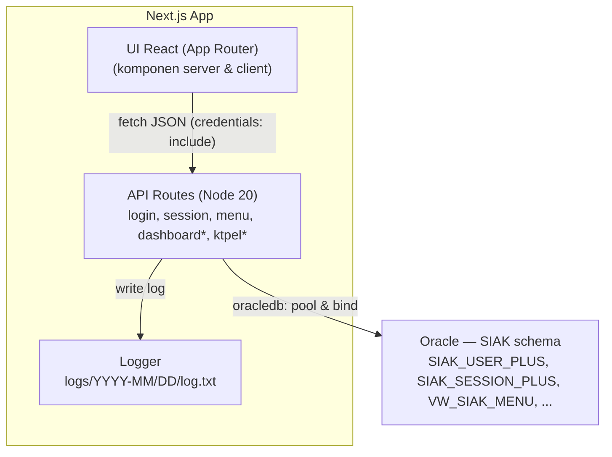
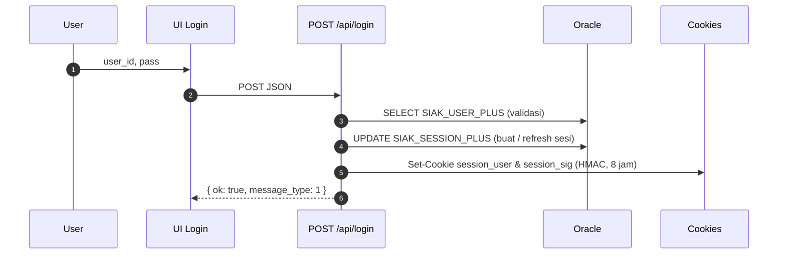
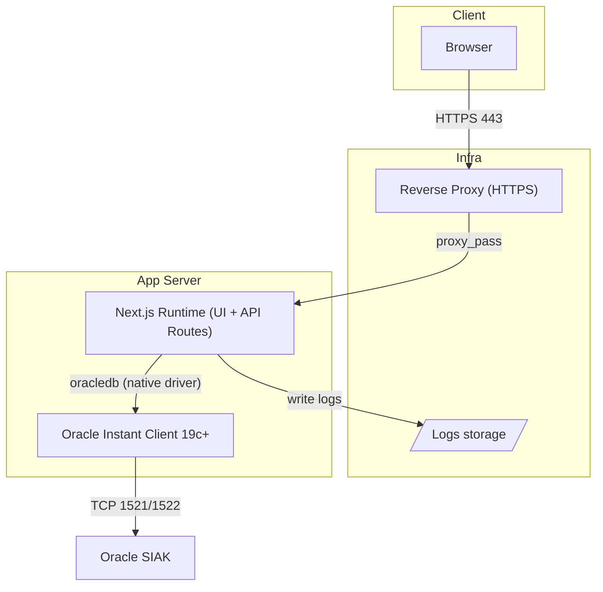
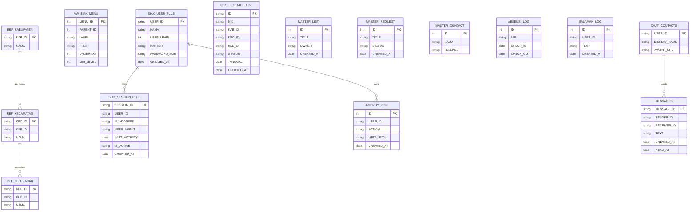

# DOKUMENTASI ARSITEKTUR DAN STRATEGI MIGRASI

## Sistem Monitoring Layanan Kependudukan (MONALISA)

## Studi Kasus: Modernisasi Stack dari Laravel ke Next.js

## Dinas Kependudukan dan Pencatatan Sipil Kota Bandung

**Repositori Modern (Next.js):** [https://gitlab.com/dianyanzen/monitoring-next](https://gitlab.com/dianyanzen/monitoring-next)   
**Repositori Legacy (Laravel):** [https://gitlab.com/dianyanzen/monitoring-laravel](https://gitlab.com/dianyanzen/monitoring-laravel) 

> ⚠️ **Catatan Peringatan Implementasi** \> Repositori ini dapat memuat kredensial *dummy* pada `.env.local` untuk tujuan pengembangan. Kredensial rahasia wajib diganti di semua lingkungan non-pengembangan dan tidak boleh di-*commit* ke repositori produksi. 

-----

## KATA PENGANTAR

Dokumen ini disusun sebagai naskah arsitektur komprehensif untuk proyek modernisasi sistem Monalisa Monitoring. Bagian berikut memuat narasi personal dari penulis, yang memberikan konteks terhadap filosofi di balik penyusunan dokumen ini.

### Identitas & Narasi Penulis

Aku, **Dian Septian, S.Tr.Kom., M.M**, adalah **Administrator Database** di **Dinas Kependudukan dan Pencatatan Sipil Kota Bandung**.   
Fondasi teknisku adalah **Gelar Sarjana Terapan Komputer**, dan landasan kepemimpinan serta organisasi kutempuh dalam **Magister Manajemen (Manajemen Sumber Daya Manusia)**. 

Bahasa dokumentasi ini sengaja lugas dan tajam: **teknis yang membumi**, **UX yang bisa dipegang**, dan **akuntabilitas publik** sebagai haluan. 

-----

## ABSTRAK

Monalisa Monitoring merepresentasikan modernisasi arsitektur antarmuka untuk monitoring layanan kependudukan di Disdukcapil Kota Bandung. Pengembangan ini mentransformasi *stack* teknologi *legacy* (Laravel 6 + Oracle)  menjadi *stack* modern (Next.js 15 (App Router) + TypeScript + Oracle). Sistem ini mengonsolidasikan beragam modul—mencakup *dashboard*, modul *master data*, monitoring KTP-el, perpesanan internal, dan utilitas operasional—ke dalam satu bahasa visual yang konsisten dengan kapabilitas *auditability* yang kuat. Interaksi dengan basis data Oracle SIAK difasilitasi melalui API Routes (Next.js), menerapkan *binding* variabel yang ketat dan *logging* berjejak harian. Hasil yang dituju mencakup peningkatan waktu tanggap sistem, percepatan pengambilan keputusan operasional, reduksi beban kognitif petugas, dan tersedianya jejak keputusan yang siap diaudit. Indikator Kinerja Utama (KPI) yang ditargetkan antara lain TTI \< 2.5s, latensi API median \< 250 ms, dan penurunan *bounce rate* ≥ 30%.

-----

## DAFTAR ISI FORMAL

  * [BAB I: PENDAHULUAN](https://www.google.com/search?q=%23bab-i-pendahuluan)
      * [1.1 Latar Belakang Masalah](https://www.google.com/search?q=%2311-latar-belakang-masalah)
      * [1.2 Rumusan Masalah](https://www.google.com/search?q=%2312-rumusan-masalah)
      * [1.3 Tujuan, Ruang Lingkup, & Prinsip Pengembangan](https://www.google.com/search?q=%2313-tujuan-ruang-lingkup--prinsip-pengembangan)
  * [BAB II: METODOLOGI PENGEMBANGAN DAN STRATEGI MIGRASI](https://www.google.com/search?q=%23bab-ii-metodologi-pengembangan-dan-strategi-migrasi)
      * [2.1 Analisis Arsitektur Legacy (Laravel 6)](https://www.google.com/search?q=%2321-analisis-arsitektur-legacy-laravel-6)
      * [2.2 Definisi Arsitektur Modern (Next.js 15)](https://www.google.com/search?q=%2322-definisi-arsitektur-modern-nextjs-15)
      * [2.3 Strategi Migrasi Bertahap](https://www.google.com/search?q=%2323-strategi-migrasi-bertahap)
      * [2.4 Peta Jalan (Roadmap) Produk](https://www.google.com/search?q=%2324-peta-jalan-roadmap-produk)
      * [2.5 Playbook dan Matriks Migrasi Modul](https://www.google.com/search?q=%2325-playbook-dan-matriks-migrasi-modul)
  * [BAB III: HASIL DAN PEMBAHASAN - DESAIN ARSITEKTUR MODERN](https://www.google.com/search?q=%23bab-iii-hasil-dan-pembahasan---desain-arsitektur-modern)
      * [3.1 Analisis Kebutuhan Pengguna (Persona & Journey)](https://www.google.com/search?q=%2331-analisis-kebutuhan-pengguna-persona--journey)
      * [3.2 Desain Arsitektur Antarmuka (Filosofi & Tema Visual)](https://www.google.com/search?q=%2332-desain-arsitektur-antarmuka-filosofi--tema-visual)
      * [3.3 Desain Arsitektur Sistem (C4, Kontainer, Sekuens)](https://www.google.com/search?q=%2333-desain-arsitektur-sistem-c4-kontainer-sekuens)
      * [3.4 Desain Arsitektur Data (ERD & Pedoman SQL)](https://www.google.com/search?q=%2334-desain-arsitektur-data-erd--pedoman-sql)
  * [BAB IV: IMPLEMENTASI DAN JAMINAN KUALITAS](https://www.google.com/search?q=%23bab-iv-implementasi-dan-jaminan-kualitas)
      * [4.1 Struktur Direktori Proyek](https://www.google.com/search?q=%2341-struktur-direktori-proyek)
      * [4.2 Desain Sistem UI dan Implementasi Token](https://www.google.com/search?q=%2342-desain-sistem-ui-dan-implementasi-token)
      * [4.3 Kontrak dan Konvensi API](https://www.google.com/search?q=%2343-kontrak-dan-konvensi-api)
      * [4.4 Tata Kelola Keamanan dan Data](https://www.google.com/search?q=%2344-tata-kelola-keamanan-dan-data)
      * [4.5 Kinerja, Observabilitas, dan Pengujian](https://www.google.com/search?q=%2345-kinerja-observabilitas-dan-pengujian)
      * [4.6 Pedoman Rilis dan Operasional (CI/CD)](https://www.google.com/search?q=%2346-pedoman-rilis-dan-operasional-cicd)
  * [BAB V: KESIMPULAN DAN PENUTUP](https://www.google.com/search?q=%23bab-v-kesimpulan-dan-penutup)
  * [DAFTAR PUSTAKA](https://www.google.com/search?q=%23daftar-pustaka)
  * [LAMPIRAN](https://www.google.com/search?q=%23lampiran)
      * [Lampiran A: Catatan Keputusan Arsitektur (ADR)](https://www.google.com/search?q=%23lampiran-a-catatan-keputusan-arsitektur-adr)
      * [Lampiran B: Rencana Pemulihan Bencana (DRP)](https://www.google.com/search?q=%23lampiran-b-rencana-pemulihan-bencana-drp)
      * [Lampiran C: Runbook Operasional](https://www.google.com/search?q=%23lampiran-c-runbook-operasional)
      * [Lampiran D: Inventori Modul Legacy Tambahan](https://www.google.com/search?q=%23lampiran-d-inventori-modul-legacy-tambahan)
      * [Lampiran E: Implementasi Seeder Menu](https://www.google.com/search?q=%23lampiran-e-implementasi-seeder-menu)
      * [Lampiran F: Dokumentasi Tambahan (Lampiran Modernisasi Lengkap)](https://www.google.com/search?q=%23lampiran-f-dokumentasi-tambahan-lampiran-modernisasi-lengkap)
      * [Lampiran G: Struktur Direktori Lengkap (project_structure.txt)](https://www.google.com/search?q=%23lampiran-g-struktur-direktori-lengkap-project_structuretxt)


### 🧭 Navigasi Cepat

  * [Ringkasan Eksekutif](https://www.google.com/search?q=%23ringkasan-eksekutif)
  * [Identitas & Narasi Penulis](https://www.google.com/search?q=%23identitas--narasi-penulis)
  * [Abstrak & Latar Belakang](https://www.google.com/search?q=%23abstrak--latar-belakang)
  * [Tujuan, Ruang Lingkup, & Prinsip](https://www.google.com/search?q=%23tujuan-ruang-lingkup--prinsip)
  * [Persona, Journey, & Kebutuhan Pengguna](https://www.google.com/search?q=%23persona-journey--kebutuhan-pengguna)
  * [Filosofi Desain & Tema Visual](https://www.google.com/search?q=%23filosofi-desain--tema-visual)
  * [Arsitektur Sistem (C4, Kontainer, Sekuens, Deployment)](https://www.google.com/search?q=%23arsitektur-sistem-c4-kontainer-sekuens-deployment)
  * [Struktur Proyek (Deep Dive)](https://www.google.com/search?q=%23struktur-proyek-deep-dive)
  * [Desain Sistem UI: Tokens, Theming, Tipografi, A11y](https://www.google.com/search?q=%23desain-sistem-ui-tokens-theming-tipografi-a11y)

-----

## BAB I: PENDAHULUAN

Bab ini menguraikan konteks, permasalahan, dan tujuan dari dilakukannya modernisasi sistem Monalisa Monitoring.

### 1.1 Latar Belakang Masalah

Dasar dari pengembangan ini adalah tantangan operasional yang teridentifikasi dalam sistem *legacy*.

#### Abstrak & Latar Belakang

Fragmentasi modul dan variasi gaya antarmuka memecah konteks operasional.   
Angka-angka statistik tanpa narasi tindakan menambah beban kognitif petugas, sementara perubahan cepat (mis. status KTP-el) menuntut antarmuka yang **mengantar aksi**, bukan sekadar menampilkan data.   
Sisi akuntabilitas publik menuntut **jejak keputusan** yang mudah ditelusuri. 

**Hipotesis produk:** \> Satu bahasa visual + arsitektur API terukur → beban kognitif turun → kualitas keputusan naik → pelayanan lebih cepat. 

### 1.2 Rumusan Masalah

Berdasarkan latar belakang tersebut, permasalahan utama dapat dirumuskan sebagai berikut:

1.  Bagaimana merancang arsitektur sistem terpadu yang mampu mengonsolidasikan modul-modul monitoring yang terfragmentasi (dashboard, master, KTP-el, chat)  untuk mengurangi fragmentasi konteks operasional? 
2.  Bagaimana mentransformasi penyajian data dari statis menjadi *insight* yang dapat ditindaklanjuti (*actionable*) untuk mengurangi beban kognitif petugas? 
3.  Bagaimana strategi migrasi teknis yang paling efektif untuk beralih dari *stack* monolitik Laravel 6  ke *stack* modern Next.js 15  sambil memastikan keamanan interaksi data Oracle  dan menciptakan jejak audit yang kuat? 

### 1.3 Tujuan, Ruang Lingkup, & Prinsip Pengembangan

Bagian ini mendefinisikan sasaran, batasan, dan kaidah dasar yang memandu pengembangan sistem modern.

#### Tujuan, Ruang Lingkup, & Prinsip

##### 🎯 Tujuan

  * Menyatukan monitoring & utilitas operasional dalam UI konsisten. 
  * Mengubah data menjadi **tindakan** dan **jejak keputusan**. 
  * Menyediakan alat bantu operasi (push ulang, filter wilayah, ekspor, chat) yang dekat dengan data. 

##### 📦 Ruang Lingkup

  * **Front-end:** Next.js 15 (App Router), React 19, Tailwind 3, Framer Motion, MUI, Chart.js, DataTables, Grid.js. 
  * **Back-end:** Next.js **API Routes** → Oracle (multi-alias pool); logging harian. 
  * **Modul:** Dashboard, Master, Check KTP-el, Chat, Activity, Template. 

##### 🛡️ Prinsip

  * **Clarity First**, **Honest Motion**, **Progressive Disclosure**. 
  * **Cognitive Economy**: pola berulang dan konsisten. 
  * **Audit-Ready by Design** — setiap keputusan dapat dilacak. 

-----

## BAB II: METODOLOGI PENGEMBANGAN DAN STRATEGI MIGRASI

Bab ini menguraikan metodologi yang digunakan untuk transisi dari sistem *legacy* ke sistem modern, mencakup perbandingan arsitektur, strategi, dan peta jalan implementasi.

### 2.1 Analisis Arsitektur Legacy (Laravel 6)

Pemahaman mendalam terhadap sistem *legacy* adalah fondasi dari strategi migrasi.

#### 📜 Legacy (Laravel 6)

  * Laravel ^6.2 (PHP ^7.2) dengan `yajra/laravel-oci8`. 
  * Session Laravel + **Passport (OAuth2)** untuk API Android *ePunten*. 
  * Blade + Semantic UI + jQuery; sebagian menggunakan Vue. 
  * Integrasi eksternal: Pusher, Browsershot/DOMPDF, Excel, Redis (opsional), **ZKTeco** (absensi via Windows service). 

### 2.2 Definisi Arsitektur Modern (Next.js 15)

Arsitektur modern dirancang untuk mengatasi keterbatasan sistem *legacy* sambil memperkenalkan kapabilitas baru.

#### ✨ Modern (Next.js)

  * **Controller → API Route:** langsung dipetakan ke `src/app/api/*`. 
  * **Passport → Cookie HMAC:** sesi internal berbasis `session_user + session_sig`. 
  * **Blade/jQuery → React 19:** semua komponen modular dan reaktif. 
  * **Queue/Service:** diganti job scheduler Node.js atau bridge Windows Service bila perlu. 

### 2.3 Strategi Migrasi Bertahap

Migrasi tidak dilakukan sebagai *big-bang*, melainkan melalui pendekatan bertahap yang terkontrol.

#### 📦 Strategi Migrasi Bertahap

1.  **Inventarisasi modul legacy** → target halaman Next.js. 
2.  **Audit schema & query** → validasi indeks, normalisasi transaksi. 
3.  **Kontrak API** → gunakan JSON, status, dan paging konsisten. 
4.  **Transisi autentikasi** → sesi HMAC; peran dan level pengguna disesuaikan. 
5.  **Replikasi UX/Paritas UI** + penambahan A11y (aksesibilitas). 
6.  **Validasi & Masking PII** → sesuai pedoman data governance. 
7.  **Release bertahap (canary)** → monitor log dan telemetri. 
8.  **Sunset modul lama** setelah Next.js stabil sepenuhnya. 

### 2.4 Peta Jalan (Roadmap) Produk

Strategi migrasi diimplementasikan melalui peta jalan pengembangan yang terbagi menjadi empat fase utama.

#### 🗺️ Roadmap Produk

> **Progress Update (Oktober 2025):** Tahap II selesai (chat, activity log, dashboard supervisor, dan latency monitor telah dirilis) dan fokus berpindah ke orkestrasi integrasi Tahap III. 

##### 1️⃣ Tahap I — Core Modernization (✅)

  * Migrasi Login, Session, Dashboard, Menu, dan Check KTP-el ke Next.js. 
  * Implementasi pool Oracle multi-alias dengan binding ketat. 
  * Logging harian + error telemetry. 
  * Desain sistem dark–light mode konsisten (Cyberpunk / Lux). 

##### 2️⃣ Tahap II — Operasional & Observabilitas (✅ Selesai — Oktober 2025)

  * Aktivasi chat & messages (socket fallback → polling teroptimasi). 
  * Audit activity log dengan filter & search. 
  * Dashboard supervisor interaktif (wilayah, capaian, anomaly trend). 
  * Monitoring API latency (middleware internal). 
  * Build modular: `/components/layout`, `/components/system`. 
  * Release note: modul chat, activity log, dashboard supervisor, dan latency monitor sudah stabil di staging. 

##### 3️⃣ Tahap III — Integrasi & Automasi (⏳ Berjalan)

  * Integrasi **E-Punten API** (mutasi keluar/datang online) — kickoff, mapping payload, dan persiapan auth token berlangsung. 
  * Integrasi **TTE** (KK, Akta, Surat Pernyataan) dengan BSrE & eSign. 
  * Rekonsiliasi database **DEMOGRAPHICS@DB5** vs **FINGERS@DB5**. 
  * Sinkronisasi warehouse PDIP (via view Oracle). 
  * Job Scheduler Node untuk rekap otomatis & daily digest. 

##### 4️⃣ Tahap IV — Predictive & Cognitive Layer (📝 Draft)

  * Deteksi anomali pelayanan berbasis data historis (AI monitor). 
  * Insight naratif otomatis: “Wilayah dengan rasio cetak KTP rendah minggu ini adalah ...”. 
  * Voice assistant untuk query data operasional (experimental). 

### 2.5 Playbook dan Matriks Migrasi Modul

Eksekusi strategi migrasi didokumentasikan dalam *playbook* dan matriks pemetaan modul berikut.

#### 📘 Playbook Migrasi Per-Modul

##### 📝 Konvensi Umum (Next.js)

  * Cookie: `session_user` (payload terenkripsi) + `session_sig` (HMAC-SHA256). 
  * `httpOnly`, `SameSite=Lax`, `Secure:true` di produksi. 
  * Env alias DB via `DB_*`, `DB222_*`, `DB221_*`, dst. 
  * Logging otomatis: `logs/YYYY-MM/DD/log.txt`. 
  * Scope log: `API`, `DB`, `SESSION`, `MIDDLEWARE`. 
  * Response envelope: `{ "success": true, "message": "OK", "data": {} }`. 
  * Paging: `?page=1&per_page=25` atau `?limit=25&offset=0`. 
  * Tanggal format ISO 8601 (UTC). 
  * Error:
      * `200 (success:false)` → validasi. 
      * `401/403` → akses ditolak. 
      * `500` → error tak terduga. 

##### 🗺️ Matriks Mapping Modul

| Modul | Laravel (Legacy) | Next.js (Modern) | Method | Autentikasi | Catatan |
| :--- | :--- | :--- | :--- | :--- | :--- |
| **Login / Session** | `AuthController@login`, `ping` | `/api/login`, `/api/session*` | POST / GET | ✅ | Cookie HMAC, sliding session |
| **Menu** | `MenuController@index` | `/api/menu` | GET | ✅ | Cache per level 300s, `buildTree()` |
| **Dashboard** | `DashboardController@*` | `/api/dashboard/*` | GET | ✅ | Metrik KTP-el/DKB/Geulis |
| **Check KTP-el** | `KtpController@*` | `/api/check/ktpel/*` | GET/POST | ✅ | Filter wilayah/tanggal, push massal |
| **Master: List** | `Master\ListController@*` | `/api/master/list` | GET | ✅ | Virtualized table |
| **Master: Request** | `Master\RequestController@*` | `/api/master/request` | GET | ✅ | Ekspor CSV/Excel |
| **Master: Contact** | `Master\ContactController@*` | `/api/master/contact` | GET | ✅ | Fitur pencarian |
| **Master: Absensi** | `Master\AbsensiController@*` | `/api/master/absensi` | GET | ✅ | Integrasi ZKTeco |
| **Master: Salam** | `Master\SalamController@*` | `/api/master/salaman` | GET | ✅ | Layanan online |
| **Chat / Messages** | `ChatController@*`, `Message@*` | `/api/chat/*`, `/api/messages/*` | GET/POST | ✅ | Optimistic send |
| **Activity Log** | `ActivityController@save` | `/api/activity/do_save` | POST | ✅ | Audit trail |
| **Account Password** | `AccountController@password` | `/api/account/password` | POST | ✅ | Upgrade hash bcrypt |
| **User Profile** | `UserController@show` | `/api/user` | GET | ✅ | Minimal PII |


-----

## BAB III: HASIL DAN PEMBAHASAN - DESAIN ARSITEKTUR MODERN

Bab ini memaparkan hasil dari proses desain dan arsitektur sistem modern, mencakup analisis kebutuhan, desain antarmuka, arsitektur sistem, dan arsitektur data.

### 3.1 Analisis Kebutuhan Pengguna (Persona & Journey)

Analisis kebutuhan pengguna dilakukan melalui pendefinisian persona dan pemetaan alur pengguna (*user journey*).

#### Persona, Journey, & Kebutuhan Pengguna

##### 👤 Persona Utama

| Peran | Tujuan | Kebutuhan |
| :--- | :--- | :--- |
| **Petugas Loket** | Mengetahui status cepat, tindakan langsung (push ulang, verifikasi). | UI ringkas, responsif, tanpa distraksi. |
| **Operator Wilayah** | Menyaring data kec/kels, ekspor, tindak lanjut. | Filter dinamis, laporan cepat. |
| **Supervisor** | Melihat tren dan anomali. | Dashboard interaktif, drill-down ringan. |
| **Administrator** | Menjamin kestabilan sistem dan audit. | Log detail, kontrol sesi, dan hak akses. |


##### 🗺️ Journey Ringkas (Check KTP-el)

1.  Pilih **wilayah** & **rentang waktu**. 
2.  Lihat **kartu metrik** (status, error, progress). 
3.  Jalankan **aksi** (push ulang / ekspor) langsung di konteks data. 
4.  **Catatan otomatis (log)** tercipta untuk audit. 

**Non-Fungsional:** - Reliabilitas tinggi di jam sibuk. 

  * Observabilitas: log terstruktur, scope jelas, payload minimal. 
  * Aksesibilitas (A11y): fokus jelas, `prefers-reduced-motion`, kontras AA. 

### 3.2 Desain Arsitektur Antarmuka (Filosofi & Tema Visual)

Desain antarmuka didasarkan pada filosofi yang berpusat pada aksi dan kejelasan, diimplementasikan melalui dua tema visual utama.

#### 🎨 Filosofi Desain & Tema Visual

  * **Angka besar untuk status utama**, teks pendukung hemat dan informatif. 
  * **Motion jujur:** hanya untuk menandai transisi atau perubahan state, bukan dekorasi. 
  * **Empty state** bukan ruang kosong, tapi panduan langkah selanjutnya. 
  * Visual mengantar **aksi**, bukan sekadar “pamer data”. 

##### Tema 1 — **Neon Cyberpunk** (default operasional)

Menampilkan atmosfer ruang kendali; aksen neon dipakai untuk *state/accent*, bukan sebagai latar.   
Rasio neon : netral ≈ **1 : 4** 

```css
/* FILE: src/styles/theme-dark.css (cuplikan) */
html:not([data-theme="light"]) {
  --surface-0:#0a0a0c; --surface-1:#0e0e14; --surface-2:#111118;
  --ink:#e5e7eb; --ink-muted:#a6adbb;
  --accent:#00e6c3; --accent-2:#36bffa;
  --success:#1ad19a; --warning:#f5c26b; --error:#ff5d73;
  --border-subtle:rgba(255,255,255,.08);
  --border-strong:rgba(255,255,255,.16);
  --focus-ring:0 0 0 3px rgba(0,230,195,.45);
}
```


##### Tema 2 — **Elegant Lux** (narasi/presentasi)

Palet seperti kertas marmer hangat dan tinta pekat, dengan aksen emas untuk detail prestige (bukan fill besar). 

```css
/* FILE: src/styles/theme-light.css (konsep) */
html[data-theme="light"] {
  --pal-silk:#EEE5D9; --pal-marble:#EBEAE0;
  --lux-ink:#1A1D21; --lux-border:rgba(26,29,33,.12);
  --gold-1:#D4AF37; --gold-2:#F6D365; --gold-3:#FFE8A3;
  --lux-gold-grad:linear-gradient(90deg,var(--gold-1),var(--gold-2) 60%,var(--gold-3));
}
```


**Kontras target:** WCAG AA untuk teks ≥ 14 px reguler / 12 px bold. 

### 3.3 Desain Arsitektur Sistem (C4, Kontainer, Sekuens)

Arsitektur sistem didokumentasikan menggunakan model C4 (Context, Container, Component, Code) untuk memvisualisasikan dekomposisi sistem.

#### 🏗️ Arsitektur Sistem (C4, Kontainer, Sekuens, Deployment)

**Stack Inti**

  * **Front-end:** Next.js 15, React 19, Tailwind 3, Framer Motion, MUI, Chart.js, DataTables, Grid.js. 
  * **API:** Next.js API Routes → node-oracledb (pool multi-alias). 
  * **Auth:** Cookie HMAC-SHA256 (`session_user` + `session_sig`) + middleware halaman dan API. 
  * **Logging:** `logs/YYYY-MM/DD/log.txt` otomatis, payload dipangkas. 

##### Diagram Konteks (C4)


##### Diagram Kontainer




##### Diagram Sekuens (Login → Session)




##### Deployment (skema)




### 3.4 Desain Arsitektur Data (ERD & Pedoman SQL)

Arsitektur data mencakup skema relasi entitas (ERD) yang disederhanakan dan serangkaian pedoman interaksi basis data (SQL).

#### 🗃️ Database & Pedoman SQL

##### 🏷️ Alias Database

`DB`, `DB222`, `DB221`, `WEBDB`, `EPUNTEN`, `WEBPUNTEN`, dsb (diatur dari `.env`). 

##### 🔑 Konvensi Utama

1.  **Penamaan:** tabel & kolom → `UPPER_SNAKE_CASE`. 
2.  **Binding:** wajib gunakan `:b_*` (tanpa interpolasi string). 
3.  **Waktu:** gunakan `SYSDATE / SYSTIMESTAMP` untuk DML. 
4.  **Format hasil:** `OUT_FORMAT_OBJECT`. 
5.  **Transaksi:** auto-commit per statement, atau eksplisit bila batch. 
6.  **Session tracking:** `SIAK_SESSION_PLUS` (SESSION\_ID, USER\_ID, IP, USER\_AGENT, LAST\_ACTIVITY, IS\_ACTIVE). 
7.  **Expiry aplikasi:** sumber dari `SIAK_MASTER` (`SYSTEM_TYPE='INIT_SETING'`, `SYSTEM_CODE='EXP'`). 
8.  **Password:** legacy MD5 → migrasi bertahap ke Argon2/BCrypt. 
9.  **Cookie:** `session_user` hanya simpan SESSION\_ID; profil diambil server-side. 
10. **Keamanan tambahan:** opsional IP check, rate limit login, audit gagal. 

##### 💡 Rekomendasi Indeks

| Tabel | Indeks Disarankan |
| :--- | :--- |
| `SIAK_SESSION_PLUS` | PK `(SESSION_ID)`, IDX `(USER_ID)`, IDX `(LAST_ACTIVITY)` |
| `VW_SIAK_MENU` | IDX `(MIN_LEVEL)`, IDX `(PARENT_ID, ORDERING)` |
| `KTP_EL_STATUS_LOG` | IDX `(KAB_ID, KEC_ID, KEL_ID, TANGGAL)`, IDX `(STATUS, TANGGAL)` |
| `MESSAGES` | IDX `(RECEIVER_ID, CREATED_AT)`, IDX `(SENDER_ID, CREATED_AT)` |
| `ABSENSI_LOG` | IDX `(NIP, CHECK_IN)` |


##### 📝 Contoh Pola SQL (Bind Variables)

```sql
-- FILE: sql/session_keepalive.sql
UPDATE SIAK_SESSION_PLUS
   SET LAST_ACTIVITY = SYSTIMESTAMP
 WHERE SESSION_ID = :b_session_id
   AND IS_ACTIVE = 1;
```


```sql
-- FILE: sql/menu_by_level.sql
SELECT MENU_ID, PARENT_ID, LABEL, HREF, ORDERING
  FROM VW_SIAK_MENU
 WHERE MIN_LEVEL <= :b_user_level
 ORDER BY NVL(PARENT_ID, 0), ORDERING;
```


```sql
-- FILE: sql/ktpel_rekap_status.sql
SELECT STATUS, COUNT(*) AS jumlah
  FROM KTP_EL_STATUS_LOG
 WHERE TANGGAL BETWEEN :b_start AND :b_end
   AND ( :b_kab IS NULL OR KAB_ID = :b_kab )
   AND ( :b_kec IS NULL OR KEC_ID = :b_kec )
   AND ( :b_kel IS NULL OR KEL_ID = :b_kel )
 GROUP BY STATUS;
```


```sql
-- FILE: sql/chat_latest_previews.sql
SELECT m.*
  FROM MESSAGES m
  JOIN (
        SELECT CASE WHEN SENDER_ID = :b_me THEN RECEIVER_ID ELSE SENDER_ID END AS peer,
               MAX(CREATED_AT) AS last_at
          FROM MESSAGES
         WHERE SENDER_ID = :b_me OR RECEIVER_ID = :b_me
         GROUP BY CASE WHEN SENDER_ID = :b_me THEN RECEIVER_ID ELSE SENDER_ID END
       ) t
    ON ( (m.SENDER_ID = :b_me AND m.RECEIVER_ID = t.peer) OR
         (m.RECEIVER_ID = :b_me AND m.SENDER_ID = t.peer) )
   AND m.CREATED_AT = t.last_at;
```


#### 📊 ERD & SQL Audit

> Skema entitas inti dan indeks yang paling sering digunakan (disederhanakan dari SIAK schema). 

##### 📊 ER Diagram (Mermaid)




##### 🔎 Contoh Query Audit

```sql
-- FILE: sql/activity_log_insert.sql
INSERT INTO ACTIVITY_LOG (USER_ID, ACTION, META_JSON, CREATED_AT)
VALUES (:b_user, :b_action, :b_meta, SYSTIMESTAMP);
```


```sql
-- FILE: sql/messages_latest_by_user.sql
SELECT m.*
  FROM MESSAGES m
 WHERE m.RECEIVER_ID = :b_user
 ORDER BY m.CREATED_AT DESC
 FETCH FIRST 25 ROWS ONLY;
```


```sql
-- FILE: sql/master_request_recap.sql
SELECT STATUS, COUNT(*) AS JUMLAH
  FROM MASTER_REQUEST
 WHERE CREATED_AT BETWEEN :b_start AND :b_end
 GROUP BY STATUS;
```


```sql
-- FILE: sql/session_expired_cleanup.sql
DELETE FROM SIAK_SESSION_PLUS
 WHERE IS_ACTIVE = 0
   OR LAST_ACTIVITY < (SYSTIMESTAMP - INTERVAL '8' HOUR);
```


##### ⚖️ Audit Policy

  * Semua query penting ditulis di folder `/sql/` dengan penamaan konsisten. 
  * Struktur log memuat waktu, alias DB, durasi eksekusi, dan hasil. 
  * Audit data export wajib mencatat filter, jumlah baris, dan operator. 

-----

## BAB IV: IMPLEMENTASI DAN JAMINAN KUALITAS

Bab ini merinci aspek-aspek teknis implementasi sistem modern, mulai dari struktur kode, kontrak API, keamanan, hingga strategi pengujian dan operasional.

### 4.1 Struktur Direktori Proyek

Struktur direktori proyek dirancang untuk skalabilitas dan kemudahan pemeliharaan, mengikuti konvensi Next.js App Router.

#### 📂 Struktur Proyek (Deep Dive)

```
├── .env.local
├── package.json
├── tsconfig.json
├── postcss.config.mjs
├── tailwind.config.js
├── public/
└── src/
    ├── app/
    │   ├── api/ (login, session, menu, dashboard, check/ktpel, master, chat, messages, activity, account, user)
    │   ├── dashboard/
    │   ├── login/
    │   ├── chat/
    │   ├── check/ktpel/
    │   ├── master/
    │   ├── globals.css
    │   └── layout.tsx
    ├── components/
    │   ├── layout/ (ResponsiveAppShell, Sidebar, Topbar, Footer)
    │   ├── dashboard/ (cards, charts)
    │   ├── datatable/ (DataTables/Grid.js wrappers)
    │   ├── system/ (overlay/dialog/alert)
    │   └── ui/ (DateRangePopup, dsb)
    ├── contexts/session.tsx
    ├── hooks/
    ├── lib/ (session.ts, log.ts, oracle.ts, db.ts, http.ts, auth.ts, user.ts)
    ├── middleware.ts
    └── middleware.api.ts
```


**Aturan Penting**

  * Jangan ubah `lib/oracle.ts`, `lib/db.ts`, `lib/http.ts` tanpa izin khusus. 
  * Semua snippet dokumentasi wajib mencantumkan **lokasi file**. 
  * Modul SIAK baru harus mengikuti pola layout �+' page seperti contoh di bawah.

#### Modul SIAK: Restore & Repair Local Biometric

Struktur khusus untuk utilitas SIAK modern ditempatkan berdampingan agar mudah dipantau perubahan UI dan API-nya.

```text
src/
  app/
    siak/
      restore/
        layout.tsx
        mainlayout.tsx
        page.tsx
      repair_local_biometric/
        layout.tsx
        mainlayout.tsx
        page.tsx
  app/api/
    restore/
      bio-wni/
        route.ts
    siak/
      repair_local_biometric/
        scan/route.ts
        delete/route.ts
```

- `layout.tsx` → mendeklarasikan metadata halaman dan menyambungkan guard sesi agar rute `/siak/*` selalu terlindungi.  
- `mainlayout.tsx` → kerangka visual (panel dua kolom + status strip) yang dipakai ulang antar-halaman agar pengalaman pengguna konsisten.  
- `page.tsx` → logika utama: `restore/page.tsx` menangani audit trail & *recovery wizard* BIO-WNI, sedangkan `repair_local_biometric/page.tsx` memuat alur pemindaian ulang biometrik (scan/delete) serta utilitas debugging jaringan.  
- API pendukung dipisah: `src/app/api/restore/bio-wni/route.ts` menyajikan pipeline restore, sementara dua endpoint di `src/app/api/siak/repair_local_biometric/*` menangani operasi `scan` dan `delete` dengan logging ketat (`Log.scope("API")`). 

Dengan struktur ini, dokumentasi dan kode saling mencerminkan sehingga analisis audit, refactor, atau *handover* dapat dilakukan tanpa menelusuri seluruh repositori.

### 4.2 Desain Sistem UI dan Implementasi Token

Implementasi desain sistem UI mencakup definisi *design tokens* dan kode implementasi tema.

#### 🖌️ Desain Sistem UI (Tokens, Theming, Tipografi, A11y)

  * **Tokens:** `src/styles/tokens.css` berisi variabel semantik (surface, ink, accent, border, shadow, radius, motion, focus). 
  * **Tema:** `theme-dark.css` (Neon Cyberpunk) & `theme-light.css` (Elegant Lux). Gunakan `data-theme="light"` untuk switch. 
  * **Tipografi:** font Inter, skala responsif, panjang baris ideal 65–80 karakter. 
  * **A11y:** fokus ring jelas, kontras AA, menghormati `prefers-reduced-motion`. 

<!-- end list -->

```ts
// FILE: src/app/layout.tsx (cuplikan)
import "./globals.css"
import "../styles/tokens.css"
import "../styles/theme-dark.css"
import "../styles/theme-light.css"
```


#### 🎨 Design Tokens & Dua Tema (Kode Penuh)

```css
/* FILE: src/styles/tokens.css */
:root {
  --surface-0: #0a0a0c; --surface-1: #0e0e14; --surface-2: #111118;
  --ink: #e5e7eb; --ink-muted: #a6adbb;
  --accent: #00e6c3; --accent-2: #36bffa;
  --success: #22c55e; --warning: #f5c26b; --error: #ff5d73;
  --border-subtle: rgba(255,255,255,.08); --border-strong: rgba(255,255,255,.16);
  --shadow-sm: 0 1px 2px rgba(0,0,0,.25); --shadow-md: 0 6px 18px rgba(0,0,0,.28); --shadow-lg: 0 18px 45px rgba(0,0,0,.35);
  --radius-sm: .375rem; --radius-md: .5rem; --radius-lg: .75rem; --radius-xl: 1rem; --radius-2xl: 1.25rem;
  --easing-std: cubic-bezier(.2,.6,.2,1); --duration-fast: 150ms; --duration-std: 240ms; --duration-slow: 360ms;
  --focus-ring: 0 0 0 3px rgba(54,191,250,.45);
  --gold-1: #d4af37; --gold-2: #f6d365; --gold-3: #ffe8a3;
  --lux-gold-grad: linear-gradient(90deg, var(--gold-1), var(--gold-2) 60%, var(--gold-3));
  --scrollbar-track: rgba(255,255,255,.06);
  --scrollbar-thumb: rgba(255,255,255,.16);
}
*::-webkit-scrollbar { width: 8px; height: 8px; }
*::-webkit-scrollbar-track { background: var(--scrollbar-track); }
*::-webkit-scrollbar-thumb { background: var(--scrollbar-thumb); border-radius: 10px; }
```


```css
/* FILE: src/styles/theme-dark.css */
html:not([data-theme="light"]) {
  --surface-0: #0a0a0c; --surface-1: #0e0e14; --surface-2: #111118;
  --ink: #e5e7eb; --ink-muted: #a6adbb;
  --accent: #00e6c3; --accent-2: #36bffa;
  --success: #1ad19a; --warning: #f5c26b; --error: #ff5d73;
  --border-subtle: rgba(255,255,255,.08); --border-strong: rgba(255,255,255,.16);
  --shadow-sm: 0 1px 2px rgba(0,0,0,.35);
  --shadow-md: 0 8px 22px rgba(0,0,0,.45);
  --shadow-lg: 0 22px 60px rgba(0,0,0,.55);
  --focus-ring: 0 0 0 3px rgba(0,230,195,.45);
  --lux-gold-grad: linear-gradient(90deg, var(--gold-1), var(--gold-2) 60%, var(--gold-3));
  --scrollbar-track: rgba(255,255,255,.06);
  --scrollbar-thumb: rgba(255,255,255,.18);
}
aside { background: rgba(20,20,26,.7); backdrop-filter: blur(12px); border-right: 1px solid var(--border-subtle); }
header{ background: rgba(25,25,32,.6); backdrop-filter: blur(10px); border-bottom: 1px solid var(--border-subtle); }
```


```css
/* FILE: src/styles/theme-light.css */
html[data-theme="light"] {
  --pal-silk:#EEE5D9; --pal-marble:#EBEAE0; --pal-champagne:#F6E7C9;
  --surface-0: var(--pal-marble); --surface-1: #F4EFE7; --surface-2: #FFF9F0;
  --ink:#1A1D21; --ink-muted:#4b5563;
  --gold-1:#d4af37; --gold-2:#f6d365; --gold-3:#ffe8a3;
  --lux-gold-grad: linear-gradient(90deg, var(--gold-1), var(--gold-2) 60%, var(--gold-3));
  --accent: var(--gold-1); --accent-2:#8f7a3e; --success:#2e7d32; --warning:#b88315; --error:#b3261e;
  --lux-border:rgba(26,29,33,.12); --border-subtle:var(--lux-border); --border-strong:rgba(26,29,33,.2);
  --shadow-sm: 0 1px 2px rgba(26,29,33,.06); --shadow-md: 0 8px 22px rgba(26,29,33,.10); --shadow-lg: 0 22px 60px rgba(26,29,33,.14);
  --focus-ring: 0 0 0 3px rgba(212,175,55,.35);
  --scrollbar-track: rgba(26,29,33,.06); --scrollbar-thumb: rgba(26,29,33,.18);
}
.card.prestige { border-color: var(--lux-border); box-shadow: var(--shadow-sm); }
.card.prestige > .gold-underline { background: var(--lux-gold-grad); height: 2px; opacity: .9; }
```


```tsx
// FILE: src/app/layout.tsx (import CSS)
import "./globals.css"
import "../styles/tokens.css"
import "../styles/theme-dark.css"
import "../styles/theme-light.css"
```


```tsx
// FILE: src/components/ui/PrestigeCard.tsx
"use client";
import { ReactNode } from "react";
type Props = { title: string; subtitle?: string; actions?: ReactNode; children?: ReactNode; };
export default function PrestigeCard({ title, subtitle, actions, children }: Props) {
  return (
    <section className="rounded-2xl border p-5 md:p-6 relative overflow-hidden" role="region" aria-label={title}
      style={{ borderColor: "var(--border-subtle)", color: "var(--ink)" }}>
      <div className="flex items-start justify-between gap-4">
        <div>
          <h3 className="text-xl md:text-2xl font-semibold">{title}</h3>
          {subtitle ? <p className="text-sm mt-1" style={{ color: "var(--ink-muted)" }}>{subtitle}</p> : null}
        </div>
        {actions ? <div className="shrink-0">{actions}</div> : null}
      </div>
      <span className="block mt-3" style={{ background: "var(--lux-gold-grad)", height: 2, opacity: .9 }} />
      <div className="mt-4 text-sm md:text-base">{children}</div>
    </section>
  );
}
```


### 4.3 Kontrak dan Konvensi API

Standarisasi komunikasi antara *front-end* dan *back-end* diatur dalam kontrak API yang ketat.

#### 📜 Kontrak API & Konvensi

##### 🔗 Konvensi URL & Verba

  * Resource nouns dengan `GET/POST` dominan (sesuai App Router best-practice). 
  * Query **selalu menggunakan bind di server (Oracle)** — tidak boleh interpolasi string mentah. 

##### ✉️ Envelope JSON

```json
{ "success": true, "message": "OK", "data": {} }
```


##### ⚠️ Status & Error

  * HTTP 200 dengan `success:false` untuk error yang bisa dipahami klien. 
  * 401 / 403 untuk akses ditolak; 500 untuk error tak terduga. 
  * Semua error ditulis ke log dengan scope relevan (API / DB / Session). 

##### 📟 Contoh cURL

```bash
# Login
curl -i -X POST http://localhost:3000/api/login \
  -H "Content-Type: application/json" \
  -d '{"user_id":"demo","pass":"demo"}'

# Session
curl -i http://localhost:3000/api/session --cookie-jar cookies.txt

# Menu
curl -i http://localhost:3000/api/menu --cookie cookies.txt

# SIAK - Repair Local Biometric (scan-only, read ops)
curl -i "http://localhost:3000/api/siak/repair_local_biometric/scan?nik=3273XXXXXXXXXX&scope=rekam" \
  --cookie cookies.txt

# SIAK - Restore BIO WNI (write ops)
curl -i -X POST http://localhost:3000/api/restore/bio-wni \
  --cookie cookies.txt \
  -H "Content-Type: application/json" \
  -d '{"nik":"3273XXXXXXXXXX","reason":"Audit trail restore"}'
```

#### Menu Dinamis SIAK (Restore & Repair)

- `src/app/api/menu/route.ts` membaca view Oracle `VW_SIAK_MENU` untuk menyusun hirarki berdasarkan `MENU_LEVEL` serta `LEVEL_HEAD/SUB/CONTENT`, lalu men-*cache* hasilnya per level user (`unstable_cache` + tag `menu:{level}`).
- Node `Restore BIO WNI (/siak/restore)` dan `Repair Local Biometric (/siak/repair_local_biometric)` ditempatkan di cabang **SIAK > Utilitas** dengan parent non-klikabel, sehingga keduanya muncul sebagai submenu tanpa rute dummy.
- Status aktif menu mengikuti kolom `IS_ACTIVE`. Ketika entri dimatikan di Oracle, halaman otomatis tersembunyi namun tetap terdokumentasi di README untuk audit & *handover*.
- Front-end hanya merender properti `TITLE`, `ICON`, dan `URL`, sehingga perubahan menu SIAK cukup dilakukan di DB tanpa build ulang Next.js.


### 4.4 Tata Kelola Keamanan dan Data

Implementasi keamanan berfokus pada autentikasi, manajemen data sensitif, dan *logging* audit.

#### 🔒 Keamanan & Data Governance

##### 🏗️ Autentikasi

  * Cookie HMAC-SHA256 (`session_user`, `session_sig`) 
  * `httpOnly`, `Secure`, `SameSite=Lax`, durasi 8 jam 
  * Middleware proteksi di semua halaman kecuali `/login` 

##### 🤫 Data Sensitif

  * Masking NIK pada tampilan publik / semi-publik 
  * Log hanya menyimpan metadata (tanpa payload sensitif) 
  * Akses ekspor data hanya untuk user berizin 

##### 📋 Audit Log

  * Semua query penting dicatat: waktu, durasi, alias, dan bind yang disamarkan. 
  * File log per hari: `logs/YYYY-MM/DD/log.txt` 

##### 🛡️ Header Keamanan

Disarankan melalui reverse proxy (Nginx/Traefik):

  * `Strict-Transport-Security: max-age=63072000; includeSubDomains; preload` 
  * `Content-Security-Policy: default-src 'self';` 
  * `X-Frame-Options: SAMEORIGIN` 

#### 🛡️ Audit & Masking

  * **NIK:** dimasking `******####` pada UI umum; tampil penuh hanya untuk peran tertentu. 
  * **Log:** menyingkat payload panjang & tidak menyimpan PII utuh. 
  * **Export:** wajib mencatat jejak (siapa, kapan, filter apa). 

### 4.5 Kinerja, Observabilitas, dan Pengujian

Bagian ini mendefinisikan target kinerja non-fungsional dan metodologi pengujian yang digunakan untuk jaminan kualitas.

#### 🚀 Kinerja & Observabilitas

##### 🎯 Target

| Metrik | Nilai |
| :--- | :--- |
| TTI | \< 2.5s |
| Median API | \< 250 ms |
| Error 5xx | \< 0.5% / minggu |
| Bounce rate turun | ≥ 30% |
| Aksi terarah naik | ≥ 20% / triwulan |


##### 🗺️ Strategi

  * Lazy load, cache strategis, virtualized table. 
  * Hindari N+1 query; gunakan join & paginasi efisien. 
  * Gunakan `unstable_cache()` untuk data statis. 
  * Stream data panjang agar tidak blocking. 

##### 🩺 Log & Health Check

  * Struktur log harian: `logs/YYYY-MM/DD/log.txt`. 
  * Jika gagal menulis log → fallback ke `stderr`. 
  * Endpoint `/api/session/ping` untuk liveness & sliding session. 

#### 🧪 Pengujian & Kualitas

##### 🔬 Jenis Pengujian

| Tipe | Fokus | Tools |
| :--- | :--- | :--- |
| Static Check | Lint & type safety | ESLint, TypeScript |
| Unit Test | Fungsi utilitas (log, session, builder menu) | Vitest / Jest |
| Integration | API Routes (login, menu, session) | Supertest |
| E2E | Alur login → dashboard → aksi | Playwright |
| Load Test | Endpoint kritikal (menu, KTP-el) | k6 / Artillery |
| A11y Test | Fokus, kontras, motion | axe-core |


**Data uji:** gunakan dummy dataset; hindari PII riil dalam fixture. 

### 4.6 Pedoman Rilis dan Operasional (CI/CD)

Proses rilis diotomatisasi menggunakan *pipeline* CI/CD dan didukung oleh pedoman operasional yang jelas.

#### ⚙️ CI/CD, Release, & Operasional

##### ✉️ Contoh `.gitlab-ci.yml`

```yaml
# FILE: .gitlab-ci.yml
image: node:20

cache:
  key: ${CI_COMMIT_REF_SLUG}
  paths:
    - node_modules/

stages:
  - install
  - lint
  - build

install:
  stage: install
  script:
    - npm ci
  artifacts:
    paths:
      - node_modules/
    expire_in: 1 day

lint:
  stage: lint
  script:
    - npx prettier -c .
    - npm run -s typecheck || true

build:
  stage: build
  script:
    - npm run build
  artifacts:
    paths:
      - .next
    expire_in: 7 days
```


##### 🏗️ Operasional

  * Reverse proxy HTTPS (`X-Forwarded-Proto` diset). 
  * Log rotation & permission ketat untuk `LOG_DIR`. 
  * Monitoring: error rate, latensi median/p95, dan ukuran bundle Next.js. 
  * Gunakan *Node 20+* dengan *Oracle Instant Client 19c+*. 

-----

## BAB V: KESIMPULAN DAN PENUTUP

Dokumen ini telah memaparkan secara komprehensif arsitektur dan strategi migrasi sistem Monalisa Monitoring. Kesimpulan dari pengembangan ini dirangkum dalam filosofi penutup berikut.

### 🏁 Penutup

> “Web bukan sekadar alat kerja — ia adalah **refleksi etika pelayanan publik**.  
> Kecepatan bukan hanya soal milidetik, tapi tentang **bagaimana setiap klik memanusiakan data**.”
>
> — *Dian Septian, S.Tr.Kom., M.M.* \> Administrator Database Kependudukan Ahli Pertama  
> Disdukcapil Kota Bandung
> 

#### ⚖️ Lisensi & Kepemilikan

Hak cipta © 2025 **Dinas Kependudukan dan Pencatatan Sipil Kota Bandung**.   
Dibangun oleh **Dian Septian, S.Tr.Kom., M.M.** Segala kode sumber, dokumentasi, dan aset visual merupakan bagian dari inisiatif modernisasi internal *Monalisa Monitoring* Disdukcapil Bandung. 

> Distribusi ulang sebagian atau seluruh dokumen ini tanpa izin tertulis dilarang.  
> Gunakan dengan integritas, dan kembangkan dengan semangat pelayanan publik yang bermartabat. 

-----

## DAFTAR PUSTAKA

Bagian ini merujuk pada sumber daya teknis eksternal yang digunakan dalam pengembangan.

### 📚 Referensi & Sumber Teknis

  * **Oracle DB Driver:** [https://oracle.github.io/node-oracledb/](https://oracle.github.io/node-oracledb/) 
  * **Next.js Docs:** [https://nextjs.org/docs](https://nextjs.org/docs) 
  * **Tailwind CSS Docs:** [https://tailwindcss.com/docs](https://tailwindcss.com/docs) 
  * **Framer Motion:** [https://www.framer.com/motion/](https://www.framer.com/motion/) 
  * **Shadcn/UI:** [https://ui.shadcn.com](https://ui.shadcn.com) 
  * **Lucide Icons:** [https://lucide.dev/icons/](https://lucide.dev/icons/) 
  * **Mermaid Diagrams:** [https://mermaid.js.org](https://mermaid.js.org) 
  * **TypeScript ESLint Config:** [https://typescript-eslint.io/](https://typescript-eslint.io/) 

-----

## LAMPIRAN

Bagian ini berisi artefak teknis pendukung yang terperinci, termasuk catatan keputusan, rencana pemulihan, *runbook*, dan inventori modul.

### Lampiran A: Catatan Keputusan Arsitektur (ADR)

#### ⚖️ ADR — Architecture Decision Record

| No | Keputusan | Alasan |
| :--- | :--- | :--- |
| **ADR-001** | Migrasi Laravel → Next.js 15 | Menghapus ketergantungan PHP/Apache, memperkuat SSR/CSR hybrid, dan memusatkan API. |
| **ADR-002** | Node-oracledb (bind variabel wajib) | Keamanan & kinerja: mencegah SQL injection, menekan parsing overhead. |
| **ADR-003** | Logging harian file-based | Jejak audit tidak tergantung DB; aman di mode read-only. |
| **ADR-004** | Theming Dual (Cyberpunk/Lux) | Dua konteks kerja: operasional cepat vs presentasi publik elegan. |
| **ADR-005** | Cookie HMAC auth | Stateless, mudah dipantau, bebas dependency eksternal (tanpa Redis). |
| **ADR-006** | Oracle alias map via `.env` | Multi-lingkungan (dev, staging, prod) tanpa ubah kode. |
| **ADR-007** | Next.js App Router (15) | Konsisten dengan arsitektur baru React & Turbopack build. |
| **ADR-008** | Logging structured per scope | Debug cepat; analisis tren error berdasarkan kategori. |


### Lampiran B: Rencana Pemulihan Bencana (DRP)

#### 🛡️ Disaster Recovery Plan (DRP)

| Risiko | Dampak | Mitigasi |
| :--- | :--- | :--- |
| **Server crash / OS corrupt** | Layanan berhenti | Snapshot harian (Oracle & Node), auto-restore |
| **Kegagalan koneksi Oracle** | API timeout | Pool fallback → alias cadangan |
| **Kehilangan log** | Audit tidak utuh | Backup `logs/` mingguan ke NAS lokal |
| **Error build Next.js** | Front-end tidak aktif | Rollback otomatis build `.next/prev` |
| **Session rusak** | Logout massal | Middleware fallback → redirect login |
| **Load tinggi** | API delay | Auto-scale ringan (PM2 cluster / Docker) |


**Backup Policy:**

  * **DB Oracle:** export dump harian (level schema) + retention 7 hari. 
  * **Aplikasi:** backup `.next`, `logs`, `.env`, dan `data/menu`. 
  * **Recovery Test:** dilakukan minimal 1x per kuartal. 

### Lampiran C: Runbook Operasional

#### 🏃 Runbook Operasional

##### 1️⃣ 1. Login & Sesi

  * File: `src/app/api/login/route.ts` 
  * Validasi: MD5 (legacy) → Argon2 (migrasi). 
  * Cookie `session_user` + `session_sig`, masa aktif 8 jam. 
  * Middleware: `src/middleware.ts`. 

##### 2️⃣ 2. Dashboard

  * File: `src/app/api/dashboard/route.ts` 
  * Query Oracle (agregat harian/mingguan). 
  * Metrik: KTP-el, DKB, Kelahiran, Kematian, dan WNI/WNA. 

##### 3️⃣ 3. Monitoring KTP-el

  * File: `src/app/api/check/ktpel/route.ts` 
  * Filter wilayah, tanggal; push ulang & ekspor CSV. 
  * Pencatatan log ke `logs/YYYY-MM-DD/`. 

##### 4️⃣ 4. Chat / Messages

  * File: `src/app/api/messages/route.ts` 
  * Optimistic update (local → confirm). 
  * Interval polling: 5–10 detik. 
  * Struktur pesan: `{ id, sender, receiver, text, has_img, created_at }`. 

##### 5️⃣ 5. Master Data

  * Folder: `src/app/api/master/*` 
  * Submodul: List, Request, Absensi, Contact, Salaman, TTE. 
  * Semua dengan pagination dan filter Oracle efisien. 

##### 6️⃣ 6. Aktivitas

  * Folder: `src/app/api/activity/*` 
  * Simpan semua aksi user sebagai log audit JSON. 
  * Kolom: USER\_ID, ACTION, META\_JSON, CREATED\_AT. 

##### 7️⃣ 7. Setting

  * Folder: `src/app/api/setting/*` 
  * ACL berbasis level user; cache & prefetch untuk Sidebar. 
  * Menu auto-build berdasarkan VW\_SIAK\_MENU. 

### Lampiran D: Inventori Modul Legacy Tambahan

#### 🗂️ Inventori Menu Tambahan (dari Legacy Excel)

> Berikut daftar menu tambahan yang sebelumnya belum tercantum dalam README lama.
> Semua dikelompokkan berdasarkan Level-1 menu.
> Ikon mengikuti standar `mdi` dan `ti` class sesuai file Excel lama. 

##### **Dashboard**

  * **User KTP-EL** — `Dashboard/Userktp`
      * Dashboard KTP-el, Biodata, Mobilitas
  * **Dashboard Capil** — `Dashboard/Capil`
  * **Dashboard Kemarin** — `Dashboard/demogh`
  * **User Perekaman** — `Dashboard/Userrekam`
    

##### **Aktivitas**

  * **Rekap Aktivitas Siak** — `ActivityRekap`
  * **Aktivitas KK** — `KK/Rekap`, `KK/Detail`, `KK/Bulanan`
  * **Aktivitas Kedatangan** — `ActivityKedatangan`
    

##### **Master Menu**

  * Master Activity, List, Request, Absensi, Contact, Pemanfaatan Data, Salaman, TTE (KK, Kelahiran, Kematian, dst),
  * Layanan Online (`Master/Salaman`), Kehadiran (`Master/Absensi`), dan E-Kedatangan (`Master/EpuntenDatang`).
    

##### **Laporan**

  * **Dafduk:** laporan perekaman, cetak, suket, KK, biodata, KIA, pindah/datang antar wilayah, identitas tunggal, blangko e-KTP, TTE KK, Petugas Khusus, dll. 
  * **Capil:** akta kelahiran/kematian/perkawinan/perceraian, pengakuan anak, pembetulan akta, konversi WNI-WNA, dan TTE akta. 
  * **Bulanan:** laporan periodik rekam-cetak-KK-KIA. 
  * **DKB:** statistik, cakupan, usia DKB. 
  * **Piak:** software, hardware, jaringan, utility, hak akses SIAK/BCARD/BENROLL, dan warehouse PDIP. 
  * **Aparatur:** pejabat struktural, fungsional, aset, inovasi, nomenklatur. 
  * **Sarana & Prasarana:** realisasi dana, blangko, barang Pemda/Capil. 
  * **BNBA:** mutasi keluar/masuk, akta kelahiran/kematian, rekap LAMPID. 

##### **Checking Dafduk**

  * Status KTP-EL, histori cetak, duplicate local, PRR list, KIA, KK, Akta, Petugas Khusus, Lintas Batas, SKTS, WNA, dan KIA Balita. 
  * Semua endpoint lama (mis. `Check/Rekam`, `Check/Cetak`, `Check/Failure`) disusun ulang dalam `/api/check/*`. 

##### **Request E-KTP**

  * Request perpindahan, suket, cetak ulang (hilang/rusak), serta form kehilangan (`InputKehilangan`). 
  * Struktur baru menggunakan `/api/request/*` dengan validasi binding Oracle. 

##### **Kendali E-KTP**

  * Blangko masuk/keluar, distribusi aset, pencetakan dinas, dan rekap ludo (input-rekap cetak). 

##### **Antrian & Helpdesk**

  * Monitoring antrian, pengecekan kepemilikan akta, biodata hilang, penyesuaian NIK, perbaikan biometrik/data. 
  * Rute modernisasi: `/api/helpdesk/*` dengan payload JSON terstruktur. 

##### **Setting**

  * Monitoring user, level, helpdesk, pejabat, menu, dan master kill. 
  * Semua kini terpusat di `/api/setting/*` dengan ACL dan caching. 

### Lampiran E: Implementasi Seeder Menu

#### 🗂️ Menu Master dari Excel (JSON & Integrasi)

**Sumber:** `Menu Monitoring.xlsx` → dinormalisasi ke **tree JSON** → `menu.normalized.json`   
**Lokasi:** `data/menu/menu.normalized.json` (repo) atau sementara di `.env` via `MENU_JSON_PATH` untuk mode dev. 

##### 🏗️ Integrasi `/api/menu` (Fallback Dev)

```ts
// FILE: src/app/api/menu/route.ts (fallback DEV)
import fs from "fs"; import path from "path";
export async function GET() {
  const menuJsonPath = process.env.MENU_JSON_PATH;
  if (process.env.NODE_ENV !== "production" && menuJsonPath) {
    const json = JSON.parse(fs.readFileSync(path.resolve(process.cwd(), menuJsonPath), "utf-8"));
    return Response.json({ success: true, data: { items: json.items } });
  }
  // TODO: production → query Oracle (APP_MENU / VW_SIAK_MENU)
}
```


##### 🧾 Schema Oracle (Seed)

```sql
-- FILE: sql/app_menu_schema.sql
CREATE TABLE APP_MENU (
  MENU_ID     VARCHAR2(64) PRIMARY KEY,
  PARENT_ID   VARCHAR2(64) NULL,
  LABEL       VARCHAR2(200) NOT NULL,
  HREF        VARCHAR2(400) NULL,
  ICON        VARCHAR2(100) NULL,
  ORDERING    NUMBER        DEFAULT 0,
  MIN_LEVEL   NUMBER        DEFAULT 1
);
CREATE INDEX IX_APP_MENU_PARENT ON APP_MENU(PARENT_ID, ORDERING);
CREATE INDEX IX_APP_MENU_LEVEL  ON APP_MENU(MIN_LEVEL);
```


##### 🌱 Seeder Node

```ts
// FILE: scripts/seed-menu.ts
import oracledb from "oracledb"; import fs from "fs";
async function flatten(items:any[], parent:any=null, acc:any[]=[]){
  for (const it of items) {
    acc.push({ id:String(it.id), parent_id:parent?String(parent):null, label:it.label||"", href:it.href||null, icon:it.icon||null, ordering:Number.isFinite(it.ordering)?it.ordering:0, min_level:Number.isFinite(it.min_level)?it.min_level:1 });
    if (it.children?.length) await flatten(it.children, it.id, acc);
  } return acc;
}
(async () => {
  const json = JSON.parse(fs.readFileSync("./data/menu/menu.normalized.json","utf-8"));
  const rows = await flatten(json.items);
  const conn = await oracledb.getConnection({ user:"...", password:"...", connectString:"..." });
  await conn.executeMany(
    `INSERT INTO APP_MENU (MENU_ID,PARENT_ID,LABEL,HREF,ICON,ORDERING,MIN_LEVEL)
     VALUES (:id,:parent_id,:label,:href,:icon,:ordering,:min_level)`,
    rows,
    { autoCommit:true }
  );
  await conn.close();
})();
```


### Lampiran F: Dokumentasi Tambahan (Lampiran Modernisasi Lengkap)

#### 📦 Lampiran Modernisasi Lengkap

*(Tambahan dokumentasi komprehensif – konten asli di atas tetap dipertahankan utuh sesuai permintaan.)* 

##### 🧱 Tumpukan Teknis & Arsitektur Singkat

| Lapisan | Rekomendasi Implementasi |
| :--- | :--- |
| Framework | Next.js 15 App Router, React 19, TypeScript 5 |
| Styling | Tailwind CSS 3, modul CSS kustom (`src/styles/**`), tema gelap/terang |
| UI Kit & Ikon | MUI 7, Radix Select, Lucide, komponen neon internal |
| Data Grid & Visual | DataTables 2 (+Buttons/Responsive), Grid.js, MUI X DataGrid, Chart.js 4 + react-chartjs-2 |
| Animasi | Framer Motion 12 |
| Backend | Next.js API Routes (runtime Node.js), `src/lib/db.ts` + `src/lib/oracle.ts` |
| Database | Oracle SIAK (multi-alias pool, Instant Client 21+) |
| Logging | `src/lib/log.ts` → `logs/YYYY-MM/DD/log.txt` (JSON ringkas) |
| Auth | Cookie HMAC (`session_user` + `session_sig`), middleware halaman & API |
| Build | Turbopack (`npm run dev/build/start`) |


##### 🏗️ Arsitektur Solusi (Rekap)

  * **App Shell**: `src/app/layout.tsx` memuat semua stylesheet global, script preferensi tema, dan membungkus anak melalui `ResponsiveAppShell` + `Sidebar` + `Topbar`. 
  * **Middleware**: `src/middleware.ts` (routing halaman) dan `src/middleware.api.ts` (proteksi semua `/api/*`). 
  * **Pool Oracle**: `src/lib/oracle.ts` menyimpan cache pool global per alias (`DB`, `DB222`, `DB5CETAK`, dst). Helper `execRows/execOne/execDml` di `src/lib/db.ts` otomatis logging ringkas. 
  * **Session**: `src/lib/session.ts` mengelola encoding JSON + HMAC, sliding refresh, dan audit login/logout. 
  * **Audit**: Semua endpoint penting menulis log melalui `Log.info/warn/error` untuk memudahkan penelusuran. 

##### 🚀 Memulai (Setup Developer)

1.  **Prasyarat**: Node.js 20+, npm 10+, Oracle Instant Client 21+ (set PATH/LD\_LIBRARY\_PATH sesuai OS). 
2.  **Instalasi**:
    ```bash
    npm install
    npm run dev
    ```
    
3.  **Build Produksi**: `npm run build && npm run start`. 
4.  **Lingkungan**: duplikasi `.env.local` → `.env.local.example` sebelum berbagi repo. 

##### 🔑 Variabel Lingkungan (Ringkasan)

  * `APP_*`, `SESSION_*`, `LOG_DIR`: identitas app & sesi. 
  * Alias Oracle mengikuti pola `<ALIAS>_{USERNAME,PASSWORD,CONN}` – contoh `DB222_USERNAME`, `DB222_CONN`, dll. 
  * Integrasi opsional: Redis (`REDIS_HOST/PORT`), Pusher, FCM, AWS, Socket (`SOCKET_URL`). 
  * Modul KTP-el mendukung override melalui `KTPEL_*` (alias master, wilayah default, push target). 

##### 📁 Struktur Direktori (Highlight)

```
src/
├─ app/              # App Router, halaman, API Routes
├─ components/       # Layout shell, dashboard widgets, tabel, UI util
├─ contexts/         # SessionProvider (user + unread chat)
├─ hooks/            # useDashboard*, useMaster*, useNotrecordOptions, dst
├─ lib/              # db/oracle/http/session/auth/log utilities
├─ styles/           # tokens, theme dark/light, modul komponen
├─ middleware(.api).ts
└─ styles/components/ (sidebar, topbar, tables, forms, toast, dll)
```


##### 📊 Modul Aplikasi (Ikhtisar)

  * **Dashboard**: `src/app/dashboard/**` menampilkan metrik KTP-el, capaian, DKB, penduduk efektif, geulis/non-geulis. Hooks utama `useDashboardData`, `useCapaian`, `usePopulation`, dll. 
  * **Monitoring Check**: `src/app/check/**` mencakup KTP-el (mode rekam/hist/wktp), duplicate, PRR/SFE, cetak, akta, not-record (DAPODIK), rekam historis. 
  * **Master Data**: `src/app/master/**` (list, request, absensi, contact, salaman). Hooks `useMaster*` menstandardisasi fetch + state loading. 
  * **Chat & Messages**: `src/app/chat/page.tsx` + `/api/chat/*` + `/api/messages/*`, dengan polling unread setiap 15 menit dari `SessionProvider`. 
  * **Activity & Audit**: `src/app/Activity/setting/page.tsx`, endpoint `/api/activity/do_save` untuk mencatat aksi. 
  * **Pengaturan**: `src/app/setting/**` memproses user level, penambahan user, pemetaan grup via `/api/setting/*`. 
  * **Template Playground**: `src/app/template/**` sebagai kerangka cepat modul baru. 
  * **Login**: `src/app/login/LoginClient.tsx` → `/api/login` (MD5 legacy + bypass dev + pembaruan `SIAK_SESSION_PLUS`). 

##### 🔌 Permukaan API (Kategorisasi Cepat)

  * **Auth & Session**: `/api/login`, `/api/logout`, `/api/session`, `/api/session/{ping,verify}`, `/api/account/password`. 
  * **Dashboard**: `/api/dashboard/m1..m8`, `/api/dashboard/time`, `/api/dashboard/capaian`, `/api/dashboard/user{ktp,rekam}/*`, dsb. 
  * **Monitoring**: `/api/check/ktpel`, `/api/check/ktpel/{meta,push,kabupaten,kecamatan,kelurahan}`, `/api/check/{duplicate,notrecord,prr,sfe,failure,akte}`. 
  * **Master & Activity**: `/api/master/{list,request,absensi,contact,salaman}`, `/api/activity/do_save`. 
  * **Chat & Pesan**: `/api/chat/{contacts,messages,send}`, `/api/messages/{previews,unread}`. 
  * **Pengaturan**: `/api/setting/{get_user_level,check_lvl,save_lvl,get_group}`, `/api/menu`, `/api/user`. 

##### 🧬 Lapisan Data & Logging

  * Pool Oracle di-cache global → hindari recreate saat hot reload. 
  * Helper `summarizeSql` memangkas query \> 800 karakter pada log. 
  * Log disimpan per hari (folder `logs/YYYY-MM/DD`), format JSON 1 baris/entry, payload dibatasi 4000 karakter. 

##### 🎨 Sistem Desain & Aset

  * Token warna & tipografi di `src/styles/tokens.css`. 
  * Tema gelap `theme-dark.css` (Neon Cyberpunk), tema terang `theme-light.css` (Elegant Lux). 
  * Modul CSS komponen: `styles/components/{sidebar,topbar,tables,forms,modal,toast,...}.css`. 
  * DataTables override: `datatable-{dark,light,cyberpunk}.css`. 
  * Aset statis: `public/assets/` (logo, ikon, plugin), executable `public/app/KTPel_x.exe`. 

##### 🧪 Kualitas & Operasional

  * **Lint & Types**: `npx prettier -c .`, `npm run lint`, `tsc --noEmit`. 
  * **Pengujian**: siapkan Vitest/Jest untuk util, Supertest untuk API, Playwright untuk alur penting. 
  * **Deploy**: Node 20+, Instant Client tersedia, `LOG_DIR` writable, reverse proxy serahkan header `X-Forwarded-*`. 
  * **Monitoring**: pantau `tookMs` di log, error rate, latensi median/p95, ukuran bundle Next.js. 

##### 🛡️ Roadmap & Operasi Tambahan

  * **Tahap I–II** (selesai): modernisasi inti, chat, activity log, dashboard supervisor, latency monitor. 
  * **Tahap III** (berjalan): integrasi E-Punten API, BSrE TTE, rekonsiliasi DEMOGRAPHICS vs FINGERS, scheduler rekap otomatis. 
  * **Tahap IV** (rencana): deteksi anomali, narasi otomatis, voice assistant eksperimen. 
  * **DRP Singkat**: backup schema Oracle harian, salin `.next`, `.env`, `logs`, `data/menu`; uji restore kuartalan; siapkan fallback alias jika koneksi utama gagal. 

##### 📚 Lampiran Teknis (Ringkas)

  * **Lampiran A** – Matriks environment & alias Oracle. 
  * **Lampiran B** – Peta alias vs modul (DB, DB222, DB5CETAK, WEBDB, DBSMS, EPUNTEN, dsb). 
  * **Lampiran C** – Daftar library UI/data (Next.js, Tailwind, DataTables, Grid.js, Chart.js, Framer Motion, Radix, Lucide, date-fns, react-date-range, jszip, pdfmake, oracledb). 
  * **Lampiran D** – ADR, DRP, & Playbook Ringkas. 

> 💡 *Gunakan lampiran ini sebagai pendamping dokumentasi utama di atas. Seluruh isi tambahan disusun untuk melengkapi, bukan menggantikan, narasi README asli.* 

##### Lampiran A – Matriks Environment (Detil)

| Kategori | Variabel | Penjelasan |
| :--- | :--- | :--- |
| Aplikasi | `APP_NAME`, `APP_ENV`, `APP_URL`, `APP_TIMEZONE`, `APP_DEBUG` | Identitas aplikasi & timezone. |
| Session | `SESSION_SECRET`, `SESSION_MAX_AGE`, `SESSION_LIFETIME`, `SESSION_DRIVER` | Pengaturan cookie HMAC & masa berlaku. |
| Logging | `LOG_DIR` | Lokasi penyimpanan log harian. |
| Oracle Utama | `DB_USERNAME`, `DB_PASSWORD`, `DB_CONN` | Alias default `DB`. |
| Oracle Tambahan | `DB222_*`, `DB221_*`, `DB2_*`, `DB5_*`, `DB5CETAK_*`, `DBSMS_*`, `WEBDB_*`, `EPUNTEN_*`, `WEBPUNTEN_*` | Sesuaikan dengan modul (KTP-el, not-record, SMS, web). |
| Redis & Queue | `QUEUE_CONNECTION`, `CACHE_DRIVER`, `REDIS_HOST`, `REDIS_PORT`, `REDIS_PASSWORD` | Opsional jika menyalakan antrean/ cache. |
| Mail | `MAIL_DRIVER`, `MAIL_HOST`, `MAIL_PORT`, `MAIL_USERNAME`, `MAIL_PASSWORD`, `MAIL_ENCRYPTION` | Notifikasi email (opsional). |
| Pusher/Socket | `BROADCAST_DRIVER`, `PUSHER_APP_*`, `SOCKET_URL` | Realtime notification / chat. |
| FCM | `FCM_SERVER_KEY`, `FCM_SENDER_ID` | Push notification mobile (opsional). |
| AWS | `AWS_ACCESS_KEY_ID`, `AWS_SECRET_ACCESS_KEY`, `AWS_DEFAULT_REGION`, `AWS_BUCKET` | Penyimpanan objek (opsional). |
| KTP-el Khusus | `KTPEL_DB_ALIAS`, `KTPEL_MASTER_ALIAS`, `KTPEL_WKTP_ALIAS`, `KTPEL_WIL_ALIAS`, `KTPEL_DEMOG_221_ALIAS`, `KTPEL_PUSH_221_ALIAS`, `KTPEL_DB221_ALIAS`, `KTPEL_DEFAULT_PROP`, `KTPEL_DEFAULT_KAB` | Mengarahkan modul KTP-el ke alias/ default wilayah yang tepat. |
| Lainnya | `APP_KEY`, `APP_DEBUG` | Menjaga kompatibilitas historis dengan repo Laravel. |


##### Lampiran B – Peta Alias Oracle & Penggunaan

| Alias | Target DB | Digunakan oleh |
| :--- | :--- | :--- |
| `DB` | SIAK utama | Login, dashboard, master, setting, sebagian besar modul. |
| `DB222` | Mirror monitoring | KTP-el meta, wilayah, arsip. |
| `DB221` / `DB221OLD` | Biomentrik lama | Push ulang, repair biometrik. |
| `DB5` / `DB5CETAK` | Cetak PRR/SFE | Monitoring PRR/SFE, not-record join. |
| `DB2` / `DB2OLD` | Cadangan | Operasi khusus/ backup. |
| `WEBDB` | Web service | Integrasi layanan daring lama. |
| `DBSMS` | SMS Gateway | Pengiriman SMS layanan. |
| `EPUNTEN` / `WEBPUNTEN` | E-Punten | Monitoring kedatangan/pindah. |
| `KTPEL_*` | Alias khusus KTP-el | Diatur via environment sesuai kebutuhan modul. |


##### Lampiran C – Library UI & Data

  * **Next.js 15**, **React 19**, **TypeScript 5** 
  * **Tailwind CSS 3**, modul CSS custom, **Framer Motion 12** 
  * **MUI 7**, **Radix UI Select**, **Lucide React** ikon 
  * **DataTables.net 2** (+Buttons, Responsive), **Grid.js**, **MUI X DataGrid** 
  * **Chart.js 4** + **react-chartjs-2**, **chroma-js** 
  * **date-fns**, **react-date-range** 
  * **jszip**, **pdfmake** (ekspor DataTables) 
  * **oracledb 6.9**, **node-oracledb Instant Client 21** 
  * **prettier**, **eslint-config-next**, **prettier-plugin-tailwindcss** 

##### Lampiran D – ADR, DRP, & Playbook Ringkas

  * **ADR-001 s.d. ADR-008**: migrasi ke Next.js, penggunaan node-oracledb, logging harian, theming dual, cookie HMAC, konfigurasi alias, App Router, logging terstruktur. 
  * **DRP**: snapshot schema Oracle harian, backup `logs/`, `.env`, `.next`, `data/menu`; uji restore kuartalan; siapkan fallback alias jika koneksi utama gagal. 
  * **Runbook**: login/session (`/api/login`), dashboard (`/api/dashboard/*`), monitoring KTP-el (`/api/check/ktpel/*`), chat/messages (`/api/chat/*`, `/api/messages/*`), master (`/api/master/*`), setting (`/api/setting/*`). 

### Lampiran G: Struktur Direktori Lengkap (`project_structure.txt`)

Bagian ini menyalin isi `project_structure.txt` secara utuh sebagai referensi arsitektural agar dokumentasi tetap konsisten dengan struktur repositori terbaru.

<details>
<summary>Klik untuk membuka struktur direktori lengkap</summary>

```text
Folder PATH listing for volume EX-SYSTEM OPERATION
Volume serial number is 36FF-E489
C:.
+---.next
   +---build
      +---chunks
   +---cache
      +---fetch-cache
      +---images
          +---0Io1ezYuGBUur1M94I5SFsWSjIWYdVVO6LqBlK3dmHQ
          +---0rPmUhsZpZpgqP0RifQEAW6kbWWKOzjQf_RPgOjpHEM
          +---0u86O0Jj4Bh_RZ2gPkWVuixpn7p0tcrKHXJfufq7SB0
          +---10WdN2NLFIKmmFQoYKseQEp1PpwCBzj-VisXatBC2cs
          +---1Pb2B_iYye-wRDyGvhwagSNaogcu0Pc6gJmp9GshUIw
          +---9WiC5WpWgPsfSZ8SgF32byqTWa6swWSwy1O0Vacl9bo
          +---b-SwGREIFWMFaSMRKGNbhvre2i3jVKR8Dywmwwq8Wq8
          +---C20IoW6RVQ0VeaKVd8Tm855vLp4VJlAInopumwsG49E
          +---CLNF5UIgls_kyKw0xdu4wsnO2xm-qIGiWOiMJ0OSHp0
          +---eUtkOtU9F1JEnZClqUdbOVzWDpuNp0XTDJxT8vQ-xtU
          +---fkSePU1LYDBoGotz2r6PCsC2rsWmPzfod7YdObtnt7o
          +---H530I2I6MhTmiQ7YJCLVXdOTZvB0EMUrDWXZ0f6oZQs
          +---HFg9_CY3ghBHRF0uFFJfeP3lt99b2mW1GjbaIJ2nTXc
          +---J70U4C63WiSyJlC8hv21yhubx02_8r9_C-IS7IxWzXU
          +---oAX-4FfNuESGFbY0m4kK4pct0-8301Ot1c63etM0o9s
          +---PYbdtWW6q0WQZQzahiUwPVKxXQjSNPwIRjUSf12QAZ8
          +---tiDhqhptARGasH-sg__33gy-RDTkhlqTBqqvLX6cFQA
          +---u0uBF5KevKLdYjQMijyzpuydPPDXtlYddrajiJbP2Q0
          +---wa10krjN1DibYhieugVwK4UrVqaM2w4louOWu49LP_U
          +---YWYnSCPj9rYhhwxGJs4FU3We0Vmuj9J2HeXaK2Wlwio
          +---z6pcaCMLoUbUGQehiuv_8RwCVoQXewuBDydGgGCoK58
          +---_L8yGKNVo0rCv-SwHp_eOUaH7yV6I4EVkfuQlGAn_jI
   +---diagnostics
   +---server
      +---app
         +---Activity
            +---setting
                +---page
         +---api
            +---account
               +---password
                   +---route
            +---activity
               +---do_save
                   +---route
            +---chat
               +---contacts
                  +---route
               +---messages
                  +---route
               +---send
                   +---route
            +---check
               +---akte
                  +---status
                      +---route
               +---cetak
                  +---route
               +---duplicate
                  +---meta
                     +---route
                  +---route
               +---failure
                  +---route
               +---history
                  +---route
               +---kk
                  +---status
                      +---route
               +---ktpel
                  +---kabupaten
                     +---route
                  +---kecamatan
                     +---route
                  +---kelurahan
                     +---route
                  +---meta
                     +---route
                  +---push
                     +---route
                  +---route
               +---notrecord
                  +---get-nik
                     +---route
                  +---list
                     +---route
                  +---report
                     +---route
                  +---sekolah
                     +---route
                  +---summary
                      +---route
               +---prr
                  +---route
               +---rekam
                  +---route
               +---sfe
                   +---route
            +---dashboard
               +---capaian
                  +---route
               +---dkb
                  +---ref
                     +---route
                  +---summary
                      +---route
               +---geulis
                  +---route
               +---m1
                  +---route
               +---m2
                  +---route
               +---m3
                  +---route
               +---m4
                  +---route
               +---m5
                  +---route
               +---m6
                  +---route
               +---m7
                  +---route
               +---m8
                  +---route
               +---nongeulis
                  +---route
               +---period
                  +---route
               +---population
                  +---route
               +---salaman
                  +---route
               +---time
                  +---route
               +---userktp
                  +---detail
                     +---kec
                        +---route
                     +---kel
                        +---route
                     +---route
                  +---summary
                      +---route
               +---userrekam
                   +---detail
                      +---kec
                         +---route
                      +---kel
                         +---route
                      +---route
                   +---summary
                       +---route
            +---login
               +---route
            +---logout
               +---route
            +---master
               +---absensi
                  +---route
               +---contact
                  +---route
               +---list
                  +---route
               +---request
                   +---route
            +---menu
               +---check
                  +---route
               +---route
            +---messages
               +---previews
                  +---route
               +---unread
                   +---route
            +---restore
               +---bio-wni
                   +---route
            +---session
               +---ping
                  +---route
               +---route
               +---verify
                   +---route
            +---setting
               +---check_lvl
                  +---route
               +---get_group
                  +---route
               +---get_user_level
                  +---route
               +---save_lvl
                   +---route
            +---siak
               +---repair_local_biometric
                   +---delete
                      +---route
                   +---scan
                       +---route
            +---user
                +---route
         +---chat
            +---page
         +---check
            +---akte
               +---page
            +---cetak
               +---page
            +---duplicate
               +---page
            +---failure
               +---page
            +---history
               +---page
            +---kk
               +---page
            +---ktpel
               +---page
            +---notrecord
               +---page
            +---prr
               +---page
            +---rekam
               +---page
            +---sfe
                +---page
         +---dashboard
            +---page
            +---userktp
               +---page
               +---[user]
                   +---page
            +---userrekam
                +---page
                +---[user]
                    +---page
         +---favicon.ico
            +---route
         +---login
            +---page
         +---master
            +---absensi
               +---page
            +---contact
               +---page
            +---list
               +---page
            +---request
               +---page
            +---salaman
                +---page
         +---setting
            +---user
               +---add
                   +---page
            +---userlevel
                +---page
         +---siak
            +---repair_local_biometric
               +---page
            +---restore
                +---page
         +---template
            +---page
            +---template
                +---page
         +---_not-found
             +---page
      +---chunks
         +---ssr
      +---edge
         +---chunks
      +---middleware
      +---pages
          +---_app
          +---_document
          +---_error
   +---static
      +---chunks
         +---pages
      +---development
      +---media
      +---U8UnaWLhckW_JUE7lWZ6q
   +---types
+---.vscode
+---logs
   +---2025-10
      +---10
      +---11
      +---13
      +---14
      +---15
      +---16
      +---17
      +---18
      +---19
      +---20
      +---21
      +---22
      +---23
      +---24
      +---25
      +---26
      +---27
      +---28
      +---29
      +---30
      +---31
   +---2025-11
       +---01
       +---03
       +---04
       +---05
       +---06
+---node_modules
   +---.bin
   +---@alloc
      +---quick-lru
   +---@babel
      +---code-frame
         +---lib
      +---compat-data
         +---data
      +---core
         +---lib
            +---config
               +---files
               +---helpers
               +---validation
            +---errors
            +---gensync-utils
            +---parser
               +---util
            +---tools
            +---transformation
               +---file
               +---util
            +---vendor
         +---node_modules
            +---.bin
            +---convert-source-map
            +---semver
                +---bin
         +---src
             +---config
                 +---files
      +---generator
         +---lib
             +---generators
             +---node
      +---helper-compilation-targets
         +---lib
         +---node_modules
             +---.bin
             +---lru-cache
             +---semver
                +---bin
             +---yallist
      +---helper-globals
         +---data
      +---helper-module-imports
         +---lib
      +---helper-module-transforms
         +---lib
      +---helper-string-parser
         +---lib
      +---helper-validator-identifier
         +---lib
      +---helper-validator-option
         +---lib
      +---helpers
         +---lib
             +---helpers
      +---parser
         +---bin
         +---lib
         +---typings
      +---runtime
         +---helpers
            +---esm
         +---regenerator
      +---template
         +---lib
      +---traverse
         +---lib
             +---path
                +---inference
                +---lib
             +---scope
                 +---lib
      +---types
          +---lib
              +---asserts
                 +---generated
              +---ast-types
                 +---generated
              +---builders
                 +---flow
                 +---generated
                 +---react
                 +---typescript
              +---clone
              +---comments
              +---constants
                 +---generated
              +---converters
              +---definitions
              +---modifications
                 +---flow
                 +---typescript
              +---retrievers
              +---traverse
              +---utils
                 +---react
              +---validators
                  +---generated
                  +---react
   +---@emnapi
      +---core
         +---dist
      +---runtime
         +---dist
      +---wasi-threads
          +---dist
   +---@emotion
      +---babel-plugin
         +---dist
         +---src
             +---utils
      +---cache
         +---dist
            +---declarations
                +---src
         +---src
             +---conditions
      +---hash
         +---dist
            +---declarations
                +---src
         +---src
      +---is-prop-valid
         +---dist
            +---declarations
                +---src
         +---src
      +---memoize
         +---dist
            +---declarations
                +---src
         +---src
      +---react
         +---dist
            +---declarations
                +---src
         +---jsx-dev-runtime
            +---dist
         +---jsx-runtime
            +---dist
         +---src
            +---conditions
         +---types
         +---_isolated-hnrs
             +---dist
      +---serialize
         +---dist
            +---declarations
                +---src
         +---src
             +---conditions
      +---sheet
         +---dist
            +---declarations
                +---src
         +---src
             +---conditions
      +---styled
         +---base
            +---dist
         +---dist
            +---declarations
                +---src
         +---src
             +---conditions
      +---unitless
         +---dist
            +---declarations
                +---src
         +---src
      +---use-insertion-effect-with-fallbacks
         +---dist
            +---declarations
                +---src
         +---src
             +---conditions
      +---utils
         +---dist
            +---declarations
                +---src
         +---src
             +---conditions
      +---weak-memoize
          +---dist
             +---declarations
                 +---src
          +---src
   +---@eslint
      +---config-array
         +---dist
            +---cjs
               +---std__path
            +---esm
                +---std__path
         +---node_modules
             +---brace-expansion
             +---minimatch
      +---config-helpers
         +---dist
             +---cjs
             +---esm
      +---core
         +---dist
             +---cjs
             +---esm
      +---eslintrc
         +---conf
         +---dist
         +---lib
            +---config-array
            +---shared
            +---types
         +---node_modules
             +---brace-expansion
             +---minimatch
      +---js
         +---src
            +---configs
         +---types
      +---object-schema
         +---dist
             +---cjs
             +---esm
      +---plugin-kit
          +---dist
              +---cjs
              +---esm
   +---@eslint-community
      +---eslint-utils
         +---node_modules
             +---eslint-visitor-keys
                 +---dist
                 +---lib
      +---regexpp
   +---@floating-ui
      +---core
         +---dist
      +---dom
         +---dist
      +---react-dom
         +---dist
      +---utils
          +---dist
          +---dom
   +---@foliojs-fork
      +---fontkit
         +---src
             +---aat
             +---cff
             +---glyph
             +---layout
             +---opentype
                +---shapers
             +---subset
             +---tables
      +---linebreak
         +---src
         +---test
      +---pdfkit
         +---js
             +---data
      +---restructure
          +---src
          +---test
   +---@humanfs
      +---core
         +---dist
         +---src
      +---node
          +---dist
          +---src
   +---@humanwhocodes
      +---module-importer
         +---dist
         +---src
      +---retry
          +---dist
   +---@img
      +---colour
      +---sharp-win32-x64
          +---lib
   +---@isaacs
      +---cliui
         +---build
             +---lib
      +---fs-minipass
          +---dist
              +---commonjs
              +---esm
   +---@jridgewell
      +---gen-mapping
         +---dist
            +---types
         +---src
         +---types
      +---remapping
         +---dist
         +---src
         +---types
      +---resolve-uri
         +---dist
             +---types
      +---sourcemap-codec
         +---dist
         +---src
         +---types
      +---trace-mapping
          +---dist
          +---src
          +---types
   +---@kurkle
      +---color
          +---dist
   +---@mdi
      +---font
          +---.github
          +---css
          +---fonts
          +---scripts
          +---scss
   +---@mui
      +---core-downloads-tracker
      +---material
         +---Accordion
         +---AccordionActions
         +---AccordionDetails
         +---AccordionSummary
         +---Alert
         +---AlertTitle
         +---AppBar
         +---Autocomplete
         +---Avatar
         +---AvatarGroup
         +---Backdrop
         +---Badge
         +---BottomNavigation
         +---BottomNavigationAction
         +---Box
         +---Breadcrumbs
         +---Button
         +---ButtonBase
         +---ButtonGroup
         +---Card
         +---CardActionArea
         +---CardActions
         +---CardContent
         +---CardHeader
         +---CardMedia
         +---Checkbox
         +---Chip
         +---CircularProgress
         +---className
         +---ClickAwayListener
         +---Collapse
         +---colors
         +---Container
         +---CssBaseline
         +---darkScrollbar
         +---DefaultPropsProvider
         +---Dialog
         +---DialogActions
         +---DialogContent
         +---DialogContentText
         +---DialogTitle
         +---Divider
         +---Drawer
         +---esm
            +---Accordion
            +---AccordionActions
            +---AccordionDetails
            +---AccordionSummary
            +---Alert
            +---AlertTitle
            +---AppBar
            +---Autocomplete
            +---Avatar
            +---AvatarGroup
            +---Backdrop
            +---Badge
            +---BottomNavigation
            +---BottomNavigationAction
            +---Box
            +---Breadcrumbs
            +---Button
            +---ButtonBase
            +---ButtonGroup
            +---Card
            +---CardActionArea
            +---CardActions
            +---CardContent
            +---CardHeader
            +---CardMedia
            +---Checkbox
            +---Chip
            +---CircularProgress
            +---className
            +---ClickAwayListener
            +---Collapse
            +---colors
            +---Container
            +---CssBaseline
            +---darkScrollbar
            +---DefaultPropsProvider
            +---Dialog
            +---DialogActions
            +---DialogContent
            +---DialogContentText
            +---DialogTitle
            +---Divider
            +---Drawer
            +---Fab
            +---Fade
            +---FilledInput
            +---FormControl
            +---FormControlLabel
            +---FormGroup
            +---FormHelperText
            +---FormLabel
            +---generateUtilityClass
            +---generateUtilityClasses
            +---GlobalStyles
            +---Grid
            +---GridLegacy
            +---Grow
            +---Icon
            +---IconButton
            +---ImageList
            +---ImageListItem
            +---ImageListItemBar
            +---InitColorSchemeScript
            +---Input
            +---InputAdornment
            +---InputBase
            +---InputLabel
            +---internal
               +---svg-icons
            +---LinearProgress
            +---Link
            +---List
            +---ListItem
            +---ListItemAvatar
            +---ListItemButton
            +---ListItemIcon
            +---ListItemSecondaryAction
            +---ListItemText
            +---ListSubheader
            +---locale
               +---utils
            +---Menu
            +---MenuItem
            +---MenuList
            +---MobileStepper
            +---Modal
            +---NativeSelect
            +---NoSsr
            +---OutlinedInput
            +---OverridableComponent
            +---Pagination
            +---PaginationItem
            +---Paper
            +---PigmentContainer
            +---PigmentGrid
            +---PigmentStack
            +---Popover
            +---Popper
            +---Portal
            +---Radio
            +---RadioGroup
            +---Rating
            +---ScopedCssBaseline
            +---Select
            +---Skeleton
            +---Slide
            +---Slider
            +---Snackbar
            +---SnackbarContent
            +---SpeedDial
            +---SpeedDialAction
            +---SpeedDialIcon
            +---Stack
            +---Step
            +---StepButton
            +---StepConnector
            +---StepContent
            +---StepIcon
            +---StepLabel
            +---Stepper
            +---styles
            +---SvgIcon
            +---SwipeableDrawer
            +---Switch
            +---Tab
            +---Table
            +---TableBody
            +---TableCell
            +---TableContainer
            +---TableFooter
            +---TableHead
            +---TablePagination
            +---TablePaginationActions
            +---TableRow
            +---TableSortLabel
            +---Tabs
            +---TabScrollButton
            +---TextareaAutosize
            +---TextField
            +---themeCssVarsAugmentation
            +---ToggleButton
            +---ToggleButtonGroup
            +---Toolbar
            +---Tooltip
            +---transitions
            +---types
            +---Typography
            +---Unstable_TrapFocus
            +---useAutocomplete
            +---useLazyRipple
            +---useMediaQuery
            +---usePagination
            +---useScrollTrigger
            +---utils
            +---version
            +---zero-styled
            +---Zoom
         +---Fab
         +---Fade
         +---FilledInput
         +---FormControl
         +---FormControlLabel
         +---FormGroup
         +---FormHelperText
         +---FormLabel
         +---generateUtilityClass
         +---generateUtilityClasses
         +---GlobalStyles
         +---Grid
         +---GridLegacy
         +---Grow
         +---Icon
         +---IconButton
         +---ImageList
         +---ImageListItem
         +---ImageListItemBar
         +---InitColorSchemeScript
         +---Input
         +---InputAdornment
         +---InputBase
         +---InputLabel
         +---internal
            +---svg-icons
         +---LinearProgress
         +---Link
         +---List
         +---ListItem
         +---ListItemAvatar
         +---ListItemButton
         +---ListItemIcon
         +---ListItemSecondaryAction
         +---ListItemText
         +---ListSubheader
         +---locale
            +---utils
         +---Menu
         +---MenuItem
         +---MenuList
         +---MobileStepper
         +---Modal
         +---NativeSelect
         +---node_modules
            +---react-is
                +---cjs
         +---NoSsr
         +---OutlinedInput
         +---OverridableComponent
         +---Pagination
         +---PaginationItem
         +---Paper
         +---PigmentContainer
         +---PigmentGrid
         +---PigmentStack
         +---Popover
         +---Popper
         +---Portal
         +---Radio
         +---RadioGroup
         +---Rating
         +---ScopedCssBaseline
         +---Select
         +---Skeleton
         +---Slide
         +---Slider
         +---Snackbar
         +---SnackbarContent
         +---SpeedDial
         +---SpeedDialAction
         +---SpeedDialIcon
         +---Stack
         +---Step
         +---StepButton
         +---StepConnector
         +---StepContent
         +---StepIcon
         +---StepLabel
         +---Stepper
         +---styles
         +---SvgIcon
         +---SwipeableDrawer
         +---Switch
         +---Tab
         +---Table
         +---TableBody
         +---TableCell
         +---TableContainer
         +---TableFooter
         +---TableHead
         +---TablePagination
         +---TablePaginationActions
         +---TableRow
         +---TableSortLabel
         +---Tabs
         +---TabScrollButton
         +---TextareaAutosize
         +---TextField
         +---themeCssVarsAugmentation
         +---ToggleButton
         +---ToggleButtonGroup
         +---Toolbar
         +---Tooltip
         +---transitions
         +---types
         +---Typography
         +---Unstable_TrapFocus
         +---useAutocomplete
         +---useLazyRipple
         +---useMediaQuery
         +---usePagination
         +---useScrollTrigger
         +---utils
         +---version
         +---zero-styled
         +---Zoom
      +---private-theming
         +---defaultTheme
         +---esm
            +---defaultTheme
            +---ThemeProvider
            +---useTheme
         +---ThemeProvider
         +---useTheme
      +---styled-engine
         +---esm
            +---GlobalStyles
            +---StyledEngineProvider
         +---GlobalStyles
         +---StyledEngineProvider
      +---system
         +---borders
         +---Box
         +---breakpoints
         +---colorManipulator
         +---compose
         +---Container
         +---createBox
         +---createBreakpoints
         +---createStyled
         +---createTheme
         +---cssContainerQueries
         +---cssGrid
         +---cssVars
         +---DefaultPropsProvider
         +---display
         +---esm
            +---borders
            +---Box
            +---breakpoints
            +---colorManipulator
            +---compose
            +---Container
            +---createBox
            +---createBreakpoints
            +---createStyled
            +---createTheme
            +---cssContainerQueries
            +---cssGrid
            +---cssVars
            +---DefaultPropsProvider
            +---display
            +---flexbox
            +---getThemeValue
            +---GlobalStyles
            +---Grid
            +---InitColorSchemeScript
            +---memoize
            +---merge
            +---palette
            +---positions
            +---propsToClassKey
            +---responsivePropType
            +---RtlProvider
            +---shadows
            +---sizing
            +---spacing
            +---Stack
            +---style
            +---styled
            +---styleFunctionSx
            +---ThemeProvider
            +---typography
            +---useMediaQuery
            +---useTheme
            +---useThemeProps
            +---useThemeWithoutDefault
            +---version
         +---flexbox
         +---getThemeValue
         +---GlobalStyles
         +---Grid
         +---InitColorSchemeScript
         +---memoize
         +---merge
         +---palette
         +---positions
         +---propsToClassKey
         +---responsivePropType
         +---RtlProvider
         +---shadows
         +---sizing
         +---spacing
         +---Stack
         +---style
         +---styled
         +---styleFunctionSx
         +---ThemeProvider
         +---typography
         +---useMediaQuery
         +---useTheme
         +---useThemeProps
         +---useThemeWithoutDefault
         +---version
      +---types
         +---esm
      +---utils
         +---appendOwnerState
         +---capitalize
         +---chainPropTypes
         +---clamp
         +---ClassNameGenerator
         +---composeClasses
         +---createChainedFunction
         +---debounce
         +---deepmerge
         +---deprecatedPropType
         +---elementAcceptingRef
         +---elementTypeAcceptingRef
         +---esm
            +---appendOwnerState
            +---capitalize
            +---chainPropTypes
            +---clamp
            +---ClassNameGenerator
            +---composeClasses
            +---createChainedFunction
            +---debounce
            +---deepmerge
            +---deprecatedPropType
            +---elementAcceptingRef
            +---elementTypeAcceptingRef
            +---exactProp
            +---extractEventHandlers
            +---formatMuiErrorMessage
            +---generateUtilityClass
            +---generateUtilityClasses
            +---getDisplayName
            +---getReactElementRef
            +---getReactNodeRef
            +---getScrollbarSize
            +---getValidReactChildren
            +---HTMLElementType
            +---integerPropType
            +---isFocusVisible
            +---isHostComponent
            +---isMuiElement
            +---mergeSlotProps
            +---omitEventHandlers
            +---ownerDocument
            +---ownerWindow
            +---ponyfillGlobal
            +---refType
            +---requirePropFactory
            +---resolveComponentProps
            +---resolveProps
            +---setRef
            +---types
            +---unsupportedProp
            +---useControlled
            +---useEnhancedEffect
            +---useEventCallback
            +---useForkRef
            +---useId
            +---useIsFocusVisible
            +---useLazyRef
            +---useLocalStorageState
            +---useOnMount
            +---usePreviousProps
            +---useSlotProps
            +---useTimeout
            +---visuallyHidden
         +---exactProp
         +---extractEventHandlers
         +---formatMuiErrorMessage
         +---generateUtilityClass
         +---generateUtilityClasses
         +---getDisplayName
         +---getReactElementRef
         +---getReactNodeRef
         +---getScrollbarSize
         +---getValidReactChildren
         +---HTMLElementType
         +---integerPropType
         +---isFocusVisible
         +---isHostComponent
         +---isMuiElement
         +---mergeSlotProps
         +---node_modules
            +---react-is
                +---cjs
         +---omitEventHandlers
         +---ownerDocument
         +---ownerWindow
         +---ponyfillGlobal
         +---refType
         +---requirePropFactory
         +---resolveComponentProps
         +---resolveProps
         +---setRef
         +---types
         +---unsupportedProp
         +---useControlled
         +---useEnhancedEffect
         +---useEventCallback
         +---useForkRef
         +---useId
         +---useIsFocusVisible
         +---useLazyRef
         +---useLocalStorageState
         +---useOnMount
         +---usePreviousProps
         +---useSlotProps
         +---useTimeout
         +---visuallyHidden
      +---x-data-grid
         +---colDef
         +---components
            +---base
            +---cell
            +---columnHeaders
            +---columnSelection
            +---columnsManagement
            +---columnsPanel
            +---containers
            +---export
            +---filterPanel
            +---menu
               +---columnMenu
                   +---menuItems
            +---panel
               +---filterPanel
            +---quickFilter
            +---toolbar
            +---toolbarV8
            +---virtualization
         +---constants
         +---context
         +---DataGrid
         +---esm
            +---colDef
            +---components
               +---base
               +---cell
               +---columnHeaders
               +---columnSelection
               +---columnsManagement
               +---columnsPanel
               +---containers
               +---export
               +---filterPanel
               +---menu
                  +---columnMenu
                      +---menuItems
               +---panel
                  +---filterPanel
               +---quickFilter
               +---toolbar
               +---toolbarV8
               +---virtualization
            +---constants
            +---context
            +---DataGrid
            +---hooks
               +---core
                  +---pipeProcessing
                  +---strategyProcessing
               +---features
                  +---clipboard
                  +---columnGrouping
                  +---columnHeaders
                  +---columnMenu
                  +---columnResize
                  +---columns
                  +---dataSource
                  +---density
                  +---dimensions
                  +---editing
                  +---events
                  +---export
                     +---serializers
                  +---filter
                  +---focus
                  +---headerFiltering
                  +---keyboardNavigation
                  +---listView
                  +---overlays
                  +---pagination
                  +---pivoting
                  +---preferencesPanel
                  +---rowReorder
                  +---rows
                  +---rowSelection
                  +---scroll
                  +---sorting
                  +---statePersistence
                  +---virtualization
               +---utils
            +---internals
               +---demo
               +---utils
            +---locales
            +---material
               +---icons
            +---models
               +---api
               +---colDef
               +---configuration
               +---events
               +---params
               +---props
            +---themeAugmentation
            +---utils
                +---cleanupTracking
                +---css
         +---hooks
            +---core
               +---pipeProcessing
               +---strategyProcessing
            +---features
               +---clipboard
               +---columnGrouping
               +---columnHeaders
               +---columnMenu
               +---columnResize
               +---columns
               +---dataSource
               +---density
               +---dimensions
               +---editing
               +---events
               +---export
                  +---serializers
               +---filter
               +---focus
               +---headerFiltering
               +---keyboardNavigation
               +---listView
               +---overlays
               +---pagination
               +---pivoting
               +---preferencesPanel
               +---rowReorder
               +---rows
               +---rowSelection
               +---scroll
               +---sorting
               +---statePersistence
               +---virtualization
            +---utils
         +---internals
            +---demo
            +---utils
         +---locales
         +---material
            +---icons
         +---models
            +---api
            +---colDef
            +---configuration
            +---events
            +---params
            +---props
         +---themeAugmentation
         +---utils
             +---cleanupTracking
             +---css
      +---x-internals
         +---esm
            +---EventManager
            +---export
            +---fastArrayCompare
            +---fastMemo
            +---fastObjectShallowCompare
            +---forwardRef
            +---hash
            +---isDeepEqual
            +---isObjectEmpty
            +---lruMemoize
            +---math
            +---platform
            +---rafThrottle
            +---reactMajor
            +---slots
            +---store
            +---throttle
            +---ToolbarContext
            +---types
            +---useAssertModelConsistency
            +---useComponentRenderer
            +---useEffectAfterFirstRender
            +---useFirstRender
            +---useResizeObserver
            +---useRunOnce
            +---warning
         +---EventManager
         +---export
         +---fastArrayCompare
         +---fastMemo
         +---fastObjectShallowCompare
         +---forwardRef
         +---hash
         +---isDeepEqual
         +---isObjectEmpty
         +---lruMemoize
         +---math
         +---platform
         +---rafThrottle
         +---reactMajor
         +---slots
         +---store
         +---throttle
         +---ToolbarContext
         +---types
         +---useAssertModelConsistency
         +---useComponentRenderer
         +---useEffectAfterFirstRender
         +---useFirstRender
         +---useResizeObserver
         +---useRunOnce
         +---warning
      +---x-virtualizer
          +---esm
             +---features
             +---models
          +---features
          +---models
   +---@napi-rs
      +---wasm-runtime
          +---dist
   +---@next
      +---env
         +---dist
      +---eslint-plugin-next
         +---dist
            +---rules
            +---utils
         +---node_modules
             +---fast-glob
                +---out
                    +---managers
                    +---providers
                       +---filters
                       +---matchers
                       +---transformers
                    +---readers
                    +---types
                    +---utils
             +---glob-parent
      +---swc-win32-x64-msvc
   +---@nodelib
      +---fs.scandir
         +---out
             +---adapters
             +---providers
             +---types
             +---utils
      +---fs.stat
         +---out
             +---adapters
             +---providers
             +---types
      +---fs.walk
          +---out
              +---providers
              +---readers
              +---types
   +---@nolyfill
      +---is-core-module
   +---@pkgjs
      +---parseargs
          +---examples
          +---internal
   +---@popperjs
      +---core
          +---dist
             +---cjs
             +---esm
                +---dom-utils
                +---modifiers
                +---utils
             +---umd
          +---lib
              +---dom-utils
              +---modifiers
              +---utils
   +---@radix-ui
      +---number
         +---dist
      +---primitive
         +---dist
      +---react-arrow
         +---dist
      +---react-collection
         +---dist
      +---react-compose-refs
         +---dist
      +---react-context
         +---dist
      +---react-direction
         +---dist
      +---react-dismissable-layer
         +---dist
      +---react-focus-guards
         +---dist
      +---react-focus-scope
         +---dist
      +---react-id
         +---dist
      +---react-popper
         +---dist
      +---react-portal
         +---dist
      +---react-primitive
         +---dist
      +---react-select
         +---dist
      +---react-slot
         +---dist
      +---react-use-callback-ref
         +---dist
      +---react-use-controllable-state
         +---dist
      +---react-use-effect-event
         +---dist
         +---src
      +---react-use-escape-keydown
         +---dist
      +---react-use-layout-effect
         +---dist
      +---react-use-previous
         +---dist
      +---react-use-rect
         +---dist
      +---react-use-size
         +---dist
      +---react-visually-hidden
         +---dist
      +---rect
          +---dist
   +---@rtsao
      +---scc
   +---@swc
      +---helpers
          +---cjs
          +---esm
          +---scripts
          +---src
          +---_
              +---index
              +---_apply_decorated_descriptor
              +---_apply_decs_2203_r
              +---_array_like_to_array
              +---_array_without_holes
              +---_array_with_holes
              +---_assert_this_initialized
              +---_async_generator
              +---_async_generator_delegate
              +---_async_iterator
              +---_async_to_generator
              +---_await_async_generator
              +---_await_value
              +---_call_super
              +---_check_private_redeclaration
              +---_class_apply_descriptor_destructure
              +---_class_apply_descriptor_get
              +---_class_apply_descriptor_set
              +---_class_apply_descriptor_update
              +---_class_call_check
              +---_class_check_private_static_access
              +---_class_check_private_static_field_descriptor
              +---_class_extract_field_descriptor
              +---_class_name_tdz_error
              +---_class_private_field_destructure
              +---_class_private_field_get
              +---_class_private_field_init
              +---_class_private_field_loose_base
              +---_class_private_field_loose_key
              +---_class_private_field_set
              +---_class_private_field_update
              +---_class_private_method_get
              +---_class_private_method_init
              +---_class_private_method_set
              +---_class_static_private_field_destructure
              +---_class_static_private_field_spec_get
              +---_class_static_private_field_spec_set
              +---_class_static_private_field_update
              +---_class_static_private_method_get
              +---_construct
              +---_create_class
              +---_create_for_of_iterator_helper_loose
              +---_create_super
              +---_decorate
              +---_defaults
              +---_define_enumerable_properties
              +---_define_property
              +---_dispose
              +---_export_star
              +---_extends
              +---_get
              +---_get_prototype_of
              +---_identity
              +---_inherits
              +---_inherits_loose
              +---_initializer_define_property
              +---_initializer_warning_helper
              +---_instanceof
              +---_interop_require_default
              +---_interop_require_wildcard
              +---_is_native_function
              +---_is_native_reflect_construct
              +---_iterable_to_array
              +---_iterable_to_array_limit
              +---_iterable_to_array_limit_loose
              +---_jsx
              +---_new_arrow_check
              +---_non_iterable_rest
              +---_non_iterable_spread
              +---_object_destructuring_empty
              +---_object_spread
              +---_object_spread_props
              +---_object_without_properties
              +---_object_without_properties_loose
              +---_possible_constructor_return
              +---_read_only_error
              +---_set
              +---_set_prototype_of
              +---_skip_first_generator_next
              +---_sliced_to_array
              +---_sliced_to_array_loose
              +---_super_prop_base
              +---_tagged_template_literal
              +---_tagged_template_literal_loose
              +---_throw
              +---_to_array
              +---_to_consumable_array
              +---_to_primitive
              +---_to_property_key
              +---_ts_add_disposable_resource
              +---_ts_decorate
              +---_ts_dispose_resources
              +---_ts_generator
              +---_ts_metadata
              +---_ts_param
              +---_ts_values
              +---_type_of
              +---_unsupported_iterable_to_array
              +---_update
              +---_using
              +---_using_ctx
              +---_wrap_async_generator
              +---_wrap_native_super
              +---_write_only_error
   +---@tailwindcss
      +---node
         +---dist
         +---node_modules
             +---tailwindcss
                 +---dist
      +---oxide
         +---scripts
      +---oxide-win32-x64-msvc
      +---postcss
          +---dist
          +---node_modules
              +---tailwindcss
                  +---dist
   +---@tybys
      +---wasm-util
          +---dist
          +---lib
              +---cjs
                 +---wasi
              +---mjs
                  +---wasi
   +---@types
      +---estree
      +---jquery
         +---dist
      +---json-schema
      +---json5
      +---node
         +---assert
         +---compatibility
         +---dns
         +---fs
         +---readline
         +---stream
         +---timers
         +---ts5.6
         +---web-globals
      +---parse-json
      +---prop-types
      +---react
         +---ts5.0
      +---react-dom
         +---test-utils
      +---react-transition-group
      +---sizzle
   +---@typescript-eslint
      +---eslint-plugin
         +---dist
            +---configs
               +---eslintrc
               +---flat
            +---rules
               +---enum-utils
               +---naming-convention-utils
               +---prefer-optional-chain-utils
            +---util
         +---node_modules
             +---ignore
      +---parser
         +---dist
      +---project-service
         +---dist
      +---scope-manager
         +---dist
             +---definition
             +---lib
             +---referencer
             +---scope
             +---variable
      +---tsconfig-utils
         +---dist
      +---type-utils
         +---dist
             +---typeOrValueSpecifiers
      +---types
         +---dist
             +---generated
      +---typescript-estree
         +---dist
             +---create-program
             +---jsx
             +---parseSettings
             +---ts-estree
      +---utils
         +---dist
             +---ast-utils
                +---eslint-utils
             +---eslint-utils
             +---ts-eslint
                +---eslint
             +---ts-utils
      +---visitor-keys
          +---dist
   +---@unrs
      +---resolver-binding-win32-x64-msvc
   +---acorn
      +---bin
      +---dist
   +---acorn-jsx
   +---ajv
      +---dist
      +---lib
         +---compile
         +---dot
         +---dotjs
         +---refs
      +---scripts
   +---ansi-regex
   +---ansi-styles
   +---any-promise
      +---register
   +---anymatch
   +---arg
   +---argparse
      +---lib
   +---aria-hidden
      +---dist
          +---es2015
          +---es2019
          +---es5
   +---aria-query
      +---lib
          +---etc
             +---roles
                 +---abstract
                 +---dpub
                 +---graphics
                 +---literal
          +---util
   +---array-buffer-byte-length
      +---.github
      +---test
   +---array-includes
      +---.github
      +---test
   +---array.prototype.findlast
      +---.github
      +---test
   +---array.prototype.findlastindex
      +---.github
      +---test
   +---array.prototype.flat
      +---.github
      +---test
   +---array.prototype.flatmap
      +---.github
      +---test
   +---array.prototype.tosorted
      +---.github
      +---test
   +---arraybuffer.prototype.slice
      +---test
   +---ast-types-flow
      +---lib
   +---async-function
      +---.github
      +---test
   +---autoprefixer
      +---bin
      +---data
      +---lib
          +---hacks
   +---available-typed-arrays
      +---.github
      +---test
   +---axe-core
      +---locales
   +---axobject-query
      +---lib
          +---etc
             +---objects
          +---util
   +---babel-plugin-macros
      +---dist
   +---balanced-match
      +---.github
   +---base64-js
   +---baseline-browser-mapping
      +---dist
   +---binary-extensions
   +---brace-expansion
      +---.github
   +---braces
      +---lib
   +---brotli
      +---build
      +---dec
      +---enc
   +---browserslist
   +---call-bind
      +---.github
      +---test
   +---call-bind-apply-helpers
      +---.github
      +---test
   +---call-bound
      +---.github
      +---test
   +---callsites
   +---camelcase-css
   +---caniuse-lite
      +---data
         +---features
         +---regions
      +---dist
          +---lib
          +---unpacker
   +---chalk
      +---node_modules
         +---ansi-styles
      +---source
   +---chart.js
      +---auto
      +---dist
         +---chunks
         +---controllers
         +---core
         +---elements
         +---helpers
         +---platform
         +---plugins
            +---plugin.filler
         +---scales
         +---types
      +---helpers
   +---chokidar
      +---lib
      +---node_modules
         +---glob-parent
      +---types
   +---chownr
      +---dist
          +---commonjs
          +---esm
   +---chroma-js
      +---.bin
      +---.husky
      +---dist
      +---src
          +---colors
          +---generator
          +---interpolator
          +---io
             +---cmyk
             +---css
             +---gl
             +---hcg
             +---hex
             +---hsi
             +---hsl
             +---hsv
             +---lab
             +---lch
             +---named
             +---num
             +---oklab
             +---oklch
             +---rgb
             +---temp
          +---ops
          +---utils
   +---classnames
   +---client-only
   +---clone
   +---clsx
      +---dist
   +---color-convert
   +---color-name
   +---commander
      +---typings
   +---concat-map
      +---example
      +---test
   +---convert-source-map
   +---core-util-is
      +---lib
   +---cosmiconfig
      +---dist
      +---node_modules
          +---yaml
              +---browser
                 +---dist
                 +---types
              +---dist
              +---types
   +---cross-spawn
      +---lib
          +---util
   +---crypto-js
      +---docs
   +---cssesc
      +---bin
      +---man
   +---csstype
   +---damerau-levenshtein
      +---scripts
      +---test
   +---data-view-buffer
      +---.github
      +---test
   +---data-view-byte-length
      +---.github
      +---test
   +---data-view-byte-offset
      +---.github
      +---test
   +---datatables.net
      +---js
      +---types
   +---datatables.net-buttons
      +---js
      +---types
   +---datatables.net-buttons-dt
      +---css
      +---js
      +---types
   +---datatables.net-dt
      +---css
      +---js
      +---types
   +---datatables.net-responsive
      +---js
      +---types
   +---datatables.net-responsive-dt
      +---css
      +---js
      +---types
   +---date-fns
      +---docs
      +---fp
         +---_lib
      +---locale
         +---af
            +---_lib
         +---ar
            +---_lib
         +---ar-DZ
            +---_lib
         +---ar-EG
            +---_lib
         +---ar-MA
            +---_lib
         +---ar-SA
            +---_lib
         +---ar-TN
            +---_lib
         +---az
            +---_lib
         +---be
            +---_lib
         +---be-tarask
            +---_lib
         +---bg
            +---_lib
         +---bn
            +---_lib
         +---bs
            +---_lib
         +---ca
            +---_lib
         +---ckb
            +---_lib
         +---cs
            +---_lib
         +---cy
            +---_lib
         +---da
            +---_lib
         +---de
            +---_lib
         +---de-AT
            +---_lib
         +---el
            +---_lib
         +---en-AU
            +---_lib
         +---en-CA
            +---_lib
         +---en-GB
            +---_lib
         +---en-IE
         +---en-IN
            +---_lib
         +---en-NZ
            +---_lib
         +---en-US
            +---_lib
         +---en-ZA
            +---_lib
         +---eo
            +---_lib
         +---es
            +---_lib
         +---et
            +---_lib
         +---eu
            +---_lib
         +---fa-IR
            +---_lib
         +---fi
            +---_lib
         +---fr
            +---_lib
         +---fr-CA
            +---_lib
         +---fr-CH
            +---_lib
         +---fy
            +---_lib
         +---gd
            +---_lib
         +---gl
            +---_lib
         +---gu
            +---_lib
         +---he
            +---_lib
         +---hi
            +---_lib
         +---hr
            +---_lib
         +---ht
            +---_lib
         +---hu
            +---_lib
         +---hy
            +---_lib
         +---id
            +---_lib
         +---is
            +---_lib
         +---it
            +---_lib
         +---it-CH
            +---_lib
         +---ja
            +---_lib
         +---ja-Hira
            +---_lib
         +---ka
            +---_lib
         +---kk
            +---_lib
         +---km
            +---_lib
         +---kn
            +---_lib
         +---ko
            +---_lib
         +---lb
            +---_lib
         +---lt
            +---_lib
         +---lv
            +---_lib
         +---mk
            +---_lib
         +---mn
            +---_lib
         +---ms
            +---_lib
         +---mt
            +---_lib
         +---nb
            +---_lib
         +---nl
            +---_lib
         +---nl-BE
            +---_lib
         +---nn
            +---_lib
         +---oc
            +---_lib
         +---pl
            +---_lib
         +---pt
            +---_lib
         +---pt-BR
            +---_lib
         +---ro
            +---_lib
         +---ru
            +---_lib
         +---se
            +---_lib
         +---sk
            +---_lib
         +---sl
            +---_lib
         +---sq
            +---_lib
         +---sr
            +---_lib
         +---sr-Latn
            +---_lib
         +---sv
            +---_lib
         +---ta
            +---_lib
         +---te
            +---_lib
         +---th
            +---_lib
         +---tr
            +---_lib
         +---ug
            +---_lib
         +---uk
            +---_lib
         +---uz
            +---_lib
         +---uz-Cyrl
            +---_lib
         +---vi
            +---_lib
         +---zh-CN
            +---_lib
         +---zh-HK
            +---_lib
         +---zh-TW
            +---_lib
         +---_lib
      +---parse
         +---_lib
             +---parsers
      +---_lib
          +---format
   +---debug
      +---src
   +---deep-equal
      +---example
      +---lib
      +---test
   +---deep-is
      +---example
      +---test
   +---define-data-property
      +---.github
      +---test
   +---define-properties
      +---.github
   +---detect-libc
      +---lib
   +---detect-node-es
      +---es5
      +---esm
   +---dfa
   +---didyoumean
   +---dlv
      +---dist
   +---doctrine
      +---lib
   +---dom-helpers
      +---activeElement
      +---addClass
      +---addEventListener
      +---animate
      +---animationFrame
      +---attribute
      +---camelize
      +---camelizeStyle
      +---canUseDOM
      +---childElements
      +---childNodes
      +---cjs
      +---clear
      +---closest
      +---collectElements
      +---collectSiblings
      +---contains
      +---css
      +---esm
      +---filterEventHandler
      +---getComputedStyle
      +---getScrollAccessor
      +---hasClass
      +---height
      +---hyphenate
      +---hyphenateStyle
      +---insertAfter
      +---isDocument
      +---isInput
      +---isTransform
      +---isVisible
      +---isWindow
      +---listen
      +---matches
      +---nextUntil
      +---offset
      +---offsetParent
      +---ownerDocument
      +---ownerWindow
      +---parents
      +---position
      +---prepend
      +---querySelectorAll
      +---remove
      +---removeClass
      +---removeEventListener
      +---scrollbarSize
      +---scrollLeft
      +---scrollParent
      +---scrollTo
      +---scrollTop
      +---siblings
      +---text
      +---toggleClass
      +---transitionEnd
      +---triggerEvent
      +---width
   +---dunder-proto
      +---.github
      +---test
   +---eastasianwidth
   +---electron-to-chromium
   +---emoji-regex
      +---es2015
   +---enhanced-resolve
      +---lib
          +---util
   +---error-ex
   +---es-abstract
      +---2015
         +---tables
      +---2016
         +---tables
      +---2017
         +---tables
      +---2018
         +---tables
      +---2019
         +---tables
      +---2020
         +---BigInt
         +---Number
         +---tables
      +---2021
         +---BigInt
         +---Number
         +---tables
      +---2022
         +---BigInt
         +---Number
         +---tables
      +---2023
         +---BigInt
         +---Number
         +---tables
      +---2024
         +---BigInt
         +---Number
         +---tables
      +---2025
         +---BigInt
         +---Number
         +---tables
      +---5
      +---helpers
         +---records
      +---operations
   +---es-define-property
      +---.github
      +---test
   +---es-errors
      +---.github
      +---test
   +---es-iterator-helpers
      +---.github
      +---aos
      +---Iterator
      +---Iterator.concat
      +---Iterator.from
      +---Iterator.prototype
      +---Iterator.prototype.constructor
      +---Iterator.prototype.drop
      +---Iterator.prototype.every
      +---Iterator.prototype.filter
      +---Iterator.prototype.find
      +---Iterator.prototype.flatMap
      +---Iterator.prototype.forEach
      +---Iterator.prototype.map
      +---Iterator.prototype.reduce
      +---Iterator.prototype.some
      +---Iterator.prototype.take
      +---Iterator.prototype.toArray
      +---Iterator.zip
      +---Iterator.zipKeyed
      +---IteratorHelperPrototype
      +---test
         +---helpers
      +---WrapForValidIteratorPrototype
   +---es-object-atoms
      +---.github
      +---test
   +---es-set-tostringtag
      +---test
   +---es-shim-unscopables
      +---.github
      +---test
   +---es-to-primitive
      +---.github
      +---helpers
      +---test
   +---escalade
      +---dist
      +---sync
   +---escape-string-regexp
   +---eslint
      +---bin
      +---conf
      +---lib
         +---cli-engine
            +---formatters
         +---config
         +---eslint
         +---languages
            +---js
                +---source-code
                    +---token-store
         +---linter
            +---code-path-analysis
         +---rule-tester
         +---rules
            +---utils
                +---unicode
         +---services
         +---shared
         +---types
      +---messages
      +---node_modules
          +---brace-expansion
          +---minimatch
   +---eslint-config-next
      +---dist
         +---src
      +---node_modules
          +---globals
   +---eslint-import-resolver-node
      +---node_modules
          +---debug
              +---src
   +---eslint-import-resolver-typescript
      +---lib
   +---eslint-module-utils
      +---node_modules
          +---debug
              +---src
   +---eslint-plugin-import
      +---config
         +---flat
      +---docs
         +---rules
      +---lib
         +---core
         +---exportMap
         +---rules
      +---memo-parser
      +---node_modules
          +---.bin
          +---brace-expansion
          +---debug
             +---src
          +---minimatch
          +---semver
              +---bin
   +---eslint-plugin-jsx-a11y
      +---docs
         +---rules
      +---lib
         +---configs
         +---rules
         +---util
             +---implicitRoles
      +---node_modules
         +---brace-expansion
         +---minimatch
      +---__mocks__
      +---__tests__
          +---src
             +---rules
             +---util
                 +---implicitRoles
          +---__util__
              +---helpers
   +---eslint-plugin-react
      +---configs
      +---lib
         +---rules
         +---util
      +---node_modules
          +---.bin
          +---brace-expansion
          +---minimatch
          +---resolve
             +---.github
             +---bin
             +---example
             +---lib
             +---test
                 +---dotdot
                    +---abc
                 +---module_dir
                    +---xmodules
                       +---aaa
                    +---ymodules
                       +---aaa
                    +---zmodules
                        +---bbb
                 +---node_path
                    +---x
                       +---aaa
                       +---ccc
                    +---y
                        +---bbb
                        +---ccc
                 +---pathfilter
                    +---deep_ref
                 +---precedence
                    +---aaa
                    +---bbb
                 +---resolver
                    +---baz
                    +---browser_field
                    +---dot_main
                    +---dot_slash_main
                    +---empty_main
                    +---false_main
                    +---incorrect_main
                    +---invalid_main
                    +---missing_index
                    +---missing_main
                    +---multirepo
                       +---packages
                           +---package-a
                           +---package-b
                    +---nested_symlinks
                       +---mylib
                    +---null_main
                    +---other_path
                       +---lib
                    +---quux
                       +---foo
                    +---same_names
                       +---foo
                    +---symlinked
                       +---package
                       +---_
                           +---node_modules
                           +---symlink_target
                    +---without_basedir
                 +---shadowed_core
                     +---node_modules
                         +---util
          +---semver
              +---bin
   +---eslint-plugin-react-hooks
      +---cjs
   +---eslint-scope
      +---dist
      +---lib
   +---eslint-visitor-keys
      +---dist
      +---lib
   +---espree
      +---dist
      +---lib
   +---esquery
      +---dist
   +---esrecurse
   +---estraverse
   +---esutils
      +---lib
   +---fast-deep-equal
      +---es6
   +---fast-glob
      +---node_modules
         +---glob-parent
      +---out
          +---managers
          +---providers
             +---filters
             +---matchers
             +---transformers
          +---readers
          +---types
          +---utils
   +---fast-json-stable-stringify
      +---.github
      +---benchmark
      +---example
      +---test
   +---fast-levenshtein
   +---fastq
      +---.github
         +---workflows
      +---test
   +---file-entry-cache
   +---fill-range
   +---find-root
      +---test
   +---find-up
   +---flat-cache
      +---src
   +---flatted
      +---cjs
      +---esm
      +---php
      +---python
      +---types
   +---for-each
      +---.github
      +---test
   +---foreground-child
      +---dist
          +---commonjs
          +---esm
   +---fraction.js
   +---framer-motion
      +---client
      +---dist
         +---cjs
         +---es
            +---animation
               +---animate
               +---animators
                  +---waapi
                      +---utils
               +---hooks
               +---interfaces
               +---optimized-appear
               +---sequence
                  +---utils
               +---utils
            +---components
               +---AnimatePresence
               +---LayoutGroup
               +---LazyMotion
               +---MotionConfig
               +---Reorder
                   +---utils
            +---context
               +---MotionContext
            +---events
            +---gestures
               +---drag
                  +---utils
               +---pan
            +---motion
               +---features
                  +---animation
                  +---layout
                  +---viewport
               +---utils
            +---projection
               +---animation
               +---geometry
               +---node
               +---shared
               +---styles
               +---utils
            +---render
               +---components
                  +---m
                  +---motion
               +---dom
                  +---scroll
                     +---offsets
                     +---utils
                  +---utils
                  +---viewport
               +---html
                  +---utils
               +---object
               +---svg
                  +---utils
               +---utils
            +---utils
               +---reduced-motion
            +---value
                +---scroll
                +---use-will-change
                +---utils
         +---types
      +---dom
         +---mini
      +---m
      +---mini
   +---function-bind
      +---.github
      +---test
   +---function.prototype.name
      +---.github
      +---helpers
      +---test
   +---functions-have-names
      +---.github
      +---test
   +---generator-function
      +---.github
      +---test
   +---gensync
      +---test
   +---get-intrinsic
      +---.github
      +---test
   +---get-nonce
      +---dist
          +---es2015
          +---es5
   +---get-proto
      +---.github
      +---test
   +---get-symbol-description
      +---.github
      +---test
   +---get-tsconfig
      +---dist
   +---glob
      +---dist
          +---commonjs
          +---esm
   +---glob-parent
   +---globals
   +---globalthis
      +---test
   +---gopd
      +---.github
      +---test
   +---graceful-fs
   +---graphemer
      +---lib
   +---gridjs
      +---dist
         +---src
            +---hooks
            +---i18n
            +---operator
            +---pipeline
               +---extractor
               +---filter
               +---initiator
               +---limit
               +---sort
               +---transformer
            +---state
            +---storage
            +---util
            +---view
                +---plugin
                   +---resize
                   +---search
                   +---sort
                +---table
         +---theme
      +---l10n
         +---dist
      +---plugins
          +---selection
              +---dist
                  +---src
                      +---rowSelection
   +---gridjs-react
      +---dist
          +---src
          +---tests
   +---has-bigints
      +---.github
      +---test
   +---has-flag
   +---has-property-descriptors
      +---.github
      +---test
   +---has-proto
      +---.github
      +---test
   +---has-symbols
      +---.github
      +---test
          +---shams
   +---has-tostringtag
      +---.github
      +---test
          +---shams
   +---hasown
      +---.github
   +---hermes-estree
      +---dist
          +---generated
   +---hermes-parser
      +---dist
          +---babel
          +---estree
          +---generated
          +---transform
          +---traverse
          +---utils
   +---hoist-non-react-statics
      +---dist
      +---src
   +---iconv-lite
      +---.github
      +---.idea
         +---codeStyles
         +---inspectionProfiles
      +---encodings
         +---tables
      +---lib
   +---ignore
   +---immediate
      +---dist
      +---lib
   +---import-fresh
   +---imurmurhash
   +---inherits
   +---internal-slot
      +---.github
      +---test
   +---is-arguments
      +---.github
      +---test
   +---is-array-buffer
      +---.github
      +---test
   +---is-arrayish
   +---is-async-function
      +---test
   +---is-bigint
      +---.github
      +---test
   +---is-binary-path
   +---is-boolean-object
      +---.github
      +---test
   +---is-bun-module
      +---dist
   +---is-callable
      +---.github
      +---test
   +---is-core-module
      +---test
   +---is-data-view
      +---.github
      +---test
   +---is-date-object
      +---.github
      +---test
   +---is-extglob
   +---is-finalizationregistry
      +---.github
      +---test
   +---is-fullwidth-code-point
   +---is-generator-function
      +---test
   +---is-glob
   +---is-map
      +---.github
      +---test
   +---is-negative-zero
      +---.github
      +---test
   +---is-number
   +---is-number-object
      +---.github
      +---test
   +---is-regex
      +---test
   +---is-set
      +---.github
      +---test
   +---is-shared-array-buffer
      +---.github
      +---test
   +---is-string
      +---.github
      +---test
   +---is-symbol
      +---.github
      +---test
   +---is-typed-array
      +---.github
      +---test
   +---is-weakmap
      +---.github
      +---test
   +---is-weakref
      +---.github
      +---test
   +---is-weakset
      +---.github
      +---test
   +---isarray
   +---isexe
      +---test
   +---iterator.prototype
      +---.github
      +---test
   +---jackspeak
      +---dist
          +---commonjs
          +---esm
   +---jiti
      +---dist
      +---lib
   +---jpeg-exif
      +---lib
      +---src
      +---test
   +---jquery
      +---dist
      +---src
          +---ajax
             +---var
          +---attributes
          +---core
             +---var
          +---css
             +---var
          +---data
             +---var
          +---deferred
          +---deprecated
          +---effects
          +---event
          +---exports
          +---manipulation
             +---var
          +---queue
          +---selector
          +---traversing
             +---var
          +---var
   +---js-tokens
   +---js-yaml
      +---bin
      +---dist
      +---lib
          +---schema
          +---type
   +---jsesc
      +---bin
      +---man
   +---json-buffer
      +---test
   +---json-parse-even-better-errors
   +---json-schema-traverse
      +---spec
          +---fixtures
   +---json-stable-stringify-without-jsonify
      +---example
      +---test
   +---json5
      +---dist
      +---lib
   +---jsx-ast-utils
      +---.github
      +---lib
         +---values
             +---expressions
      +---src
         +---values
             +---expressions
      +---__tests__
          +---src
   +---jszip
      +---.github
         +---workflows
      +---dist
      +---lib
         +---generate
         +---nodejs
         +---reader
         +---stream
      +---vendor
   +---keyv
      +---src
   +---language-subtag-registry
      +---data
          +---json
   +---language-tags
      +---lib
   +---levn
      +---lib
   +---lie
      +---dist
      +---lib
   +---lightningcss
      +---node
   +---lightningcss-win32-x64-msvc
   +---lilconfig
      +---dist
   +---lines-and-columns
      +---build
   +---locate-path
   +---lodash.merge
   +---loose-envify
   +---lru-cache
      +---dist
          +---commonjs
          +---esm
   +---lucide-react
      +---dist
          +---cjs
          +---esm
             +---icons
             +---shared
                 +---src
          +---umd
   +---magic-string
      +---dist
   +---math-intrinsics
      +---.github
      +---constants
      +---test
   +---memoize-one
      +---dist
      +---src
   +---merge2
   +---micromatch
   +---minimatch
      +---dist
          +---commonjs
          +---esm
   +---minimist
      +---.github
      +---example
      +---test
   +---minipass
      +---dist
          +---commonjs
          +---esm
   +---minizlib
      +---dist
          +---commonjs
          +---esm
   +---motion-dom
      +---dist
          +---cjs
          +---es
              +---animation
                 +---drivers
                 +---generators
                    +---spring
                    +---utils
                 +---keyframes
                    +---offsets
                    +---utils
                 +---utils
                 +---waapi
                     +---easing
                     +---supports
                     +---utils
              +---effects
                 +---attr
                 +---prop
                 +---style
                 +---svg
                 +---utils
              +---frameloop
              +---gestures
                 +---drag
                    +---state
                 +---press
                    +---utils
                 +---utils
              +---render
                 +---dom
                    +---utils
                 +---utils
              +---resize
              +---scroll
              +---stats
              +---utils
                 +---mix
                 +---supports
              +---value
                 +---types
                    +---color
                    +---complex
                    +---maps
                    +---numbers
                    +---utils
                 +---utils
              +---view
                  +---utils
   +---motion-utils
      +---dist
          +---cjs
          +---es
              +---easing
                  +---modifiers
                  +---utils
   +---ms
   +---mz
   +---nanoid
      +---async
      +---bin
      +---non-secure
      +---url-alphabet
   +---napi-postinstall
      +---lib
   +---natural-compare
   +---next
      +---compat
      +---dist
         +---api
         +---bin
         +---build
            +---adapter
            +---analysis
            +---babel
               +---loader
               +---plugins
            +---jest
               +---__mocks__
            +---manifests
               +---formatter
            +---next-config-ts
            +---output
            +---polyfills
               +---fetch
               +---object.assign
            +---segment-config
               +---app
               +---middleware
               +---pages
            +---static-paths
            +---swc
            +---templates
            +---turbopack-build
            +---turborepo-access-trace
            +---webpack
               +---alias
               +---config
                  +---blocks
                      +---css
                         +---loaders
                      +---images
               +---loaders
                  +---css-loader
                     +---src
                         +---plugins
                         +---runtime
                  +---devtool
                  +---lightningcss-loader
                     +---src
                  +---metadata
                  +---next-app-loader
                  +---next-edge-app-route-loader
                  +---next-edge-ssr-loader
                  +---next-flight-loader
                  +---next-font-loader
                  +---next-image-loader
                  +---next-route-loader
                  +---next-style-loader
                     +---runtime
                  +---postcss-loader
                     +---src
                  +---resolve-url-loader
                      +---lib
               +---plugins
                   +---minify-webpack-plugin
                      +---src
                   +---next-types-plugin
                   +---telemetry-plugin
                   +---wellknown-errors-plugin
            +---webpack-build
            +---webpack-config-rules
         +---cli
            +---internal
         +---client
            +---app-dir
            +---compat
            +---components
               +---builtin
               +---errors
               +---http-access-fallback
               +---metadata
               +---router-reducer
                  +---reducers
               +---segment-cache-impl
               +---styles
            +---dev
               +---error-overlay
               +---hot-reloader
                   +---app
                   +---pages
            +---legacy
            +---lib
            +---portal
            +---react-client-callbacks
            +---request
            +---tracing
         +---compiled
            +---@ampproject
               +---toolbox-optimizer
            +---@babel
               +---runtime
                   +---helpers
                      +---esm
                   +---regenerator
            +---@edge-runtime
               +---cookies
               +---ponyfill
               +---primitives
            +---@hapi
               +---accept
            +---@mswjs
               +---interceptors
                   +---ClientRequest
            +---@napi-rs
               +---triples
            +---@next
               +---font
                  +---dist
                     +---fontkit
                     +---google
                     +---local
                  +---google
                  +---local
               +---react-refresh-utils
                   +---dist
                       +---internal
            +---@opentelemetry
               +---api
            +---@vercel
               +---nft
               +---og
                   +---emoji
                   +---figma
                   +---language
                   +---satori
            +---acorn
            +---amphtml-validator
            +---anser
            +---assert
            +---async-retry
            +---async-sema
            +---babel
            +---babel-packages
            +---browserify-zlib
            +---browserslist
            +---buffer
            +---busboy
            +---bytes
            +---ci-info
            +---cli-select
            +---client-only
            +---commander
            +---comment-json
            +---compression
            +---conf
            +---constants-browserify
            +---content-disposition
            +---content-type
            +---cookie
            +---cross-spawn
            +---crypto-browserify
            +---css.escape
            +---cssnano-simple
            +---data-uri-to-buffer
            +---debug
            +---devalue
            +---domain-browser
            +---edge-runtime
            +---events
            +---find-up
            +---fresh
            +---glob
            +---gzip-size
            +---http-proxy
            +---http-proxy-agent
            +---https-browserify
            +---https-proxy-agent
            +---icss-utils
            +---ignore-loader
            +---image-detector
            +---image-size
            +---is-animated
            +---is-docker
            +---is-wsl
            +---jest-worker
            +---json5
            +---jsonwebtoken
            +---loader-runner
            +---loader-utils2
            +---loader-utils3
            +---lodash.curry
            +---lru-cache
            +---mini-css-extract-plugin
               +---hmr
            +---nanoid
            +---native-url
            +---neo-async
            +---next-devtools
            +---next-server
            +---node-html-parser
            +---ora
            +---os-browserify
            +---p-limit
            +---p-queue
            +---path-browserify
            +---path-to-regexp
            +---picomatch
            +---postcss-flexbugs-fixes
            +---postcss-modules-extract-imports
            +---postcss-modules-local-by-default
            +---postcss-modules-scope
            +---postcss-modules-values
            +---postcss-plugin-stub-for-cssnano-simple
            +---postcss-preset-env
            +---postcss-safe-parser
            +---postcss-scss
            +---postcss-value-parser
            +---process
            +---punycode
            +---querystring-es3
            +---raw-body
            +---react
               +---cjs
            +---react-dom
               +---cjs
            +---react-dom-experimental
               +---cjs
            +---react-experimental
               +---cjs
            +---react-is
               +---cjs
            +---react-refresh
               +---cjs
            +---react-server-dom-turbopack
               +---cjs
            +---react-server-dom-turbopack-experimental
               +---cjs
            +---react-server-dom-webpack
               +---cjs
            +---react-server-dom-webpack-experimental
               +---cjs
            +---regenerator-runtime
            +---safe-stable-stringify
            +---sass-loader
            +---scheduler
               +---cjs
            +---scheduler-experimental
               +---cjs
            +---schema-utils2
            +---schema-utils3
            +---semver
            +---send
            +---server-only
            +---setimmediate
            +---shell-quote
            +---source-map
            +---source-map08
            +---stacktrace-parser
            +---stream-browserify
            +---stream-http
            +---string-hash
            +---string_decoder
            +---strip-ansi
            +---superstruct
            +---tar
            +---terser
            +---text-table
            +---timers-browserify
            +---tty-browserify
            +---ua-parser-js
            +---unistore
            +---util
            +---vm-browserify
            +---watchpack
            +---web-vitals
            +---web-vitals-attribution
            +---webpack
            +---webpack-sources1
            +---webpack-sources3
            +---ws
            +---zod
            +---zod-validation-error
         +---diagnostics
         +---esm
            +---api
            +---build
               +---adapter
               +---analysis
               +---babel
                  +---loader
                  +---plugins
               +---manifests
                  +---formatter
               +---next-config-ts
               +---output
               +---polyfills
                  +---fetch
                  +---object.assign
               +---segment-config
                  +---app
                  +---middleware
                  +---pages
               +---static-paths
               +---swc
               +---templates
               +---turbopack-build
               +---turborepo-access-trace
               +---webpack
                  +---alias
                  +---config
                     +---blocks
                         +---css
                            +---loaders
                         +---images
                  +---loaders
                     +---css-loader
                        +---src
                            +---plugins
                            +---runtime
                     +---devtool
                     +---lightningcss-loader
                        +---src
                     +---metadata
                     +---next-app-loader
                     +---next-edge-app-route-loader
                     +---next-edge-ssr-loader
                     +---next-flight-loader
                     +---next-font-loader
                     +---next-image-loader
                     +---next-route-loader
                     +---next-style-loader
                        +---runtime
                     +---postcss-loader
                        +---src
                     +---resolve-url-loader
                         +---lib
                  +---plugins
                      +---minify-webpack-plugin
                         +---src
                      +---next-types-plugin
                      +---telemetry-plugin
                      +---wellknown-errors-plugin
               +---webpack-build
               +---webpack-config-rules
            +---client
               +---app-dir
               +---compat
               +---components
                  +---builtin
                  +---errors
                  +---http-access-fallback
                  +---metadata
                  +---router-reducer
                     +---reducers
                  +---segment-cache-impl
                  +---styles
               +---dev
                  +---error-overlay
                  +---hot-reloader
                      +---app
                      +---pages
               +---legacy
               +---lib
               +---portal
               +---react-client-callbacks
               +---request
               +---tracing
            +---export
               +---helpers
               +---routes
            +---lib
               +---eslint
               +---framework
               +---fs
               +---helpers
               +---memory
               +---metadata
                  +---generate
                  +---resolvers
                  +---types
               +---typescript
            +---next-devtools
               +---server
                  +---font
               +---shared
               +---userspace
                   +---app
                      +---errors
                   +---pages
            +---pages
            +---server
               +---after
               +---api-utils
                  +---node
               +---app-render
                  +---metadata-insertion
                  +---module-loading
                  +---rsc
               +---async-storage
               +---base-http
               +---dev
                  +---browser-logs
               +---instrumentation
               +---lib
                  +---cache-handlers
                  +---experimental
                  +---incremental-cache
                  +---module-loader
                  +---router-utils
                  +---server-ipc
                  +---trace
               +---node-environment-extensions
               +---normalizers
                  +---built
                     +---app
                     +---pages
                  +---request
               +---og
               +---request
               +---response-cache
               +---resume-data-cache
               +---route-definitions
               +---route-matcher-managers
               +---route-matcher-providers
                  +---dev
                     +---helpers
                         +---file-reader
                  +---helpers
                      +---manifest-loaders
               +---route-matchers
               +---route-matches
               +---route-modules
                  +---app-page
                     +---helpers
                     +---vendored
                         +---contexts
                         +---rsc
                         +---ssr
                  +---app-route
                     +---helpers
                  +---pages
                     +---builtin
                     +---vendored
                         +---contexts
                  +---pages-api
               +---stream-utils
               +---typescript
                  +---rules
               +---use-cache
               +---web
                   +---exports
                   +---sandbox
                   +---spec-extension
                       +---adapters
            +---shared
                +---lib
                    +---errors
                    +---i18n
                    +---isomorphic
                    +---lazy-dynamic
                    +---page-path
                    +---router
                       +---utils
                    +---segment-cache
                    +---turbopack
                    +---utils
         +---experimental
            +---testing
               +---server
            +---testmode
                +---playwright
                +---proxy
         +---export
            +---helpers
            +---routes
         +---lib
            +---eslint
            +---framework
            +---fs
            +---helpers
            +---memory
            +---metadata
               +---generate
               +---resolvers
               +---types
            +---typescript
         +---next-devtools
            +---dev-overlay
               +---components
                  +---call-stack
                  +---call-stack-frame
                  +---code-frame
                  +---copy-button
                  +---devtools-indicator
                     +---hooks
                  +---devtools-panel
                     +---resize
                  +---dialog
                  +---errors
                     +---dev-tools-indicator
                        +---dev-tools-info
                     +---dialog
                     +---environment-name-label
                     +---error-message
                     +---error-overlay
                     +---error-overlay-bottom-stack
                     +---error-overlay-call-stack
                     +---error-overlay-footer
                        +---error-feedback
                     +---error-overlay-layout
                     +---error-overlay-nav
                     +---error-overlay-pagination
                     +---error-overlay-toolbar
                     +---error-type-label
                     +---overlay
                  +---fader
                  +---hot-linked-text
                  +---hydration-diff
                  +---overlay
                  +---overview
                  +---resizer
                  +---terminal
                  +---toast
                  +---tooltip
                  +---version-staleness-info
               +---container
                  +---runtime-error
               +---font
               +---hooks
               +---icons
                  +---thumbs
               +---menu
               +---panel
               +---styles
               +---utils
            +---server
               +---font
            +---shared
            +---userspace
                +---app
                   +---errors
                +---pages
         +---pages
         +---server
            +---after
            +---api-utils
               +---node
            +---app-render
               +---metadata-insertion
               +---module-loading
               +---rsc
            +---async-storage
            +---base-http
            +---dev
               +---browser-logs
            +---instrumentation
            +---lib
               +---cache-handlers
               +---experimental
               +---incremental-cache
               +---module-loader
               +---router-utils
               +---server-ipc
               +---trace
            +---node-environment-extensions
            +---normalizers
               +---built
                  +---app
                  +---pages
               +---request
            +---og
            +---request
            +---response-cache
            +---resume-data-cache
            +---route-definitions
            +---route-matcher-managers
            +---route-matcher-providers
               +---dev
                  +---helpers
                      +---file-reader
               +---helpers
                   +---manifest-loaders
            +---route-matchers
            +---route-matches
            +---route-modules
               +---app-page
                  +---helpers
                  +---vendored
                      +---contexts
                      +---rsc
                      +---ssr
               +---app-route
                  +---helpers
               +---pages
                  +---builtin
                  +---vendored
                      +---contexts
               +---pages-api
            +---stream-utils
            +---typescript
               +---rules
            +---use-cache
            +---web
                +---exports
                +---sandbox
                +---spec-extension
                    +---adapters
         +---shared
            +---lib
                +---errors
                +---i18n
                +---isomorphic
                +---lazy-dynamic
                +---page-path
                +---router
                   +---utils
                +---segment-cache
                +---turbopack
                +---utils
         +---styled-jsx
            +---types
         +---telemetry
            +---events
         +---trace
             +---report
      +---experimental
         +---testing
         +---testmode
             +---playwright
      +---font
         +---google
         +---local
      +---image-types
      +---legacy
      +---navigation-types
         +---compat
      +---node_modules
         +---postcss
             +---lib
      +---types
   +---node-releases
      +---data
          +---processed
          +---release-schedule
   +---normalize-path
   +---normalize-range
   +---object-assign
   +---object-hash
      +---dist
   +---object-inspect
      +---.github
      +---example
      +---test
          +---browser
   +---object-is
      +---test
   +---object-keys
      +---test
   +---object.assign
      +---.github
      +---dist
      +---test
   +---object.entries
      +---test
   +---object.fromentries
      +---test
   +---object.groupby
      +---.github
      +---test
   +---object.values
      +---test
   +---optionator
      +---lib
   +---oracledb
      +---build
         +---Release
      +---examples
      +---lib
         +---configProviders
         +---impl
            +---datahandlers
         +---thin
             +---protocol
                +---messages
             +---sqlnet
      +---package
      +---plugins
          +---configProviders
             +---azure
             +---azurevault
             +---ociobject
             +---ocivault
          +---token
              +---extensionAzure
              +---extensionOci
   +---own-keys
      +---.github
      +---test
   +---p-limit
   +---p-locate
   +---package-json-from-dist
      +---dist
          +---commonjs
          +---esm
   +---pako
      +---dist
      +---lib
          +---utils
          +---zlib
   +---parent-module
   +---parse-json
   +---path-exists
   +---path-key
   +---path-parse
   +---path-scurry
      +---dist
          +---commonjs
          +---esm
   +---path-type
   +---pdfmake
      +---build
      +---src
          +---3rd-party
             +---svg-to-pdfkit
          +---browser-extensions
   +---picocolors
   +---picomatch
      +---lib
   +---pify
   +---pirates
      +---lib
   +---png-js
      +---examples
      +---images
      +---test
          +---images
          +---__snapshots__
   +---possible-typed-array-names
      +---.github
      +---test
   +---postcss
      +---lib
   +---postcss-import
      +---lib
   +---postcss-js
   +---postcss-nested
   +---postcss-selector-parser
      +---dist
          +---selectors
          +---util
   +---postcss-value-parser
      +---lib
   +---preact
      +---compat
         +---dist
         +---src
      +---debug
         +---dist
         +---src
      +---devtools
         +---dist
         +---src
      +---dist
      +---hooks
         +---dist
         +---src
      +---jsx-runtime
         +---dist
         +---src
      +---src
         +---diff
      +---test-utils
          +---dist
          +---src
   +---prelude-ls
      +---lib
   +---prettier
      +---bin
      +---internal
      +---plugins
   +---prettier-plugin-tailwindcss
      +---dist
          +---css
          +---licenses
              +---@babel
                 +---types
              +---@ianvs
                 +---prettier-plugin-sort-imports
              +---@prettier
                 +---plugin-hermes
                 +---plugin-oxc
                 +---plugin-pug
              +---@shopify
                 +---prettier-plugin-liquid
              +---@trivago
                 +---prettier-plugin-sort-imports
              +---@types
                 +---node
              +---@zackad
                 +---prettier-plugin-twig
              +---ast-types
              +---clear-module
              +---dedent
              +---enhanced-resolve
              +---escalade
              +---import-sort-style-module
              +---jiti
              +---jsesc
              +---line-column
              +---marko
              +---postcss
              +---postcss-import
              +---prettier-plugin-astro
              +---prettier-plugin-css-order
              +---prettier-plugin-import-sort
              +---prettier-plugin-jsdoc
              +---prettier-plugin-marko
              +---prettier-plugin-multiline-arrays
              +---prettier-plugin-organize-attributes
              +---prettier-plugin-organize-imports
              +---prettier-plugin-sort-imports
              +---prettier-plugin-style-order
              +---prettier-plugin-svelte
              +---recast
              +---resolve-from
              +---tailwindcss
   +---process-nextick-args
   +---prop-types
      +---lib
   +---punycode
   +---queue-microtask
   +---react
      +---cjs
   +---react-chartjs-2
      +---dist
   +---react-date-range
      +---dist
         +---accessibility
         +---components
            +---Calendar
            +---DateInput
            +---DateRange
            +---DateRangePicker
            +---DayCell
            +---DefinedRange
            +---InputRangeField
            +---Month
         +---locale
         +---theme
      +---src
          +---accessibility
          +---components
             +---Calendar
             +---DateInput
             +---DateRange
             +---DateRangePicker
             +---DayCell
             +---DefinedRange
                +---__snapshots__
             +---InputRangeField
                +---__snapshots__
             +---Month
          +---locale
          +---theme
   +---react-dom
      +---cjs
   +---react-icons
      +---ai
      +---bi
      +---bs
      +---cg
      +---ci
      +---di
      +---fa
      +---fa6
      +---fc
      +---fi
      +---gi
      +---go
      +---gr
      +---hi
      +---hi2
      +---im
      +---io
      +---io5
      +---lia
      +---lib
      +---lu
      +---md
      +---pi
      +---ri
      +---rx
      +---si
      +---sl
      +---tb
      +---tfi
      +---ti
      +---vsc
      +---wi
   +---react-is
      +---cjs
      +---umd
   +---react-list
   +---react-remove-scroll
      +---dist
         +---es2015
         +---es2019
         +---es5
      +---sidecar
      +---UI
   +---react-remove-scroll-bar
      +---constants
      +---dist
          +---es2015
          +---es2019
          +---es5
   +---react-select
      +---animated
         +---dist
      +---async
         +---dist
      +---async-creatable
         +---dist
      +---base
         +---dist
      +---creatable
         +---dist
      +---dist
          +---declarations
              +---src
                  +---accessibility
                  +---animated
                  +---async
                  +---async-creatable
                  +---base
                  +---components
                  +---creatable
                  +---internal
   +---react-style-singleton
      +---dist
          +---es2015
          +---es2019
          +---es5
   +---react-transition-group
      +---cjs
         +---utils
      +---config
      +---CSSTransition
      +---dist
      +---esm
         +---utils
      +---ReplaceTransition
      +---SwitchTransition
      +---Transition
      +---TransitionGroup
      +---TransitionGroupContext
   +---read-cache
   +---readable-stream
      +---doc
         +---wg-meetings
      +---lib
          +---internal
              +---streams
   +---readdirp
   +---reflect.getprototypeof
      +---test
   +---regexp.prototype.flags
      +---test
   +---reselect
      +---dist
         +---cjs
      +---src
          +---autotrackMemoize
          +---devModeChecks
          +---versionedTypes
   +---resolve
      +---.github
      +---bin
      +---example
      +---lib
      +---test
          +---dotdot
             +---abc
          +---module_dir
             +---xmodules
                +---aaa
             +---ymodules
                +---aaa
             +---zmodules
                 +---bbb
          +---node_path
             +---x
                +---aaa
                +---ccc
             +---y
                 +---bbb
                 +---ccc
          +---pathfilter
             +---deep_ref
          +---precedence
             +---aaa
             +---bbb
          +---resolver
             +---baz
             +---browser_field
             +---dot_main
             +---dot_slash_main
             +---false_main
             +---incorrect_main
             +---invalid_main
             +---multirepo
                +---packages
                    +---package-a
                    +---package-b
             +---nested_symlinks
                +---mylib
             +---other_path
                +---lib
             +---quux
                +---foo
             +---same_names
                +---foo
             +---symlinked
                +---package
                +---_
                    +---node_modules
                    +---symlink_target
             +---without_basedir
          +---shadowed_core
              +---node_modules
                  +---util
   +---resolve-from
   +---resolve-pkg-maps
      +---dist
   +---reusify
      +---.github
         +---workflows
      +---benchmarks
   +---run-parallel
   +---safe-array-concat
      +---.github
      +---node_modules
         +---isarray
      +---test
   +---safe-buffer
   +---safe-push-apply
      +---.github
      +---node_modules
         +---isarray
      +---test
   +---safe-regex-test
      +---.github
      +---test
   +---safer-buffer
   +---sax
      +---lib
   +---scheduler
      +---cjs
   +---semver
      +---bin
      +---classes
      +---functions
      +---internal
      +---ranges
   +---set-function-length
      +---.github
   +---set-function-name
      +---.github
   +---set-proto
      +---.github
      +---test
   +---setimmediate
   +---shallow-equal
      +---arrays
      +---dist
      +---objects
   +---sharp
      +---install
      +---lib
      +---src
   +---shebang-command
   +---shebang-regex
   +---side-channel
      +---.github
      +---test
   +---side-channel-list
      +---.github
      +---test
   +---side-channel-map
      +---.github
      +---test
   +---side-channel-weakmap
      +---.github
      +---test
   +---signal-exit
      +---dist
          +---cjs
          +---mjs
   +---source-map
      +---dist
      +---lib
   +---source-map-js
      +---lib
   +---stable-hash
      +---dist
   +---stop-iteration-iterator
      +---.github
      +---test
   +---string-width
   +---string-width-cjs
      +---node_modules
          +---ansi-regex
          +---emoji-regex
             +---es2015
          +---strip-ansi
   +---string.prototype.includes
      +---.github
         +---workflows
      +---tests
   +---string.prototype.matchall
      +---.github
      +---test
   +---string.prototype.repeat
      +---tests
   +---string.prototype.trim
      +---test
   +---string.prototype.trimend
      +---test
   +---string.prototype.trimstart
      +---test
   +---string_decoder
      +---lib
   +---strip-ansi
   +---strip-ansi-cjs
      +---node_modules
          +---ansi-regex
   +---strip-bom
   +---strip-json-comments
   +---styled-jsx
      +---dist
         +---babel
         +---index
         +---webpack
      +---lib
   +---stylis
      +---dist
         +---umd
      +---src
   +---sucrase
      +---bin
      +---dist
         +---esm
            +---parser
               +---plugins
                  +---jsx
               +---tokenizer
               +---traverser
               +---util
            +---transformers
            +---util
         +---parser
            +---plugins
               +---jsx
            +---tokenizer
            +---traverser
            +---util
         +---transformers
         +---types
            +---parser
               +---plugins
                  +---jsx
               +---tokenizer
               +---traverser
               +---util
            +---transformers
            +---util
         +---util
      +---register
      +---ts-node-plugin
   +---supports-color
   +---supports-preserve-symlinks-flag
      +---.github
      +---test
   +---tailwindcss
      +---lib
         +---cli
            +---build
            +---help
            +---init
         +---css
         +---lib
         +---postcss-plugins
            +---nesting
         +---public
         +---util
         +---value-parser
      +---nesting
      +---node_modules
         +---.bin
         +---jiti
            +---bin
            +---dist
               +---plugins
            +---lib
         +---postcss-load-config
             +---node_modules
                +---lilconfig
                    +---src
             +---src
      +---peers
      +---scripts
      +---src
         +---cli
            +---build
            +---help
            +---init
         +---css
         +---lib
         +---postcss-plugins
            +---nesting
         +---public
         +---util
         +---value-parser
      +---stubs
      +---types
          +---generated
   +---tapable
      +---lib
   +---tar
      +---dist
          +---commonjs
          +---esm
   +---thenify
   +---thenify-all
   +---tiny-inflate
      +---test
   +---tinyglobby
      +---dist
      +---node_modules
          +---fdir
             +---dist
          +---picomatch
              +---lib
   +---to-regex-range
   +---ts-api-utils
      +---lib
   +---ts-interface-checker
      +---dist
   +---tsconfig-paths
      +---lib
         +---__tests__
             +---data
      +---node_modules
         +---.bin
         +---json5
             +---dist
             +---lib
      +---src
          +---__tests__
              +---data
   +---tslib
      +---modules
   +---type-check
      +---lib
   +---typed-array-buffer
      +---.github
      +---test
   +---typed-array-byte-length
      +---.github
      +---test
   +---typed-array-byte-offset
      +---.github
      +---test
   +---typed-array-length
      +---.github
      +---test
   +---typescript
      +---bin
      +---lib
          +---cs
          +---de
          +---es
          +---fr
          +---it
          +---ja
          +---ko
          +---pl
          +---pt-br
          +---ru
          +---tr
          +---zh-cn
          +---zh-tw
   +---typescript-eslint
      +---dist
   +---unbox-primitive
      +---.github
      +---test
   +---undici-types
   +---unicode-properties
      +---dist
   +---unicode-trie
      +---node_modules
         +---pako
             +---dist
             +---lib
                 +---utils
                 +---zlib
      +---test
   +---unrs-resolver
   +---update-browserslist-db
   +---uri-js
      +---dist
          +---es5
          +---esnext
              +---schemes
   +---use-callback-ref
      +---dist
          +---es2015
          +---es2019
          +---es5
   +---use-isomorphic-layout-effect
      +---dist
          +---declarations
              +---src
   +---use-sidecar
      +---dist
          +---es2015
          +---es2019
          +---es5
   +---use-sync-external-store
      +---cjs
         +---use-sync-external-store-shim
      +---shim
   +---util-deprecate
   +---which
      +---bin
   +---which-boxed-primitive
      +---.github
      +---test
   +---which-builtin-type
      +---node_modules
         +---isarray
      +---test
   +---which-collection
      +---.github
      +---test
   +---which-typed-array
      +---.github
      +---test
   +---word-wrap
   +---wrap-ansi
   +---wrap-ansi-cjs
      +---node_modules
          +---ansi-regex
          +---ansi-styles
          +---emoji-regex
             +---es2015
          +---string-width
          +---strip-ansi
   +---xmldoc
      +---dist
      +---lib
   +---yallist
      +---dist
          +---commonjs
          +---esm
   +---yaml
      +---browser
         +---dist
             +---compose
             +---doc
             +---nodes
             +---parse
             +---schema
                +---common
                +---core
                +---json
                +---yaml-1.1
             +---stringify
      +---dist
          +---compose
          +---doc
          +---nodes
          +---parse
          +---schema
             +---common
             +---core
             +---json
             +---yaml-1.1
          +---stringify
   +---yocto-queue
   +---zod
      +---locales
      +---mini
      +---src
         +---locales
         +---mini
         +---v3
            +---benchmarks
            +---helpers
            +---locales
            +---tests
         +---v4
            +---classic
               +---tests
            +---core
               +---tests
                   +---locales
            +---locales
            +---mini
                +---tests
         +---v4-mini
      +---v3
         +---helpers
         +---locales
      +---v4
         +---classic
         +---core
         +---locales
         +---mini
      +---v4-mini
   +---zod-validation-error
       +---v3
       +---v4
+---public
   +---app
   +---assets
       +---material-design-iconic-font
          +---css
          +---fonts
       +---plugins
          +---images
              +---assets
              +---big
              +---brand
              +---Disduk
                 +---Backup
              +---docs
              +---heading-bg
              +---icons
              +---ill
              +---inovasi
              +---large
              +---layanan
              +---salaman
              +---slider
              +---small
              +---theme
              +---tooltip
              +---users
              +---vendor
                  +---owl.carousel
                      +---dist
       +---upload
           +---pp
+---src
    +---app
       +---Activity
          +---setting
       +---api
          +---account
             +---password
          +---activity
             +---do_save
          +---chat
             +---contacts
             +---messages
             +---send
          +---check
             +---akte
                +---status
             +---cetak
             +---duplicate
                +---meta
             +---failure
             +---history
             +---kk
                +---status
             +---ktpel
                +---kabupaten
                +---kecamatan
                +---kelurahan
                +---meta
                +---push
             +---notrecord
                +---get-nik
                +---list
                +---report
                +---sekolah
                +---summary
             +---prr
             +---rekam
             +---sfe
          +---dashboard
             +---capaian
             +---dkb
                +---ref
                +---summary
             +---geulis
             +---m1
             +---m2
             +---m3
             +---m4
             +---m5
             +---m6
             +---m7
             +---m8
             +---nongeulis
             +---period
             +---population
             +---salaman
             +---time
             +---userktp
                +---detail
                   +---kec
                   +---kel
                +---summary
             +---userrekam
                 +---detail
                    +---kec
                    +---kel
                 +---summary
          +---login
          +---logout
          +---master
             +---absensi
             +---contact
             +---list
             +---request
          +---menu
             +---check
          +---messages
             +---previews
             +---unread
          +---restore
             +---bio-wni
          +---session
             +---ping
             +---verify
          +---setting
             +---check_lvl
             +---get_group
             +---get_user_level
             +---save_lvl
          +---siak
             +---repair_local_biometric
                 +---delete
                 +---scan
          +---user
       +---chat
       +---check
          +---akte
          +---cetak
          +---duplicate
          +---failure
          +---history
          +---kk
          +---ktpel
          +---notrecord
          +---prr
          +---rekam
          +---sfe
       +---dashboard
          +---userktp
             +---[user]
          +---userrekam
              +---[user]
       +---login
       +---master
          +---absensi
          +---contact
          +---list
          +---request
          +---salaman
       +---setting
          +---user
             +---add
          +---userlevel
       +---siak
          +---repair_local_biometric
          +---restore
       +---template
           +---template
    +---components
       +---charts
       +---dashboard
       +---datatable
       +---layout
       +---system
       +---tables
       +---ui
    +---contexts
    +---hooks
       +---dashboard
       +---master
    +---lib
    +---styles
        +---components

```

</details>
