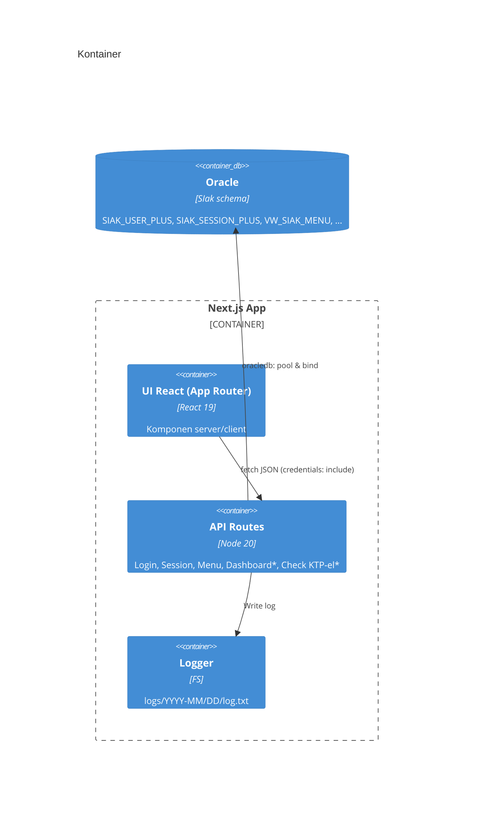
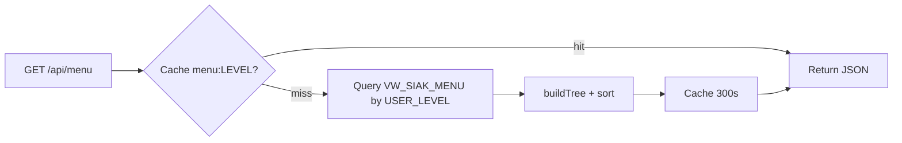
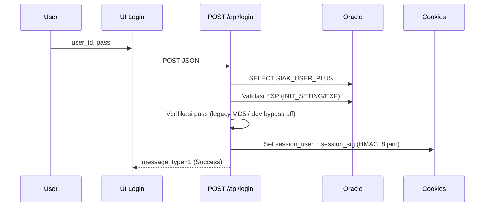

# Monalisa Monitoring (Next.js) — _Tesis Teknis & Desain Produk_

> “Web adalah kanvas pelayanan publik: data → narasi → keputusan → dampak.”

**Repo Utama:** <https://gitlab.com/dianyanzen/monitoring-next>

---

## Ringkasan Eksekutif

Monalisa Monitoring memodernisasi antarmuka monitoring layanan kependudukan Disdukcapil Kota Bandung. Sistem berbasis **Next.js 15 (App Router)** + **TypeScript** ini menyatukan **dashboard**, **modul master**, **monitoring KTP‑el**, **chat internal**, dan **utilitas operasional** dalam satu bahasa visual yang konsisten, mengutamakan **kejelasan**, **akuntabilitas**, dan **ketahanan operasional**. Aplikasi berkomunikasi ke **Oracle SIAK** melalui **API internal** dengan pola **binding variabel** yang ketat dan **logging** berjejak.

**Sasaran akhir**: waktu tanggap cepat, keputusan operasional yang lebih tajam, dan jejak keputusan yang siap diaudit.

---

## Daftar Isi

1. [Abstrak & Latar Belakang](#abstrak--latar-belakang)  
2. [Tujuan, Ruang Lingkup, & Prinsip](#tujuan-ruang-lingkup--prinsip)  
3. [Persona, Journey, & Kebutuhan Pengguna](#persona-journey--kebutuhan-pengguna)  
4. [Filosofi Desain & Narasi Visual](#filosofi-desain--narasi-visual)  
5. [Palet Warna & Dua Tema (Dark Neon, Luxe Light)](#palet-warna--dua-tema-dark-neon-luxe-light)  
6. [Arsitektur Sistem](#arsitektur-sistem)  
   - [Diagram Konteks (C4)](#diagram-konteks-c4)  
   - [Diagram Kontainer](#diagram-kontainer)  
   - [Diagram Komponen](#diagram-komponen)  
   - [Diagram Sekuens (Login, Menu, KTP‑el)](#diagram-sekuens-login-menu-ktp-el)  
   - [Diagram Deployment](#diagram-deployment)  
7. [Struktur Proyek (Deep Dive)](#struktur-proyek-deep-dive)  
8. [Desain Sistem UI: Tokens, Theming, Tipografi, A11y](#desain-sistem-ui-tokens-theming-tipografi-a11y)  
9. [Kontrak API & Konvensi](#kontrak-api--konvensi)  
10. [Database & Pedoman SQL](#database--pedoman-sql)  
11. [Keamanan & Data Governance](#keamanan--data-governance)  
12. [Kinerja & Observabilitas](#kinerja--observabilitas)  
13. [Pengujian & Kualitas](#pengujian--kualitas)  
14. [CI/CD, Release, & Operasional](#cicd-release--operasional)  
15. [Manajemen Risiko & DRP](#manajemen-risiko--drp)  
16. [Roadmap Produk & Epik](#roadmap-produk--epik)  
17. [ADR (Architecture Decision Records)](#adr-architecture-decision-records)  
18. [Glosarium](#glosarium)  
19. [Lampiran A—Runbook Insiden](#lampiran-a—runbook-insiden)  
20. [Lampiran B—Komponen UI Inventori](#lampiran-b—komponen-ui-inventori)  
21. [Lampiran C—Template Issue & PR](#lampiran-c—template-issue--pr)  
22. [Referensi & Sumber](#referensi--sumber)

---

## Abstrak & Latar Belakang

Fragmentasi modul dan keragaman gaya antarmuka mengakibatkan **konteks yang patah** dalam operasi harian. Angka‑angka statistik sering **tanpa narasi** yang memandu aksi, sementara perubahan cepat di lapangan (mis. **status KTP‑el**) menuntut antarmuka yang **mengarahkan tindakan**. Di sisi lain, **akuntabilitas** publik menuntut **jejak keputusan** yang rapi dan mudah ditelusuri.

Monalisa merespons ini dengan **kerangka desain** dan **arsitektur teknis** yang menyeimbangkan **kejelasan informasi**, **ketahanan**, dan **kecepatan**, sekaligus menjaga **governance** data kependudukan.

**Hipotesis**: satu bahasa visual yang jujur + arsitektur API terukur → mengurangi beban kognitif → meningkatkan kualitas keputusan → mempercepat pelayanan.

---

## Tujuan, Ruang Lingkup, & Prinsip

### Tujuan
- Menyatukan monitoring & utilitas operasional dalam UI konsisten.
- Mengubah data menjadi **tindakan** dan **jejak keputusan**.
- Menyediakan **alat bantu operasi** (push ulang, filter wilayah, export, dsb.) dekat dengan data.

### Ruang Lingkup
- **Front‑end**: Next.js 15 (App Router), React 19, Tailwind 3, Framer Motion.
- **Back‑end**: API Routes → Oracle SIAK (multi‑alias pool).
- **Modul**: Dashboard, Master, Check KTP‑el, Chat, Activity, Template.

### Prinsip
- **Clarity First**, **Honest Motion**, **Progressive Disclosure**.
- **Cognitive Economy**: pola berulang, konsisten.
- **Audit‑Ready by Design**.

**KPI**: TTI < 2.5s, median latensi API < 250 ms, penurunan bounce ≥ 30%, kenaikan aksi terarah ≥ 20%/triwulan, error 5xx < 0.5%/minggu.

---

## Persona, Journey, & Kebutuhan Pengguna

**Persona Utama**
- **Petugas Loket**: butuh status cepat, tindakan langsung (push ulang, verifikasi).
- **Operator Wilayah**: filter kec/kels, ekspor data, tindak lanjut.
- **Supervisor**: tren, anomali, drill‑down ringan.
- **Administrator**: manajemen hak akses, audit log, kestabilan sistem.

**Journey Ringkas (Check KTP‑el)**
1. Memilih **wilayah** dan **rentang waktu**.
2. Melihat **kartu metrik** (status, error, progress).
3. Menjalankan **aksi** (push ulang / ekspor) dari konteks yang sama.
4. **Catatan** otomatis (log) tercipta untuk audit.

**Kebutuhan Non‑Fungsional**
- **Reliability** tinggi pada jam sibuk.
- **Observabilitas**: log, scope jelas, payload dipangkas.
- **A11y**: fokus jelas, preferensi reduksi animasi, kontras AA.

---

## Filosofi Desain & Narasi Visual

- **Angka besar untuk status utama**, teks pendukung hemat.
- **Motion jujur**: penanda transisi, bukan dekorasi kosong.
- **Empty state** memandu langkah selanjutnya.
- Visual mengantar **aksi**, bukan hanya “pamer data”.

---

## Palet Warna & Dua Tema (Dark Neon, Luxe Light)

### Dark Neon (default, operasional)
- **Rasa**: ruang kendali, neon sebagai *accent/state*.
- **Rasio** neon:netral ≈ **1:4**.

```css
/* FILE: src/styles/theme-dark.css (cuplikan) */
html:not([data-theme="light"]) {
  --surface-0:#0a0a0c; --surface-1:#0e0e14; --ink:#e5e7eb;
  --accent:#00e6c3; --accent-2:#36bffa; --warning:#f5c26b; --error:#ff5d73;
  --border-subtle:rgba(255,255,255,.08);
}
```

### Luxe Light (presentasi)
- **Rasa**: kertas marmer hangat, tinta pekat, aksen emas elegan.
- **Gunakan emas** untuk **detail prestige** (garis, underline).

```css
/* FILE: src/styles/theme-light.css (cuplikan) */
html[data-theme="light"] {
  --pal-silk:#EEE5D9; --pal-marble:#EBEAE0; --lux-ink:#1A1D21;
  --lux-border:rgba(26,29,33,.12);
  --lux-gold-grad:linear-gradient(90deg,#D4AF37,#F6D365 60%,#FFE8A3);
}
```

> Target kontras **AA** untuk teks ≥14px reguler / 12px bold.

---

## Arsitektur Sistem

### Stack Inti
- **Front‑end**: Next.js 15, React 19, Tailwind 3, Framer Motion, MUI, Chart.js, DataTables, Grid.js.
- **API**: Next.js Routes → **node‑oracledb** via **pool multi‑alias**.
- **Auth**: Cookie **HMAC‑SHA256** (`session_user` + `session_sig`) dengan middleware halaman & API.
- **Logging**: `logs/YYYY‑MM/DD/log.txt` (auto mkdir), payload dipangkas.

### Diagram Konteks (C4)

```mermaid
C4Context
title Konteks Sistem

Person(user, "Petugas/Administrator")
System_Boundary(web, "Monalisa (Next.js)") {
  System_UI(ui, "UI + API Routes", "Next.js", "Dashboard, Master, Check KTP‑el, Chat, Activity")
}
SystemDb(oracle, "Oracle SIAK", "oracledb")

Rel(user, ui, "Operasi harian")
Rel(ui, oracle, "SQL bind, pool multi‑alias")
```

### Diagram Kontainer



### Diagram Komponen (API Menu)



### Diagram Sekuens (Login)



### Diagram Deployment

```mermaid
flowchart TB
  subgraph Client
    B[Browser]
  end
  subgraph Server
    N[Next.js Runtime]
    P[(Oracle Instant Client 19c+)]
  end
  subgraph Infra
    RP[Reverse Proxy (HTTPS)]
    FS[/logs storage/]
  end

  B -- HTTPS --> RP -- proxy_pass --> N
  N -- oracledb/native --> P
  N -- write --> FS
```

---

## Struktur Proyek (Deep Dive)

```
├── .env.local
├── package.json
├── tsconfig.json
├── postcss.config.mjs
├── tailwind.config.js
├── public/
└── src/
    ├── app/
    │   ├── api/
    │   │   ├── login/route.ts
    │   │   ├── session/route.ts
    │   │   ├── menu/route.ts
    │   │   └── ... modul lainnya
    │   ├── dashboard/page.tsx
    │   ├── login/page.tsx
    │   ├── globals.css
    │   └── layout.tsx
    ├── components/
    │   ├── layout/ (ResponsiveAppShell, Sidebar, Topbar, Footer)
    │   ├── dashboard/ (cards, charts)
    │   ├── datatable/ (wrapper DataTables/Grid.js)
    │   ├── system/ (overlay/dialog/alert)
    │   └── ui/ (elemen kecil: DateRangePopup, dll)
    ├── contexts/session.tsx
    ├── hooks/
    ├── lib/ (session.ts, log.ts, oracle.ts, db.ts, http.ts, auth.ts, user.ts)
    ├── middleware.ts
    └── middleware.api.ts
```

**Aturan proyek (penting)**  
- **Jangan ubah**: `.env`, `/lib/oracle.ts`, `/lib/db.ts`, `/lib/http.ts` **kecuali diminta eksplisit**.  
- Setiap snippet kode pada dokumentasi mencantumkan **file path** yang dituju.

---

## Desain Sistem UI: Tokens, Theming, Tipografi, A11y

- **Tokens** di `src/styles/tokens.css` → variabel semantik (surface, ink, accent, border, shadow, radius, motion, focus).  
- **Tema**: `theme-dark.css` (default), `theme-light.css` (Luxe). Switch memakai `data-theme="light"` pada elemen `html`.  
- **Tipografi**: Inter; skala responsif, panjang baris ideal 65–80 karakter.  
- **A11y**: target WCAG AA, focus ring jelas, hormati `prefers-reduced-motion`.

**Import urutan**:  
```ts
// FILE: src/app/layout.tsx (cuplikan)
import "./globals.css"
import "../styles/tokens.css"
import "../styles/theme-dark.css"
import "../styles/theme-light.css"
```

---

## Kontrak API & Konvensi

### Konvensi URL & Verba
- Resource nouns, kebanyakan `GET/POST` (sesuai App Router best practice).
- Query menggunakan **bind** di sisi server (Oracle), tidak menyisipkan string mentah.

### Skema Respons
```json
{
  "success": true,
  "message": "OK",
  "data": { "rows": [] }
}
```

### Status & Error
- Gunakan HTTP 200 untuk respons terstruktur + `success:false` pada kasus yang bisa dipahami klien.  
- Gunakan 401/403 untuk akses, 500 untuk kesalahan tak terduga.  
- Semua error **ditulis** ke log dengan scope yang relevan.

### Contoh: Login
```bash
curl -i -X POST http://localhost:3000/api/login \
  -H "Content-Type: application/json" \
  -d '{"user_id":"demo","pass":"demo"}'
```

### Contoh: Session
```bash
curl -i http://localhost:3000/api/session --cookie-jar cookies.txt
```

### Contoh: Menu
```bash
curl -i http://localhost:3000/api/menu --cookie cookies.txt
```

---

## Database & Pedoman SQL

**Alias (contoh, non‑rahasia)**: `DB`, `DB222`, `DB221`, `WEBDB`, `EPUNTEN`, `WEBPUNTEN`, dll.  
**Konvensi**:
1) Penamaan tabel & kolom: `UPPER_SNAKE_CASE`  
2) Binding: **wajib** `:b_*` (tanpa interpolasi string)  
3) Waktu: `SYSDATE/SYSTIMESTAMP` untuk DML  
4) Format hasil: `oracledb.OUT_FORMAT_OBJECT`  
5) Transaksi: DML auto‑commit / transaksi eksplisit  
6) Session: `SIAK_SESSION_PLUS` (SESSION_ID, USER_ID, IP_ADDRESS, USER_AGENT, LAST_ACTIVITY, IS_ACTIVE)  
7) Expiry: `SIAK_MASTER` (INIT_SETING/EXP) → validasi di DB  
8) Password: MD5 (legacy) → **migrasi** rekomendasi ke Argon2/BCrypt  
9) Cookie: `session_user` hanya simpan `SESSION_ID`, profil diambil server‑side  
10) Keamanan tambahan: verifikasi IP opsional, rate limit & audit login gagal

> **Catatan**: kredensial produksi **tidak** disimpan di repo; gunakan `.env.production` terpisah.

---

## Keamanan & Data Governance

- **Auth & Session**: HMAC‑SHA256; httpOnly; `Secure` di produksi; `SameSite=Lax`.  
- **Middleware**: proteksi halaman (kecuali `/login`), proteksi `/api/*`.  
- **PII**: Mask NIK pada tampilan publik/semi; export berizin; log menyingkat payload sensitif.  
- **Audit**: setiap query penting dicatat (waktu, durasi, alias, bind disamarkan).  
- **Headers** via reverse proxy: HSTS, CSP minimal, X‑Frame‑Options SAMEORIGIN.

---

## Kinerja & Observabilitas

- **Budget**: TTI < 2.5s; median API < 250 ms; error 5xx < 0.5%.  
- **Strategi**: lazy load, cache, virtualized tables, hindari N+1, gunakan `unstable_cache` pada data statis berbasis level.  
- **Log**: struktur harian `logs/YYYY‑MM/DD/log.txt`; fallback ke `stderr` bila gagal menulis file.  
- **Health**: `/api/session/ping` untuk liveness; fungsi `checkOracleHealth()` untuk koneksi alias.

---

## Pengujian & Kualitas

- **Static checks**: ESLint, TypeScript build.  
- **Unit**: utilitas (log, session).  
- **Integration**: API Routes (login, menu, session).  
- **E2E**: alur login → dashboard → aksi sederhana.  
- **Load test** (opsional): endpoint kritikal (menu, ktp‑el).  
- **A11y test**: fokus, kontras, `prefers-reduced-motion`.

**Test Data**: gunakan dataset dummy; jangan menaruh PII riil dalam fixture.

---

## CI/CD, Release, & Operasional

### Contoh `.gitlab-ci.yml`
```yaml
# FILE: .gitlab-ci.yml
image: node:20

cache:
  key: ${CI_COMMIT_REF_SLUG}
  paths: [node_modules/]

stages: [install, lint, build]

install:
  stage: install
  script: [ "npm ci" ]
  artifacts: { paths: [ "node_modules/" ], expire_in: 1 day }

lint:
  stage: lint
  script:
    - npx prettier -c .
    - npm run -s typecheck || true

build:
  stage: build
  script: [ "npm run build" ]
  artifacts: { paths: [ ".next" ], expire_in: 7 days }
```

### Release & Versioning
- **Conventional Commits** (`feat:`, `fix:`, `docs:` …).  
- **Changelog** otomatis (opsional).  
- **Release** staging → produksi dengan checklist rilis.

### Operasional
- **Reverse proxy** HTTPS (header `X‑Forwarded‑Proto`).  
- **Log rotation** & permission `LOG_DIR`.  
- **Monitoring**: error rate, latensi median, waktu build.

---

## Manajemen Risiko & DRP

- **Risiko**: koneksi Oracle gagal; `DPI‑1047`; kesalahan kredensial; cache basi.  
- **Mitigasi**: health check alias, rebuild `oracledb`, fallback pesan UI jelas, invalidasi cache manual (`/api/menu?action=revalidate`).  
- **DRP**: backup log harian; backup konfigurasi; RPO ≤ 24 jam (untuk artefak non‑PII); RTO < 2 jam untuk layanan web.

---

## Roadmap Produk & Epik

**Short term**
- Pusat notifikasi terpadu.
- Theme editor (preview token).
- Perbaikan fokus & kontras lintas komponen.

**Mid term**
- Realtime ringan (polling/SSE) untuk metrik tertentu.
- Audit viewer (filter by scope/time).
- Ekspor terjadwal (CSV/Excel) dengan peran.

**Long term**
- Pengingat tugas dari indikator dashboard.
- Lumbung metrik time‑series (tren jangka panjang).

---

## ADR (Architecture Decision Records)

- **ADR‑001**: App Router vs Pages Router → **App Router** untuk _server components_ & streaming.  
- **ADR‑002**: Oracledb native vs REST middleware → **native** demi latensi minimal & kontrol bind.  
- **ADR‑003**: Session HMAC cookie vs JWT → **HMAC cookie**: sederhana, aman, cocok multi‑instance.  
- **ADR‑004**: Tailwind + tokens CSS vs CSS‑in‑JS → **Tailwind + tokens**: _build‑time_ ringan, dapat dipadu CSS modular.  
- **ADR‑005**: Dua tema (Dark Neon + Luxe Light) → **dua konteks kerja** (operasional vs narasi).

---

## Glosarium

- **A11y**: Accessibility.  
- **App Router**: arsitektur routing Next.js 13+ dengan **server components**.  
- **Bind**: parameter terikat pada driver DB (bukan string literal).  
- **HMAC**: _Hash‑based Message Authentication Code_.  
- **PII**: _Personally Identifiable Information_.

---

## Lampiran A—Runbook Insiden

1) **Tidak bisa login**  
   - Cek `SESSION_SECRET`, cookie httpOnly, header HTTPS (`X‑Forwarded‑Proto`), expiry.  
   - Lihat log scope `SESSION` & `API`.

2) **DPI‑1047 / NJS‑045**  
   - Pastikan Oracle Instant Client terpasang & masuk PATH/LD_LIBRARY_PATH.  
   - `npm rebuild oracledb --force`

3) **Menu kosong / cache basi**  
   - Hit `/api/menu?action=revalidate` setelah perubahan level/role.  
   - Cek `VW_SIAK_MENU` di DB.

4) **Lambat saat jam sibuk**  
   - Audit log `DB` (durasi tinggi), periksa indeks, _virtualize_ tabel besar.

---

## Lampiran B—Komponen UI Inventori

- **Layout**: ResponsiveAppShell, Sidebar, Topbar, Footer, RouteChangeOverlay.  
- **Dashboard**: StatCard, TrendChart, CategoryBreakdown.  
- **UI**: DateRangePopup, NiceAlert, Modal, Tooltip.  
- **Data**: DataTable wrapper (DataTables/Grid.js).  
- **Chat**: ContactList, ThreadView, MessageComposer.  
- **Check KTP‑el**: FilterPanel, ResultTable, BulkActions.

---

## Lampiran C—Template Issue & PR

**Issue (Bug)**
- **Ringkasan**: …  
- **Langkah Repro**: …  
- **Ekspektasi vs Realita**: …  
- **Log/Console**: …  
- **Lingkungan**: dev/staging/prod

**Issue (Feature)**
- **Tujuan bisnis**: …  
- **Kriteria penerimaan**: …  
- **Dampak UI/DB**: …  
- **Risiko & mitigasi**: …

**PR**
- **Judul**: `feat(scope): ringkas`  
- **Deskripsi**: perubahan, alasan, dampak, _breaking_?  
- **Checklist**: lint, typecheck, log, dokumentasi.

---

## Referensi & Sumber

- **Repo**: <https://gitlab.com/dianyanzen/monitoring-next>  
- Next.js Docs — <https://nextjs.org/docs>  
- Node‑oracledb — <https://oracle.github.io/node-oracledb/doc/api.html>  
- Tailwind CSS — <https://tailwindcss.com/docs>  
- Chart.js — <https://www.chartjs.org/docs/latest/>  
- DataTables — <https://datatables.net/manual/>

---

> **Catatan penting**: Repositori ini memuat *credentials* dummy pada `.env.local`. Ganti seluruh rahasia untuk lingkungan lain dan **jangan** commit file `.env` berisi data produksi.

**Repo Utama (ulang)**: <https://gitlab.com/dianyanzen/monitoring-next>

---

## Lampiran D—Design Tokens & Contoh Implementasi

### D.1. Urutan Import (Layout)

```tsx
// FILE: src/app/layout.tsx (cuplikan impor CSS)
import "./globals.css"                 // Tailwind entry
import "../styles/tokens.css"          // 1) Tokens
import "../styles/theme-dark.css"      // 2) Dark overrides
import "../styles/theme-light.css"     // 3) Light overrides
```

> Default: **Dark Neon** (selector `html:not([data-theme="light"])`).
> Untuk beralih ke **Luxe Light**: `document.documentElement.dataset.theme = "light"` pada bootstrap awal.

### D.2. File Tokens & Theme (siap pakai)

- **[src/styles/tokens.css](src/styles/tokens.css)** — variabel semantik global + helper.  
- **[src/styles/theme-dark.css](src/styles/theme-dark.css)** — tema Dark Neon.  
- **[src/styles/theme-light.css](src/styles/theme-light.css)** — tema Luxe Light.

> Versi unduhan cepat:  
> • [tokens.css](sandbox:/mnt/data/src/styles/tokens.css)  
> • [theme-dark.css](sandbox:/mnt/data/src/styles/theme-dark.css)  
> • [theme-light.css](sandbox:/mnt/data/src/styles/theme-light.css)

### D.3. Komponen “Prestige Card” (contoh)

```tsx
// FILE: src/components/ui/PrestigeCard.tsx
"use client";

import { ReactNode } from "react";

type Props = {
  title: string;
  subtitle?: string;
  actions?: ReactNode;
  children?: ReactNode;
};

export default function PrestigeCard({ title, subtitle, actions, children }: Props) {
  return (
    <section
      className="token-card rounded-2xl border p-5 md:p-6 relative overflow-hidden card prestige"
      role="region"
      aria-label={title}
      style={{ borderColor: "var(--border-subtle)" }}
    >
      {/* Header */}
      <div className="flex items-start justify-between gap-4">
        <div>
          <h3 className="text-xl md:text-2xl font-semibold" style={{ color: "var(--ink)" }}>
            {title}
          </h3>
          {subtitle ? (
            <p className="text-sm mt-1" style={{ color: "var(--ink-muted)" }}>
              {subtitle}
            </p>
          ) : null}
        </div>
        {actions ? <div className="shrink-0">{actions}</div> : null}
      </div>

      {/* Gold underline (di Light akan bergradasi emas) */}
      <span className="gold-underline block mt-3 token-underline-prestige" />

      {/* Body */}
      <div className="mt-4 text-sm md:text-base" style={{ color: "var(--ink)" }}>
        {children}
      </div>
    </section>
  );
}
```

**Catatan**  
- Di **Dark Neon**, garis bawah mengikuti `--lux-gold-grad` untuk konsistensi prestige (tetap subtle).  
- Di **Luxe Light**, border & shadow lebih halus; underline menjadi aksen emas elegan (lihat `theme-light.css`).  
- Semua warna mengambil dari **tokens** → tema override; tidak hardcode warna di komponen.

### D.4. Contoh Pemakaian

```tsx
// FILE: src/app/dashboard/_components/SamplePrestige.tsx
"use client";

import { Button } from "@/components/ui/button"; // contoh, opsional (shadcn/mui/custom)
import PrestigeCard from "@/components/ui/PrestigeCard";

export default function SamplePrestige() {
  return (
    <PrestigeCard
      title="KTP-el Status Overview"
      subtitle="Periode 01–30 • Kecamatan Bojongsoang"
      actions={<button className="px-3 py-1.5 rounded-md border" style={{borderColor:"var(--border-strong)"}}>Export</button>}
    >
      <ul className="list-disc pl-5 space-y-1">
        <li><b>Siap Cetak:</b> 1.284</li>
        <li><b>Tertunda:</b> 213</li>
        <li><b>Error Perangkat:</b> 17</li>
      </ul>
    </PrestigeCard>
  );
}
```

### D.5. Switcher Tema Minimal

```tsx
// FILE: src/components/system/ThemeSwitch.tsx
"use client";

import { useEffect, useState } from "react";

export default function ThemeSwitch() {
  const [isLight, setIsLight] = useState(false);

  useEffect(() => {
    const root = document.documentElement;
    const saved = localStorage.getItem("ml_theme");
    if (saved === "light") {
      root.dataset.theme = "light";
      setIsLight(true);
    }
  }, []);

  const toggle = () => {
    const root = document.documentElement;
    const next = root.dataset.theme === "light" ? "" : "light";
    if (next) root.dataset.theme = next; else root.removeAttribute("data-theme");
    localStorage.setItem("ml_theme", next ? "light" : "dark");
    setIsLight(next === "light");
  };

  return (
    <button
      onClick={toggle}
      className="px-3 py-1.5 rounded-md border"
      style={{ borderColor: "var(--border-strong)", color: "var(--ink)" }}
      aria-pressed={isLight}
      aria-label="Toggle theme"
      title={isLight ? "Switch to Dark Neon" : "Switch to Luxe Light"}
    >
      {isLight ? "Luxe Light" : "Dark Neon"}
    </button>
  );
}
```

---

> Dengan Lampiran D ini, README menjadi “kit” lengkap: **tokens** siap pakai, **tema** siap impor, dan **komponen contoh** untuk mengilustrasikan filosofi “prestige detail”—emas yang halus, bukan bising.
