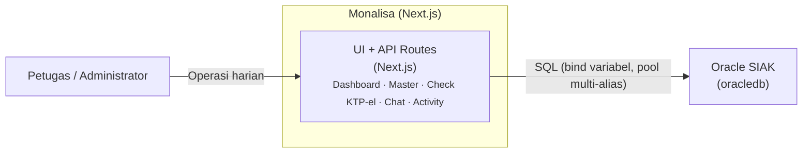
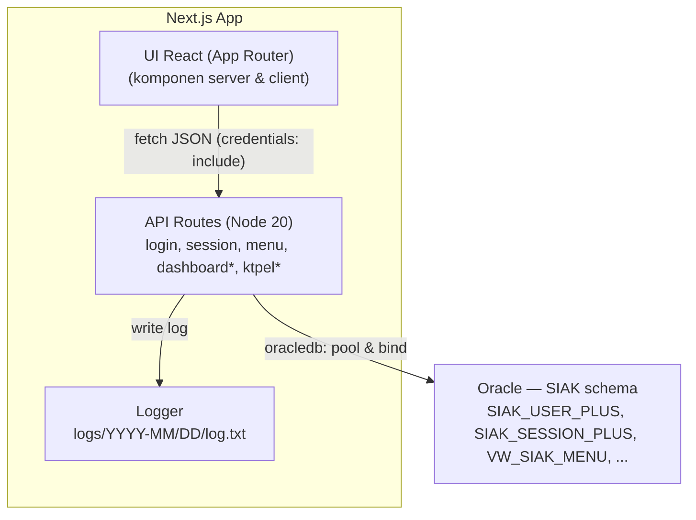
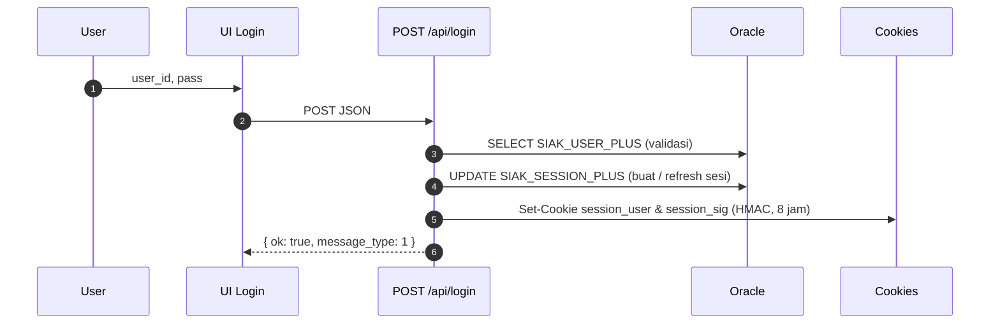
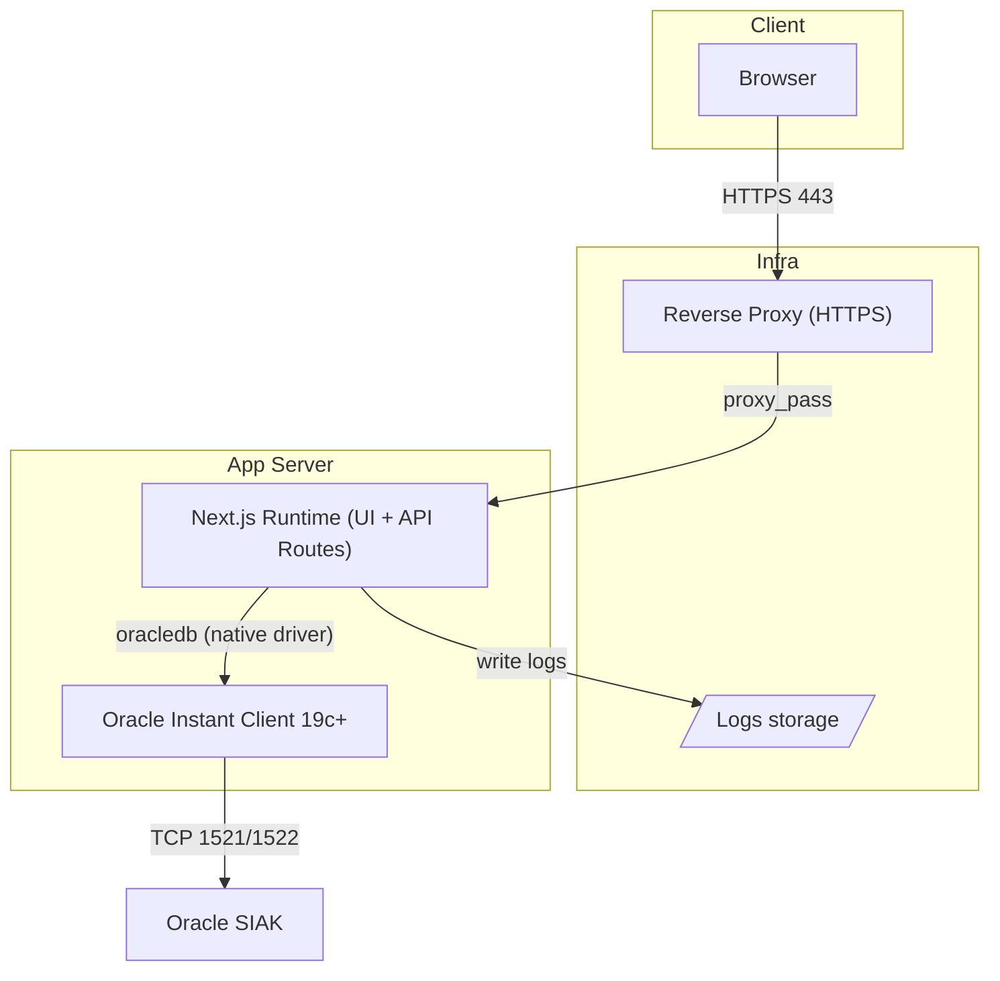

# Monalisa Monitoring — **README**
> “Web adalah kanvas pelayanan publik: **data → narasi → keputusan → dampak**.”

**Ditulis oleh:** **Dian Septian, S.Tr.Kom., M.M**  
**Peran:** Administrator Database Kependudukan Ahli Pertama — Dinas Kependudukan & Pencatatan Sipil Kota Bandung  
**Gelar:** **Sarjana Terapan Komputer** • **Magister Manajemen (konsentrasi Manajemen Sumber Daya Manusia)**

**Repo modern (Next.js):** <https://gitlab.com/dianyanzen/monitoring-next>  
**Repo legacy (Laravel):** <https://gitlab.com/dianyanzen/monitoring-laravel>

> ⚠️ **Catatan penting**  
> Repositori ini bisa memuat *credentials* dummy pada `.env.local` untuk pengembangan. Ganti seluruh rahasia di lingkungan lain dan **jangan** commit `.env` produksi.

---

## 📚 Navigasi Cepat
- [Ringkasan Eksekutif](#ringkasan-eksekutif)
- [Identitas & Narasi Penulis](#identitas--narasi-penulis)
- [Abstrak & Latar Belakang](#abstrak--latar-belakang)
- [Tujuan, Ruang Lingkup, & Prinsip](#tujuan-ruang-lingkup--prinsip)
- [Persona, Journey, & Kebutuhan Pengguna](#persona-journey--kebutuhan-pengguna)
- [Filosofi Desain & Tema Visual](#filosofi-desain--tema-visual)
- [Arsitektur Sistem (C4, Kontainer, Sekuens, Deployment)](#arsitektur-sistem-c4-kontainer-sekuens-deployment)
- [Struktur Proyek (Deep Dive)](#struktur-proyek-deep-dive)
- [Desain Sistem UI: Tokens, Theming, Tipografi, A11y](#desain-sistem-ui-tokens-theming-tipografi-a11y)

---

## Ringkasan Eksekutif
Monalisa Monitoring memodernisasi antarmuka monitoring layanan kependudukan Disdukcapil Kota Bandung dari stack **Laravel 6 + Oracle** (legacy) menjadi **Next.js 15 (App Router) + TypeScript + Oracle** (modern).  
Sistem menyatukan **dashboard**, **modul master**, **monitoring KTP-el**, **chat internal**, dan **utilitas operasional** dengan satu bahasa visual konsisten dan *auditability* yang kuat.  
Aplikasi berbicara ke **Oracle SIAK** via **API Routes** (Next.js) dengan **binding variabel** yang ketat dan **logging berjejak** per-hari.

**Hasil yang dituju:** waktu tanggap cepat, keputusan operasional yang tajam, pengurangan beban kognitif petugas, dan jejak keputusan siap diaudit.

**KPI Utama:**
- TTI < 2.5s  
- Median latensi API < 250 ms  
- Penurunan bounce ≥ 30%  
- Kenaikan aksi terarah ≥ 20% per triwulan  
- Error 5xx < 0.5% per minggu

---

## Identitas & Narasi Penulis
Aku, **Dian Septian, S.Tr.Kom., M.M**, adalah **Administrator Database** di **Dinas Kependudukan dan Pencatatan Sipil Kota Bandung**.  
Fondasi teknisku adalah **Gelar Sarjana Terapan Komputer**, dan landasan kepemimpinan serta organisasi kutempuh dalam **Magister Manajemen (Manajemen Sumber Daya Manusia)**.  

Bahasa dokumentasi ini sengaja lugas dan tajam: **teknis yang membumi**, **UX yang bisa dipegang**, dan **akuntabilitas publik** sebagai haluan.

---

## Abstrak & Latar Belakang
Fragmentasi modul dan variasi gaya antarmuka memecah konteks operasional.  
Angka-angka statistik tanpa narasi tindakan menambah beban kognitif petugas, sementara perubahan cepat (mis. status KTP-el) menuntut antarmuka yang **mengantar aksi**, bukan sekadar menampilkan data.  
Sisi akuntabilitas publik menuntut **jejak keputusan** yang mudah ditelusuri.

**Hipotesis produk:**  
> Satu bahasa visual + arsitektur API terukur → beban kognitif turun → kualitas keputusan naik → pelayanan lebih cepat.

---

## Tujuan, Ruang Lingkup, & Prinsip

### 🎯 Tujuan
- Menyatukan monitoring & utilitas operasional dalam UI konsisten.
- Mengubah data menjadi **tindakan** dan **jejak keputusan**.
- Menyediakan alat bantu operasi (push ulang, filter wilayah, ekspor, chat) yang dekat dengan data.

### 🧭 Ruang Lingkup
- **Front-end:** Next.js 15 (App Router), React 19, Tailwind 3, Framer Motion, MUI, Chart.js, DataTables, Grid.js.  
- **Back-end:** Next.js **API Routes** → Oracle (multi-alias pool); logging harian.  
- **Modul:** Dashboard, Master, Check KTP-el, Chat, Activity, Template.

### ⚖️ Prinsip
- **Clarity First**, **Honest Motion**, **Progressive Disclosure**.  
- **Cognitive Economy**: pola berulang dan konsisten.  
- **Audit-Ready by Design** — setiap keputusan dapat dilacak.

---

## Persona, Journey, & Kebutuhan Pengguna

### 👤 Persona Utama
| Peran | Tujuan | Kebutuhan |
|-------|---------|------------|
| **Petugas Loket** | Mengetahui status cepat, tindakan langsung (push ulang, verifikasi). | UI ringkas, responsif, tanpa distraksi. |
| **Operator Wilayah** | Menyaring data kec/kels, ekspor, tindak lanjut. | Filter dinamis, laporan cepat. |
| **Supervisor** | Melihat tren dan anomali. | Dashboard interaktif, drill-down ringan. |
| **Administrator** | Menjamin kestabilan sistem dan audit. | Log detail, kontrol sesi, dan hak akses. |

### 🔄 Journey Ringkas (Check KTP-el)
1. Pilih **wilayah** & **rentang waktu**.  
2. Lihat **kartu metrik** (status, error, progress).  
3. Jalankan **aksi** (push ulang / ekspor) langsung di konteks data.  
4. **Catatan otomatis (log)** tercipta untuk audit.

**Non-Fungsional:**  
- Reliabilitas tinggi di jam sibuk.  
- Observabilitas: log terstruktur, scope jelas, payload minimal.  
- Aksesibilitas (A11y): fokus jelas, `prefers-reduced-motion`, kontras AA.

Baik. Berikut **Batch 2** dari README final dalam format Markdown penuh — berisi **Filosofi Desain, Arsitektur Sistem, Struktur Proyek,** dan **Desain UI (Tokens, Theming, Tipografi, A11y)**.
Semua sudah dirapikan dan siap langsung ditempel ke GitLab.

---

## 🎨 Filosofi Desain & Tema Visual

- **Angka besar untuk status utama**, teks pendukung hemat dan informatif.  
- **Motion jujur:** hanya untuk menandai transisi atau perubahan state, bukan dekorasi.  
- **Empty state** bukan ruang kosong, tapi panduan langkah selanjutnya.  
- Visual mengantar **aksi**, bukan sekadar “pamer data”.

---

### Tema 1 — **Neon Cyberpunk** (default operasional)
Menampilkan atmosfer ruang kendali; aksen neon dipakai untuk *state/accent*, bukan sebagai latar.  
Rasio neon : netral ≈ **1 : 4**

```css
/* FILE: src/styles/theme-dark.css (cuplikan) */
html:not([data-theme="light"]) {
  --surface-0:#0a0a0c; --surface-1:#0e0e14; --surface-2:#111118;
  --ink:#e5e7eb; --ink-muted:#a6adbb;
  --accent:#00e6c3; --accent-2:#36bffa;
  --success:#1ad19a; --warning:#f5c26b; --error:#ff5d73;
  --border-subtle:rgba(255,255,255,.08);
  --border-strong:rgba(255,255,255,.16);
  --focus-ring:0 0 0 3px rgba(0,230,195,.45);
}
````

---

### Tema 2 — **Elegant Lux** (narasi/presentasi)

Palet seperti kertas marmer hangat dan tinta pekat, dengan aksen emas untuk detail prestige (bukan fill besar).

```css
/* FILE: src/styles/theme-light.css (konsep) */
html[data-theme="light"] {
  --pal-silk:#EEE5D9; --pal-marble:#EBEAE0;
  --lux-ink:#1A1D21; --lux-border:rgba(26,29,33,.12);
  --gold-1:#D4AF37; --gold-2:#F6D365; --gold-3:#FFE8A3;
  --lux-gold-grad:linear-gradient(90deg,var(--gold-1),var(--gold-2) 60%,var(--gold-3));
}
```

**Kontras target:** WCAG AA untuk teks ≥ 14 px reguler / 12 px bold.

---

## 🧩 Arsitektur Sistem (C4, Kontainer, Sekuens, Deployment)

**Stack Inti**

* **Front-end:** Next.js 15, React 19, Tailwind 3, Framer Motion, MUI, Chart.js, DataTables, Grid.js.
* **API:** Next.js API Routes → node-oracledb (pool multi-alias).
* **Auth:** Cookie HMAC-SHA256 (`session_user` + `session_sig`) + middleware halaman dan API.
* **Logging:** `logs/YYYY-MM/DD/log.txt` otomatis, payload dipangkas.

---

### Diagram Konteks (C4)



---

### Diagram Kontainer



---

### Diagram Sekuens (Login → Session)



---

### Deployment (skema)



---

## 🗂️ Struktur Proyek (Deep Dive)

```
├── .env.local
├── package.json
├── tsconfig.json
├── postcss.config.mjs
├── tailwind.config.js
├── public/
└── src/
    ├── app/
    │   ├── api/ (login, session, menu, dashboard, check/ktpel, master, chat, messages, activity, account, user)
    │   ├── dashboard/
    │   ├── login/
    │   ├── chat/
    │   ├── check/ktpel/
    │   ├── master/
    │   ├── globals.css
    │   └── layout.tsx
    ├── components/
    │   ├── layout/ (ResponsiveAppShell, Sidebar, Topbar, Footer)
    │   ├── dashboard/ (cards, charts)
    │   ├── datatable/ (DataTables/Grid.js wrappers)
    │   ├── system/ (overlay/dialog/alert)
    │   └── ui/ (DateRangePopup, dsb)
    ├── contexts/session.tsx
    ├── hooks/
    ├── lib/ (session.ts, log.ts, oracle.ts, db.ts, http.ts, auth.ts, user.ts)
    ├── middleware.ts
    └── middleware.api.ts
```

**Aturan Penting**

* Jangan ubah `lib/oracle.ts`, `lib/db.ts`, `lib/http.ts` tanpa izin khusus.
* Semua snippet dokumentasi wajib mencantumkan **lokasi file**.

---

## 💅 Desain Sistem UI (Tokens, Theming, Tipografi, A11y)

* **Tokens:** `src/styles/tokens.css` berisi variabel semantik (surface, ink, accent, border, shadow, radius, motion, focus).
* **Tema:** `theme-dark.css` (Neon Cyberpunk) & `theme-light.css` (Elegant Lux). Gunakan `data-theme="light"` untuk switch.
* **Tipografi:** font Inter, skala responsif, panjang baris ideal 65–80 karakter.
* **A11y:** fokus ring jelas, kontras AA, menghormati `prefers-reduced-motion`.

```ts
// FILE: src/app/layout.tsx (cuplikan)
import "./globals.css"
import "../styles/tokens.css"
import "../styles/theme-dark.css"
import "../styles/theme-light.css"
```


## 🔌 Kontrak API & Konvensi

### 📄 Konvensi URL & Verba
- Resource nouns dengan `GET/POST` dominan (sesuai App Router best-practice).
- Query **selalu menggunakan bind di server (Oracle)** — tidak boleh interpolasi string mentah.

### 📦 Envelope JSON
```json
{ "success": true, "message": "OK", "data": {} }
````

### ⚠️ Status & Error

* HTTP 200 dengan `success:false` untuk error yang bisa dipahami klien.
* 401 / 403 untuk akses ditolak; 500 untuk error tak terduga.
* Semua error ditulis ke log dengan scope relevan (API / DB / Session).

### 💻 Contoh cURL

```bash
# Login
curl -i -X POST http://localhost:3000/api/login \
  -H "Content-Type: application/json" \
  -d '{"user_id":"demo","pass":"demo"}'

# Session
curl -i http://localhost:3000/api/session --cookie-jar cookies.txt

# Menu
curl -i http://localhost:3000/api/menu --cookie cookies.txt
```

---

## 🧠 Database & Pedoman SQL

### 📡 Alias Database

`DB`, `DB222`, `DB221`, `WEBDB`, `EPUNTEN`, `WEBPUNTEN`, dsb (diatur dari `.env`).

### 📐 Konvensi Utama

1. **Penamaan:** tabel & kolom → `UPPER_SNAKE_CASE`.
2. **Binding:** wajib gunakan `:b_*` (tanpa interpolasi string).
3. **Waktu:** gunakan `SYSDATE / SYSTIMESTAMP` untuk DML.
4. **Format hasil:** `OUT_FORMAT_OBJECT`.
5. **Transaksi:** auto-commit per statement, atau eksplisit bila batch.
6. **Session tracking:** `SIAK_SESSION_PLUS` (SESSION_ID, USER_ID, IP, USER_AGENT, LAST_ACTIVITY, IS_ACTIVE).
7. **Expiry aplikasi:** sumber dari `SIAK_MASTER` (`SYSTEM_TYPE='INIT_SETING'`, `SYSTEM_CODE='EXP'`).
8. **Password:** legacy MD5 → migrasi bertahap ke Argon2/BCrypt.
9. **Cookie:** `session_user` hanya simpan SESSION_ID; profil diambil server-side.
10. **Keamanan tambahan:** opsional IP check, rate limit login, audit gagal.

---

### ⚡ Rekomendasi Indeks

| Tabel               | Indeks Disarankan                                                |
| ------------------- | ---------------------------------------------------------------- |
| `SIAK_SESSION_PLUS` | PK `(SESSION_ID)`, IDX `(USER_ID)`, IDX `(LAST_ACTIVITY)`        |
| `VW_SIAK_MENU`      | IDX `(MIN_LEVEL)`, IDX `(PARENT_ID, ORDERING)`                   |
| `KTP_EL_STATUS_LOG` | IDX `(KAB_ID, KEC_ID, KEL_ID, TANGGAL)`, IDX `(STATUS, TANGGAL)` |
| `MESSAGES`          | IDX `(RECEIVER_ID, CREATED_AT)`, IDX `(SENDER_ID, CREATED_AT)`   |
| `ABSENSI_LOG`       | IDX `(NIP, CHECK_IN)`                                            |

---

### 📜 Contoh Pola SQL (Bind Variables)

```sql
-- FILE: sql/session_keepalive.sql
UPDATE SIAK_SESSION_PLUS
   SET LAST_ACTIVITY = SYSTIMESTAMP
 WHERE SESSION_ID = :b_session_id
   AND IS_ACTIVE = 1;
```

```sql
-- FILE: sql/menu_by_level.sql
SELECT MENU_ID, PARENT_ID, LABEL, HREF, ORDERING
  FROM VW_SIAK_MENU
 WHERE MIN_LEVEL <= :b_user_level
 ORDER BY NVL(PARENT_ID, 0), ORDERING;
```

```sql
-- FILE: sql/ktpel_rekap_status.sql
SELECT STATUS, COUNT(*) AS jumlah
  FROM KTP_EL_STATUS_LOG
 WHERE TANGGAL BETWEEN :b_start AND :b_end
   AND ( :b_kab IS NULL OR KAB_ID = :b_kab )
   AND ( :b_kec IS NULL OR KEC_ID = :b_kec )
   AND ( :b_kel IS NULL OR KEL_ID = :b_kel )
 GROUP BY STATUS;
```

```sql
-- FILE: sql/chat_latest_previews.sql
SELECT m.*
  FROM MESSAGES m
  JOIN (
        SELECT CASE WHEN SENDER_ID = :b_me THEN RECEIVER_ID ELSE SENDER_ID END AS peer,
               MAX(CREATED_AT) AS last_at
          FROM MESSAGES
         WHERE SENDER_ID = :b_me OR RECEIVER_ID = :b_me
         GROUP BY CASE WHEN SENDER_ID = :b_me THEN RECEIVER_ID ELSE SENDER_ID END
       ) t
    ON ( (m.SENDER_ID = :b_me AND m.RECEIVER_ID = t.peer) OR
         (m.RECEIVER_ID = :b_me AND m.SENDER_ID = t.peer) )
   AND m.CREATED_AT = t.last_at;
```

---

### 🕵️ Audit & Masking

* **NIK:** dimasking `******####` pada UI umum; tampil penuh hanya untuk peran tertentu.
* **Log:** menyingkat payload panjang & tidak menyimpan PII utuh.
* **Export:** wajib mencatat jejak (siapa, kapan, filter apa).

---

## 🔐 Keamanan & Data Governance

### 🧩 Autentikasi

* Cookie HMAC-SHA256 (`session_user`, `session_sig`)
* `httpOnly`, `Secure`, `SameSite=Lax`, durasi 8 jam
* Middleware proteksi di semua halaman kecuali `/login`

### 🧱 Data Sensitif

* Masking NIK pada tampilan publik / semi-publik
* Log hanya menyimpan metadata (tanpa payload sensitif)
* Akses ekspor data hanya untuk user berizin

### 📘 Audit Log

* Semua query penting dicatat: waktu, durasi, alias, dan bind yang disamarkan.
* File log per hari: `logs/YYYY-MM/DD/log.txt`

### 🧰 Header Keamanan

Disarankan melalui reverse proxy (Nginx/Traefik):

* `Strict-Transport-Security: max-age=63072000; includeSubDomains; preload`
* `Content-Security-Policy: default-src 'self';`
* `X-Frame-Options: SAMEORIGIN`

---

## ⚙️ Kinerja & Observabilitas

### 🎯 Target

| Metrik            | Nilai            |
| ----------------- | ---------------- |
| TTI               | < 2.5s           |
| Median API        | < 250 ms         |
| Error 5xx         | < 0.5% / minggu  |
| Bounce rate turun | ≥ 30%            |
| Aksi terarah naik | ≥ 20% / triwulan |

### 🚀 Strategi

* Lazy load, cache strategis, virtualized table.
* Hindari N+1 query; gunakan join & paginasi efisien.
* Gunakan `unstable_cache()` untuk data statis.
* Stream data panjang agar tidak blocking.

### 🧾 Log & Health Check

* Struktur log harian: `logs/YYYY-MM/DD/log.txt`.
* Jika gagal menulis log → fallback ke `stderr`.
* Endpoint `/api/session/ping` untuk liveness & sliding session.

---

## 🧪 Pengujian & Kualitas

### 🔍 Jenis Pengujian

| Tipe         | Fokus                                        | Tools              |
| ------------ | -------------------------------------------- | ------------------ |
| Static Check | Lint & type safety                           | ESLint, TypeScript |
| Unit Test    | Fungsi utilitas (log, session, builder menu) | Vitest / Jest      |
| Integration  | API Routes (login, menu, session)            | Supertest          |
| E2E          | Alur login → dashboard → aksi                | Playwright         |
| Load Test    | Endpoint kritikal (menu, KTP-el)             | k6 / Artillery     |
| A11y Test    | Fokus, kontras, motion                       | axe-core           |

**Data uji:** gunakan dummy dataset; hindari PII riil dalam fixture.

---

## 🔁 CI/CD, Release, & Operasional

### 📦 Contoh `.gitlab-ci.yml`

```yaml
# FILE: .gitlab-ci.yml
image: node:20

cache:
  key: ${CI_COMMIT_REF_SLUG}
  paths:
    - node_modules/

stages:
  - install
  - lint
  - build

install:
  stage: install
  script:
    - npm ci
  artifacts:
    paths:
      - node_modules/
    expire_in: 1 day

lint:
  stage: lint
  script:
    - npx prettier -c .
    - npm run -s typecheck || true

build:
  stage: build
  script:
    - npm run build
  artifacts:
    paths:
      - .next
    expire_in: 7 days
```

---

### 🧩 Operasional

* Reverse proxy HTTPS (`X-Forwarded-Proto` diset).
* Log rotation & permission ketat untuk `LOG_DIR`.
* Monitoring: error rate, latensi median/p95, dan ukuran bundle Next.js.
* Gunakan *Node 20+* dengan *Oracle Instant Client 19c+*.

---


## 🔄 Perbandingan & Strategi Migrasi (Laravel → Next.js)

### ⚙️ Legacy (Laravel 6)
- Laravel ^6.2 (PHP ^7.2) dengan `yajra/laravel-oci8`.  
- Session Laravel + **Passport (OAuth2)** untuk API Android *ePunten*.  
- Blade + Semantic UI + jQuery; sebagian menggunakan Vue.  
- Integrasi eksternal: Pusher, Browsershot/DOMPDF, Excel, Redis (opsional), **ZKTeco** (absensi via Windows service).

---

### ⚡ Modern (Next.js)
- **Controller → API Route:** langsung dipetakan ke `src/app/api/*`.  
- **Passport → Cookie HMAC:** sesi internal berbasis `session_user + session_sig`.  
- **Blade/jQuery → React 19:** semua komponen modular dan reaktif.  
- **Queue/Service:** diganti job scheduler Node.js atau bridge Windows Service bila perlu.

---

### 🧭 Strategi Migrasi Bertahap
1. **Inventarisasi modul legacy** → target halaman Next.js.  
2. **Audit schema & query** → validasi indeks, normalisasi transaksi.  
3. **Kontrak API** → gunakan JSON, status, dan paging konsisten.  
4. **Transisi autentikasi** → sesi HMAC; peran dan level pengguna disesuaikan.  
5. **Replikasi UX/Paritas UI** + penambahan A11y (aksesibilitas).  
6. **Validasi & Masking PII** → sesuai pedoman data governance.  
7. **Release bertahap (canary)** → monitor log dan telemetri.  
8. **Sunset modul lama** setelah Next.js stabil sepenuhnya.

---

## 📘 Playbook Migrasi Per-Modul

### 🔧 Konvensi Umum (Next.js)
- Cookie: `session_user` (payload terenkripsi) + `session_sig` (HMAC-SHA256).  
- `httpOnly`, `SameSite=Lax`, `Secure:true` di produksi.  
- Env alias DB via `DB_*`, `DB222_*`, `DB221_*`, dst.  
- Logging otomatis: `logs/YYYY-MM/DD/log.txt`.  
- Scope log: `API`, `DB`, `SESSION`, `MIDDLEWARE`.  
- Response envelope: `{ "success": true, "message": "OK", "data": {} }`.  
- Paging: `?page=1&per_page=25` atau `?limit=25&offset=0`.  
- Tanggal format ISO 8601 (UTC).  
- Error:  
  - `200 (success:false)` → validasi.  
  - `401/403` → akses ditolak.  
  - `500` → error tak terduga.

---

### 🗺️ Matriks Mapping Modul

| Modul | Laravel (Legacy) | Next.js (Modern) | Method | Autentikasi | Catatan |
|--------|------------------|-----------------|---------|--------------|----------|
| **Login / Session** | `AuthController@login`, `ping` | `/api/login`, `/api/session*` | POST / GET | ✅ | Cookie HMAC, sliding session |
| **Menu** | `MenuController@index` | `/api/menu` | GET | ✅ | Cache per level 300s, `buildTree()` |
| **Dashboard** | `DashboardController@*` | `/api/dashboard/*` | GET | ✅ | Metrik KTP-el/DKB/Geulis |
| **Check KTP-el** | `KtpController@*` | `/api/check/ktpel/*` | GET/POST | ✅ | Filter wilayah/tanggal, push massal |
| **Master: List** | `Master\ListController@*` | `/api/master/list` | GET | ✅ | Virtualized table |
| **Master: Request** | `Master\RequestController@*` | `/api/master/request` | GET | ✅ | Ekspor CSV/Excel |
| **Master: Contact** | `Master\ContactController@*` | `/api/master/contact` | GET | ✅ | Fitur pencarian |
| **Master: Absensi** | `Master\AbsensiController@*` | `/api/master/absensi` | GET | ✅ | Integrasi ZKTeco |
| **Master: Salam** | `Master\SalamController@*` | `/api/master/salaman` | GET | ✅ | Layanan online |
| **Chat / Messages** | `ChatController@*`, `Message@*` | `/api/chat/*`, `/api/messages/*` | GET/POST | ✅ | Optimistic send |
| **Activity Log** | `ActivityController@save` | `/api/activity/do_save` | POST | ✅ | Audit trail |
| **Account Password** | `AccountController@password` | `/api/account/password` | POST | ✅ | Upgrade hash bcrypt |
| **User Profile** | `UserController@show` | `/api/user` | GET | ✅ | Minimal PII |

---

## 🧬 ERD & SQL Audit

> Skema entitas inti dan indeks yang paling sering digunakan (disederhanakan dari SIAK schema).

### 🗺️ ER Diagram (Mermaid)
```mermaid
erDiagram

  SIAK_USER_PLUS {
    string USER_ID PK
    string NAMA
    int    USER_LEVEL
    string KANTOR
    string PASSWORD_MD5
    date   CREATED_AT
  }

  SIAK_SESSION_PLUS {
    string SESSION_ID PK
    string USER_ID
    string IP_ADDRESS
    string USER_AGENT
    date   LAST_ACTIVITY
    string IS_ACTIVE
    date   CREATED_AT
  }

  VW_SIAK_MENU {
    int    MENU_ID PK
    int    PARENT_ID
    string LABEL
    string HREF
    int    ORDERING
    int    MIN_LEVEL
  }

  REF_KABUPATEN {
    string KAB_ID PK
    string NAMA
  }

  REF_KECAMATAN {
    string KEC_ID PK
    string KAB_ID
    string NAMA
  }

  REF_KELURAHAN {
    string KEL_ID PK
    string KEC_ID
    string NAMA
  }

  KTP_EL_STATUS_LOG {
    string ID PK
    string NIK
    string KAB_ID
    string KEC_ID
    string KEL_ID
    string STATUS
    date   TANGGAL
    date   UPDATED_AT
  }

  MASTER_LIST {
    int    ID PK
    string TITLE
    string OWNER
    date   CREATED_AT
  }

  MASTER_REQUEST {
    int    ID PK
    string TITLE
    string STATUS
    date   CREATED_AT
  }

  MASTER_CONTACT {
    int    ID PK
    string NAMA
    string TELEPON
  }

  ABSENSI_LOG {
    int    ID PK
    string NIP
    date   CHECK_IN
    date   CHECK_OUT
  }

  SALAMAN_LOG {
    int    ID PK
    string USER_ID
    string TEXT
    date   CREATED_AT
  }

  CHAT_CONTACTS {
    string USER_ID PK
    string DISPLAY_NAME
    string AVATAR_URL
  }

  MESSAGES {
    string MESSAGE_ID PK
    string SENDER_ID
    string RECEIVER_ID
    string TEXT
    date   CREATED_AT
    date   READ_AT
  }

  ACTIVITY_LOG {
    int    ID PK
    string USER_ID
    string ACTION
    string META_JSON
    date   CREATED_AT
  }

  %% ====== Relationships (letakkan DI BAWAH definisi entitas) ======
  SIAK_USER_PLUS     ||--o{ SIAK_SESSION_PLUS : has
  REF_KABUPATEN      ||--o{ REF_KECAMATAN    : contains
  REF_KECAMATAN      ||--o{ REF_KELURAHAN    : contains
  CHAT_CONTACTS      ||--o{ MESSAGES         : sends
  SIAK_USER_PLUS     ||--o{ ACTIVITY_LOG     : acts

````

---

### 💾 Contoh Query Audit

```sql
-- FILE: sql/activity_log_insert.sql
INSERT INTO ACTIVITY_LOG (USER_ID, ACTION, META_JSON, CREATED_AT)
VALUES (:b_user, :b_action, :b_meta, SYSTIMESTAMP);
```

```sql
-- FILE: sql/messages_latest_by_user.sql
SELECT m.*
  FROM MESSAGES m
 WHERE m.RECEIVER_ID = :b_user
 ORDER BY m.CREATED_AT DESC
 FETCH FIRST 25 ROWS ONLY;
```

```sql
-- FILE: sql/master_request_recap.sql
SELECT STATUS, COUNT(*) AS JUMLAH
  FROM MASTER_REQUEST
 WHERE CREATED_AT BETWEEN :b_start AND :b_end
 GROUP BY STATUS;
```

```sql
-- FILE: sql/session_expired_cleanup.sql
DELETE FROM SIAK_SESSION_PLUS
 WHERE IS_ACTIVE = 0
   OR LAST_ACTIVITY < (SYSTIMESTAMP - INTERVAL '8' HOUR);
```

---

### 🧾 Audit Policy

* Semua query penting ditulis di folder `/sql/` dengan penamaan konsisten.
* Struktur log memuat waktu, alias DB, durasi eksekusi, dan hasil.
* Audit data export wajib mencatat filter, jumlah baris, dan operator.

---

## 🎨 Design Tokens & Dua Tema (Kode Penuh)

```css
/* FILE: src/styles/tokens.css */
:root {
  --surface-0: #0a0a0c; --surface-1: #0e0e14; --surface-2: #111118;
  --ink: #e5e7eb; --ink-muted: #a6adbb;
  --accent: #00e6c3; --accent-2: #36bffa;
  --success: #22c55e; --warning: #f5c26b; --error: #ff5d73;
  --border-subtle: rgba(255,255,255,.08); --border-strong: rgba(255,255,255,.16);
  --shadow-sm: 0 1px 2px rgba(0,0,0,.25); --shadow-md: 0 6px 18px rgba(0,0,0,.28); --shadow-lg: 0 18px 45px rgba(0,0,0,.35);
  --radius-sm: .375rem; --radius-md: .5rem; --radius-lg: .75rem; --radius-xl: 1rem; --radius-2xl: 1.25rem;
  --easing-std: cubic-bezier(.2,.6,.2,1); --duration-fast: 150ms; --duration-std: 240ms; --duration-slow: 360ms;
  --focus-ring: 0 0 0 3px rgba(54,191,250,.45);
  --gold-1: #d4af37; --gold-2: #f6d365; --gold-3: #ffe8a3;
  --lux-gold-grad: linear-gradient(90deg, var(--gold-1), var(--gold-2) 60%, var(--gold-3));
  --scrollbar-track: rgba(255,255,255,.06);
  --scrollbar-thumb: rgba(255,255,255,.16);
}
*::-webkit-scrollbar { width: 8px; height: 8px; }
*::-webkit-scrollbar-track { background: var(--scrollbar-track); }
*::-webkit-scrollbar-thumb { background: var(--scrollbar-thumb); border-radius: 10px; }
````

```css
/* FILE: src/styles/theme-dark.css */
html:not([data-theme="light"]) {
  --surface-0: #0a0a0c; --surface-1: #0e0e14; --surface-2: #111118;
  --ink: #e5e7eb; --ink-muted: #a6adbb;
  --accent: #00e6c3; --accent-2: #36bffa;
  --success: #1ad19a; --warning: #f5c26b; --error: #ff5d73;
  --border-subtle: rgba(255,255,255,.08); --border-strong: rgba(255,255,255,.16);
  --shadow-sm: 0 1px 2px rgba(0,0,0,.35);
  --shadow-md: 0 8px 22px rgba(0,0,0,.45);
  --shadow-lg: 0 22px 60px rgba(0,0,0,.55);
  --focus-ring: 0 0 0 3px rgba(0,230,195,.45);
  --lux-gold-grad: linear-gradient(90deg, var(--gold-1), var(--gold-2) 60%, var(--gold-3));
  --scrollbar-track: rgba(255,255,255,.06);
  --scrollbar-thumb: rgba(255,255,255,.18);
}
aside { background: rgba(20,20,26,.7); backdrop-filter: blur(12px); border-right: 1px solid var(--border-subtle); }
header{ background: rgba(25,25,32,.6); backdrop-filter: blur(10px); border-bottom: 1px solid var(--border-subtle); }
```

```css
/* FILE: src/styles/theme-light.css */
html[data-theme="light"] {
  --pal-silk:#EEE5D9; --pal-marble:#EBEAE0; --pal-champagne:#F6E7C9;
  --surface-0: var(--pal-marble); --surface-1: #F4EFE7; --surface-2: #FFF9F0;
  --ink:#1A1D21; --ink-muted:#4b5563;
  --gold-1:#d4af37; --gold-2:#f6d365; --gold-3:#ffe8a3;
  --lux-gold-grad: linear-gradient(90deg, var(--gold-1), var(--gold-2) 60%, var(--gold-3));
  --accent: var(--gold-1); --accent-2:#8f7a3e; --success:#2e7d32; --warning:#b88315; --error:#b3261e;
  --lux-border:rgba(26,29,33,.12); --border-subtle:var(--lux-border); --border-strong:rgba(26,29,33,.2);
  --shadow-sm: 0 1px 2px rgba(26,29,33,.06); --shadow-md: 0 8px 22px rgba(26,29,33,.10); --shadow-lg: 0 22px 60px rgba(26,29,33,.14);
  --focus-ring: 0 0 0 3px rgba(212,175,55,.35);
  --scrollbar-track: rgba(26,29,33,.06); --scrollbar-thumb: rgba(26,29,33,.18);
}
.card.prestige { border-color: var(--lux-border); box-shadow: var(--shadow-sm); }
.card.prestige > .gold-underline { background: var(--lux-gold-grad); height: 2px; opacity: .9; }
```

```tsx
// FILE: src/app/layout.tsx (import CSS)
import "./globals.css"
import "../styles/tokens.css"
import "../styles/theme-dark.css"
import "../styles/theme-light.css"
```

```tsx
// FILE: src/components/ui/PrestigeCard.tsx
"use client";
import { ReactNode } from "react";
type Props = { title: string; subtitle?: string; actions?: ReactNode; children?: ReactNode; };
export default function PrestigeCard({ title, subtitle, actions, children }: Props) {
  return (
    <section className="rounded-2xl border p-5 md:p-6 relative overflow-hidden" role="region" aria-label={title}
      style={{ borderColor: "var(--border-subtle)", color: "var(--ink)" }}>
      <div className="flex items-start justify-between gap-4">
        <div>
          <h3 className="text-xl md:text-2xl font-semibold">{title}</h3>
          {subtitle ? <p className="text-sm mt-1" style={{ color: "var(--ink-muted)" }}>{subtitle}</p> : null}
        </div>
        {actions ? <div className="shrink-0">{actions}</div> : null}
      </div>
      <span className="block mt-3" style={{ background: "var(--lux-gold-grad)", height: 2, opacity: .9 }} />
      <div className="mt-4 text-sm md:text-base">{children}</div>
    </section>
  );
}
```

---

## 🧭 Menu Master dari Excel (JSON & Integrasi)

**Sumber:** `Menu Monitoring.xlsx` → dinormalisasi ke **tree JSON** → `menu.normalized.json`
**Lokasi:** `data/menu/menu.normalized.json` (repo) atau sementara di `.env` via `MENU_JSON_PATH` untuk mode dev.

### 🧩 Integrasi `/api/menu` (Fallback Dev)

```ts
// FILE: src/app/api/menu/route.ts (fallback DEV)
import fs from "fs"; import path from "path";
export async function GET() {
  const menuJsonPath = process.env.MENU_JSON_PATH;
  if (process.env.NODE_ENV !== "production" && menuJsonPath) {
    const json = JSON.parse(fs.readFileSync(path.resolve(process.cwd(), menuJsonPath), "utf-8"));
    return Response.json({ success: true, data: { items: json.items } });
  }
  // TODO: production → query Oracle (APP_MENU / VW_SIAK_MENU)
}
```

---

### 🗄️ Schema Oracle (Seed)

```sql
-- FILE: sql/app_menu_schema.sql
CREATE TABLE APP_MENU (
  MENU_ID     VARCHAR2(64) PRIMARY KEY,
  PARENT_ID   VARCHAR2(64) NULL,
  LABEL       VARCHAR2(200) NOT NULL,
  HREF        VARCHAR2(400) NULL,
  ICON        VARCHAR2(100) NULL,
  ORDERING    NUMBER        DEFAULT 0,
  MIN_LEVEL   NUMBER        DEFAULT 1
);
CREATE INDEX IX_APP_MENU_PARENT ON APP_MENU(PARENT_ID, ORDERING);
CREATE INDEX IX_APP_MENU_LEVEL  ON APP_MENU(MIN_LEVEL);
```

---

### 🧰 Seeder Node

```ts
// FILE: scripts/seed-menu.ts
import oracledb from "oracledb"; import fs from "fs";
async function flatten(items:any[], parent:any=null, acc:any[]=[]){
  for (const it of items) {
    acc.push({ id:String(it.id), parent_id:parent?String(parent):null, label:it.label||"", href:it.href||null, icon:it.icon||null, ordering:Number.isFinite(it.ordering)?it.ordering:0, min_level:Number.isFinite(it.min_level)?it.min_level:1 });
    if (it.children?.length) await flatten(it.children, it.id, acc);
  } return acc;
}
(async () => {
  const json = JSON.parse(fs.readFileSync("./data/menu/menu.normalized.json","utf-8"));
  const rows = await flatten(json.items);
  const conn = await oracledb.getConnection({ user:"...", password:"...", connectString:"..." });
  await conn.executeMany(
    `INSERT INTO APP_MENU (MENU_ID,PARENT_ID,LABEL,HREF,ICON,ORDERING,MIN_LEVEL)
     VALUES (:id,:parent_id,:label,:href,:icon,:ordering,:min_level)`,
    rows,
    { autoCommit:true }
  );
  await conn.close();
})();
```

---

## 🧾 Inventori Menu Tambahan (dari Legacy Excel)

> Berikut daftar menu tambahan yang sebelumnya belum tercantum dalam README lama.
> Semua dikelompokkan berdasarkan Level-1 menu.
> Ikon mengikuti standar `mdi` dan `ti` class sesuai file Excel lama.

---

### **Dashboard**

* **User KTP-EL** — `Dashboard/Userktp`

  * Dashboard KTP-el, Biodata, Mobilitas
* **Dashboard Capil** — `Dashboard/Capil`
* **Dashboard Kemarin** — `Dashboard/demogh`
* **User Perekaman** — `Dashboard/Userrekam`

---

### **Aktivitas**

* **Rekap Aktivitas Siak** — `ActivityRekap`
* **Aktivitas KK** — `KK/Rekap`, `KK/Detail`, `KK/Bulanan`
* **Aktivitas Kedatangan** — `ActivityKedatangan`

---

### **Master Menu**

* Master Activity, List, Request, Absensi, Contact, Pemanfaatan Data, Salaman, TTE (KK, Kelahiran, Kematian, dst),
* Layanan Online (`Master/Salaman`), Kehadiran (`Master/Absensi`), dan E-Kedatangan (`Master/EpuntenDatang`).

---

### **Laporan**

* **Dafduk:** laporan perekaman, cetak, suket, KK, biodata, KIA, pindah/datang antar wilayah, identitas tunggal, blangko e-KTP, TTE KK, Petugas Khusus, dll.
* **Capil:** akta kelahiran/kematian/perkawinan/perceraian, pengakuan anak, pembetulan akta, konversi WNI-WNA, dan TTE akta.
* **Bulanan:** laporan periodik rekam-cetak-KK-KIA.
* **DKB:** statistik, cakupan, usia DKB.
* **Piak:** software, hardware, jaringan, utility, hak akses SIAK/BCARD/BENROLL, dan warehouse PDIP.
* **Aparatur:** pejabat struktural, fungsional, aset, inovasi, nomenklatur.
* **Sarana & Prasarana:** realisasi dana, blangko, barang Pemda/Capil.
* **BNBA:** mutasi keluar/masuk, akta kelahiran/kematian, rekap LAMPID.

---

### **Checking Dafduk**

* Status KTP-EL, histori cetak, duplicate local, PRR list, KIA, KK, Akta, Petugas Khusus, Lintas Batas, SKTS, WNA, dan KIA Balita.
* Semua endpoint lama (mis. `Check/Rekam`, `Check/Cetak`, `Check/Failure`) disusun ulang dalam `/api/check/*`.

---

### **Request E-KTP**

* Request perpindahan, suket, cetak ulang (hilang/rusak), serta form kehilangan (`InputKehilangan`).
* Struktur baru menggunakan `/api/request/*` dengan validasi binding Oracle.

---

### **Kendali E-KTP**

* Blangko masuk/keluar, distribusi aset, pencetakan dinas, dan rekap ludo (input-rekap cetak).

---

### **Antrian & Helpdesk**

* Monitoring antrian, pengecekan kepemilikan akta, biodata hilang, penyesuaian NIK, perbaikan biometrik/data.
* Rute modernisasi: `/api/helpdesk/*` dengan payload JSON terstruktur.

---

### **Setting**

* Monitoring user, level, helpdesk, pejabat, menu, dan master kill.
* Semua kini terpusat di `/api/setting/*` dengan ACL dan caching.

---

## 🧭 Roadmap Produk

### 🗓️ Tahap I — Core Modernization (✅)
- Migrasi Login, Session, Dashboard, Menu, dan Check KTP-el ke Next.js.
- Implementasi pool Oracle multi-alias dengan binding ketat.
- Logging harian + error telemetry.
- Desain sistem dark–light mode konsisten (Cyberpunk / Lux).

### 🚀 Tahap II — Operasional & Observabilitas (🟡 Berjalan)
- Aktivasi chat & messages (socket fallback → polling teroptimasi).
- Audit activity log dengan filter & search.
- Dashboard supervisor interaktif (wilayah, capaian, anomaly trend).
- Monitoring API latency (middleware internal).
- Build modular: `/components/layout`, `/components/system`.

### 🧩 Tahap III — Integrasi & Automasi (🟠 Rencana)
- Integrasi **E-Punten API** (mutasi keluar/datang online).
- Integrasi **TTE** (KK, Akta, Surat Pernyataan) dengan BSrE & eSign.
- Rekonsiliasi database **DEMOGRAPHICS@DB5** vs **FINGERS@DB5**.
- Sinkronisasi warehouse PDIP (via view Oracle).
- Job Scheduler Node untuk rekap otomatis & daily digest.

### 🔮 Tahap IV — Predictive & Cognitive Layer (⚪ Draft)
- Deteksi anomali pelayanan berbasis data historis (AI monitor).
- Insight naratif otomatis: “Wilayah dengan rasio cetak KTP rendah minggu ini adalah ...”.
- Voice assistant untuk query data operasional (experimental).

---

## 🧰 Disaster Recovery Plan (DRP)

| Risiko | Dampak | Mitigasi |
|---------|---------|-----------|
| **Server crash / OS corrupt** | Layanan berhenti | Snapshot harian (Oracle & Node), auto-restore |
| **Kegagalan koneksi Oracle** | API timeout | Pool fallback → alias cadangan |
| **Kehilangan log** | Audit tidak utuh | Backup `logs/` mingguan ke NAS lokal |
| **Error build Next.js** | Front-end tidak aktif | Rollback otomatis build `.next/prev` |
| **Session rusak** | Logout massal | Middleware fallback → redirect login |
| **Load tinggi** | API delay | Auto-scale ringan (PM2 cluster / Docker) |

**Backup Policy:**
- **DB Oracle:** export dump harian (level schema) + retention 7 hari.  
- **Aplikasi:** backup `.next`, `logs`, `.env`, dan `data/menu`.  
- **Recovery Test:** dilakukan minimal 1x per kuartal.  

---

## 📜 ADR — Architecture Decision Record

| No | Keputusan | Alasan |
|----|------------|--------|
| **ADR-001** | Migrasi Laravel → Next.js 15 | Menghapus ketergantungan PHP/Apache, memperkuat SSR/CSR hybrid, dan memusatkan API. |
| **ADR-002** | Node-oracledb (bind variabel wajib) | Keamanan & kinerja: mencegah SQL injection, menekan parsing overhead. |
| **ADR-003** | Logging harian file-based | Jejak audit tidak tergantung DB; aman di mode read-only. |
| **ADR-004** | Theming Dual (Cyberpunk/Lux) | Dua konteks kerja: operasional cepat vs presentasi publik elegan. |
| **ADR-005** | Cookie HMAC auth | Stateless, mudah dipantau, bebas dependency eksternal (tanpa Redis). |
| **ADR-006** | Oracle alias map via `.env` | Multi-lingkungan (dev, staging, prod) tanpa ubah kode. |
| **ADR-007** | Next.js App Router (15) | Konsisten dengan arsitektur baru React & Turbopack build. |
| **ADR-008** | Logging structured per scope | Debug cepat; analisis tren error berdasarkan kategori. |

---

## ⚙️ Runbook Operasional

### 🔐 1. Login & Sesi
- File: `src/app/api/login/route.ts`
- Validasi: MD5 (legacy) → Argon2 (migrasi).
- Cookie `session_user` + `session_sig`, masa aktif 8 jam.
- Middleware: `src/middleware.ts`.

### 📈 2. Dashboard
- File: `src/app/api/dashboard/route.ts`
- Query Oracle (agregat harian/mingguan).
- Metrik: KTP-el, DKB, Kelahiran, Kematian, dan WNI/WNA.

### 🧾 3. Monitoring KTP-el
- File: `src/app/api/check/ktpel/route.ts`
- Filter wilayah, tanggal; push ulang & ekspor CSV.
- Pencatatan log ke `logs/YYYY-MM-DD/`.

### 💬 4. Chat / Messages
- File: `src/app/api/messages/route.ts`
- Optimistic update (local → confirm).
- Interval polling: 5–10 detik.
- Struktur pesan: `{ id, sender, receiver, text, has_img, created_at }`.

### 🧰 5. Master Data
- Folder: `src/app/api/master/*`
- Submodul: List, Request, Absensi, Contact, Salaman, TTE.
- Semua dengan pagination dan filter Oracle efisien.

### 🧩 6. Aktivitas
- Folder: `src/app/api/activity/*`
- Simpan semua aksi user sebagai log audit JSON.
- Kolom: USER_ID, ACTION, META_JSON, CREATED_AT.

### ⚙️ 7. Setting
- Folder: `src/app/api/setting/*`
- ACL berbasis level user; cache & prefetch untuk Sidebar.
- Menu auto-build berdasarkan VW_SIAK_MENU.

---

## 📚 Referensi & Sumber Teknis

- **Oracle DB Driver:** <https://oracle.github.io/node-oracledb/>
- **Next.js Docs:** <https://nextjs.org/docs>
- **Tailwind CSS Docs:** <https://tailwindcss.com/docs>
- **Framer Motion:** <https://www.framer.com/motion/>
- **Shadcn/UI:** <https://ui.shadcn.com>
- **Lucide Icons:** <https://lucide.dev/icons/>
- **Mermaid Diagrams:** <https://mermaid.js.org>
- **TypeScript ESLint Config:** <https://typescript-eslint.io/>

---

## 🧾 Lisensi & Kepemilikan

Hak cipta © 2025 **Dinas Kependudukan dan Pencatatan Sipil Kota Bandung**.  
Dibangun oleh **Dian Septian, S.Tr.Kom., M.M.**  
Segala kode sumber, dokumentasi, dan aset visual merupakan bagian dari inisiatif modernisasi internal *Monalisa Monitoring* Disdukcapil Bandung.

> Distribusi ulang sebagian atau seluruh dokumen ini tanpa izin tertulis dilarang.  
> Gunakan dengan integritas, dan kembangkan dengan semangat pelayanan publik yang bermartabat.

---

## ✍️ Penutup

> “Web bukan sekadar alat kerja — ia adalah **refleksi etika pelayanan publik**.  
> Kecepatan bukan hanya soal milidetik, tapi tentang **bagaimana setiap klik memanusiakan data**.”  
>
> — *Dian Septian, S.Tr.Kom., M.M.*  
> Administrator Database Kependudukan Ahli Pertama  
> Disdukcapil Kota Bandung
