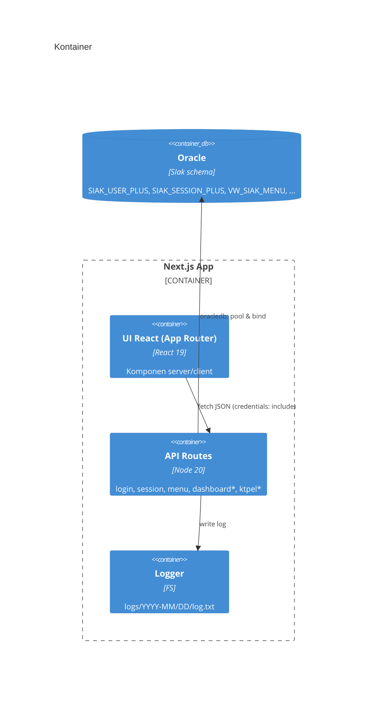
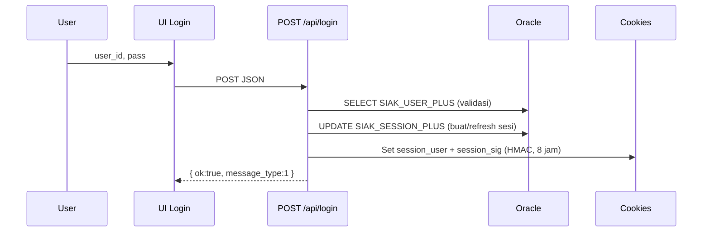

# Monalisa Monitoring — **Dokumentasi Master (Teknis, Migrasi, & Operasional)**
> “Web adalah kanvas pelayanan publik: **data → narasi → keputusan → dampak**.”

**Repo modern (Next.js):** <https://gitlab.com/dianyanzen/monitoring-next>  
**Repo legacy (Laravel):** <https://gitlab.com/dianyanzen/monitoring-laravel>

---

## 📚 Navigasi Cepat
- [Bagian I — Tesis Teknis & Desain Produk](#bagian-i--tesis-teknis--desain-produk)
- [Bagian II — Playbook Migrasi Per‑Modul](#bagian-ii--playbook-migrasi-permodul)
- [Bagian III — ERD & SQL Audit](#bagian-iii--erd--sql-audit)
- [Bagian IV — Design Tokens & Dua Tema (Kode Penuh)](#bagian-iv--design-tokens--dua-tema-kode-penuh)
- [Bagian V — Menu Master dari Excel (JSON & Integrasi)](#bagian-v--menu-master-dari-excel-json--integrasi)
- [Bagian VI — Draft Merge Request (Siap Tempel)](#bagian-vi--draft-merge-request-siap-tempel)
- [Lampiran — Runbook, Inventori Komponen, Template Issue/PR, Referensi](#lampiran)

---

## Bagian I — Tesis Teknis & Desain Produk

# Monalisa Monitoring (Next.js) — *Tesis Teknis, Desain, & Migrasi Produk*

> “Web adalah kanvas pelayanan publik: **data → narasi → keputusan → dampak**.”

**Repo modern (Next.js):** <https://gitlab.com/dianyanzen/monitoring-next>  
**Repo legacy (Laravel):** <https://gitlab.com/dianyanzen/monitoring-laravel>

---

## Ringkasan Eksekutif

Monalisa Monitoring memodernisasi antarmuka monitoring layanan kependudukan Disdukcapil Kota Bandung dari stack **Laravel 6 + Oracle** (legacy) menjadi **Next.js 15 (App Router) + TypeScript + Oracle** (modern). Sistem menyatukan **dashboard**, **modul master**, **monitoring KTP‑el**, **chat internal**, dan **utilitas operasional** dengan satu bahasa visual konsisten dan *auditability* yang kuat. Aplikasi berbicara ke **Oracle SIAK** melalui **API Routes** (Next.js) dengan **binding variabel** yang ketat dan **logging berjejak** per-hari.

**Hasil yang dituju:** waktu tanggap cepat, keputusan operasional yang tajam, pengurangan beban kognitif petugas, dan jejak keputusan siap diaudit.

---

## Daftar Isi

1. [Abstrak & Latar Belakang](#abstrak--latar-belakang)  
2. [Tujuan, Ruang Lingkup, & Prinsip](#tujuan-ruang-lingkup--prinsip)  
3. [Persona, Journey, & Kebutuhan Pengguna](#persona-journey--kebutuhan-pengguna)  
4. [Filosofi Desain & Narasi Visual](#filosofi-desain--narasi-visual)  
5. [Tema Visual: **Neon Cyberpunk** & **Elegant Lux**](#tema-visual-neon-cyberpunk--elegant-lux)  
6. [Arsitektur Sistem (C4 + Sekuens)](#arsitektur-sistem-c4--sekuens)  
7. [Struktur Proyek (Deep Dive)](#struktur-proyek-deep-dive)  
8. [Desain Sistem UI: Tokens, Theming, Tipografi, A11y](#desain-sistem-ui-tokens-theming-tipografi-a11y)  
9. [Kontrak API & Konvensi](#kontrak-api--konvensi)  
10. [Database & Pedoman SQL](#database--pedoman-sql)  
11. [Keamanan & Data Governance](#keamanan--data-governance)  
12. [Kinerja & Observabilitas](#kinerja--observabilitas)  
13. [Pengujian & Kualitas](#pengujian--kualitas)  
14. [CI/CD, Release, & Operasional](#cicd-release--operasional)  
15. [Perbandingan & Migrasi Legacy Laravel → Next](#perbandingan--migrasi-legacy-laravel--next)  
16. [Manajemen Risiko & DRP](#manajemen-risiko--drp)  
17. [Roadmap Produk & ADR](#roadmap-produk--adr)  
18. [Glosarium](#glosarium)  
19. [Lampiran A—Runbook Insiden](#lampiran-a—runbook-insiden)  
20. [Lampiran B—Inventori Komponen UI](#lampiran-b—inventori-komponen-ui)  
21. [Lampiran C—Template Issue & PR](#lampiran-c—template-issue--pr)  
22. [Lampiran D—Tokens & Komponen Contoh](#lampiran-d—tokens--komponen-contoh)  
23. [Referensi](#referensi)

---

## Abstrak & Latar Belakang

Fragmentasi modul dan variasi gaya antarmuka memecah konteks operasional. Angka‑angka statistik tanpa narasi tindakan menambah beban kognitif petugas, sementara perubahan cepat (mis. status KTP‑el) butuh antarmuka yang **mengantar aksi**. Sisi akuntabilitas publik menuntut **jejak keputusan** yang mudah ditelusuri.

**Hipotesis produk:** satu bahasa visual + arsitektur API terukur → beban kognitif turun → kualitas keputusan naik → pelayanan lebih cepat.

---

## Tujuan, Ruang Lingkup, & Prinsip

### Tujuan
- Menyatukan monitoring & utilitas operasional dalam UI konsisten.
- Mengubah data menjadi **tindakan** dan **jejak keputusan**.
- Menyediakan alat bantu operasi (push ulang, filter wilayah, export, chat) dekat dengan data.

### Ruang Lingkup
- **Front‑end**: Next.js 15 (App Router), React 19, Tailwind 3, Framer Motion, MUI, Chart.js, DataTables, Grid.js.
- **Back‑end**: Next.js **API Routes** → Oracle (multi‑alias pool); logging harian.
- **Modul**: Dashboard, Master, Check KTP‑el, Chat, Activity, Template.

### Prinsip
- **Clarity First**, **Honest Motion**, **Progressive Disclosure**.
- **Cognitive Economy**: pola berulang, konsisten.
- **Audit‑Ready by Design**.

**KPI**: TTI < 2.5s, median latensi API < 250 ms, penurunan bounce ≥ 30%, kenaikan aksi terarah ≥ 20%/triwulan, error 5xx < 0.5%/minggu.

---

## Persona, Journey, & Kebutuhan Pengguna

**Persona Utama**
- **Petugas Loket**: status cepat, tindakan langsung (push ulang, verifikasi).
- **Operator Wilayah**: filter kec/kels, ekspor data, tindak lanjut.
- **Supervisor**: tren, anomali, drill‑down ringan.
- **Administrator**: manajemen hak akses, audit log, kestabilan sistem.

**Journey Ringkas (Check KTP‑el)**
1. Pilih **wilayah** & **rentang waktu**.
2. Lihat **kartu metrik** (status, error, progress).
3. Jalankan **aksi** (push ulang / ekspor) di konteks yang sama.
4. **Catatan** otomatis (log) tercipta untuk audit.

**Non‑Fungsional**
- **Reliability** tinggi pada jam sibuk.
- **Observabilitas**: log, scope jelas, payload dipangkas.
- **A11y**: fokus jelas, `prefers-reduced-motion`, kontras AA.

---

## Filosofi Desain & Narasi Visual

- **Angka besar untuk status utama**, teks pendukung hemat.
- **Motion jujur**: sebagai penanda transisi, bukan dekorasi kosong.
- **Empty state** memandu langkah selanjutnya.
- Visual mengantar **aksi**, bukan sekadar “pamer data”.

---

## Tema Visual: **Neon Cyberpunk** & **Elegant Lux**

> Dua rasa visual untuk dua konteks kerja: operasi intens (gelap) vs narasi/presentasi (terang).

### 1) Neon Cyberpunk (default, operasional)
- **Rasa**: ruang kendali, aksen neon untuk *state/accent*, bukan backdrop luas.
- **Rasio** neon:netral ≈ **1:4**.

```css
/* FILE: src/styles/theme-dark.css (cuplikan) */
html:not([data-theme="light"]) {
  --surface-0:#0a0a0c; --surface-1:#0e0e14; --surface-2:#111118;
  --ink:#e5e7eb; --ink-muted:#a6adbb;
  --accent:#00e6c3; --accent-2:#36bffa;
  --success:#1ad19a; --warning:#f5c26b; --error:#ff5d73;
  --border-subtle:rgba(255,255,255,.08);
  --border-strong:rgba(255,255,255,.16);
  --focus-ring:0 0 0 3px rgba(0,230,195,.45);
}
```

### 2) Elegant Lux (narasi/presentasi)
- **Rasa**: kertas marmer hangat, tinta pekat, aksen emas elegan.
- **Gunakan emas** untuk detail prestige (garis kecil/underline), bukan *fill* besar.

```css
/* FILE: src/styles/theme-light.css (konsep) */
html[data-theme="light"] {
  --pal-silk:#EEE5D9; --pal-marble:#EBEAE0;
  --lux-ink:#1A1D21; --lux-border:rgba(26,29,33,.12);
  --gold-1:#D4AF37; --gold-2:#F6D365; --gold-3:#FFE8A3;
  --lux-gold-grad:linear-gradient(90deg,var(--gold-1),var(--gold-2) 60%,var(--gold-3));
}
```

**Kontras target**: WCAG **AA** untuk teks ≥14px reguler/12px bold.  
**Tip**: gunakan aksen untuk *state* (aktif/terpilih, fokus, sukses), bukan area besar.

---

## Arsitektur Sistem (C4 & Sekuens)

### Stack Inti
- **Front‑end**: Next.js 15, React 19, Tailwind 3, Framer Motion, MUI, Chart.js, DataTables, Grid.js.
- **API**: Next.js **API Routes** → **node‑oracledb** (pool multi‑alias).  
- **Auth**: Cookie **HMAC‑SHA256** (`session_user` + `session_sig`) + middleware halaman & API.  
- **Logging**: `logs/YYYY‑MM/DD/log.txt` (otomatis dibuat), payload dipangkas.

### Diagram Konteks (C4)

```mermaid
C4Context
title Konteks Sistem

Person(user, "Petugas/Administrator")
System_Boundary(web, "Monalisa (Next.js)") {
  System_UI(ui, "UI + API Routes", "Next.js", "Dashboard, Master, Check KTP‑el, Chat, Activity")
}
SystemDb(oracle, "Oracle SIAK", "oracledb")

Rel(user, ui, "Operasi harian")
Rel(ui, oracle, "SQL bind, pool multi‑alias")
```

### Diagram Kontainer



### Diagram Sekuens (Login → Session)



---

## Struktur Proyek (Deep Dive)

```
├── .env.local
├── package.json
├── tsconfig.json
├── postcss.config.mjs
├── tailwind.config.js
├── public/
└── src/
    ├── app/
    │   ├── api/ (login, session, menu, dashboard, check/ktpel, master, chat, messages, activity, account, user)
    │   ├── dashboard/
    │   ├── login/
    │   ├── chat/
    │   ├── check/ktpel/
    │   ├── master/
    │   ├── globals.css
    │   └── layout.tsx
    ├── components/
    │   ├── layout/ (ResponsiveAppShell, Sidebar, Topbar, Footer)
    │   ├── dashboard/ (cards, charts)
    │   ├── datatable/ (DataTables/Grid.js wrappers)
    │   ├── system/ (overlay/dialog/alert)
    │   └── ui/ (DateRangePopup, dsb)
    ├── contexts/session.tsx
    ├── hooks/
    ├── lib/ (session.ts, log.ts, oracle.ts, db.ts, http.ts, auth.ts, user.ts)
    ├── middleware.ts
    └── middleware.api.ts
```

**Aturan penting**
- Hindari mengubah `lib/oracle.ts`, `lib/db.ts`, `lib/http.ts` tanpa alasan jelas.
- Seluruh snippet dokumentasi menyebutkan **lokasi file** yang dituju.

---

## Desain Sistem UI: Tokens, Theming, Tipografi, A11y

- **Tokens** (`src/styles/tokens.css`): variabel semantik (surface, ink, accent, border, shadow, radius, motion, focus).  
- **Tema**: `theme-dark.css` (Neon Cyberpunk, default) & `theme-light.css` (Elegant Lux). Gunakan `data-theme="light"` untuk switch.  
- **Tipografi**: Inter; skala responsif; panjang baris ideal 65–80 karakter.  
- **A11y**: fokus ring jelas, target kontras AA, hormati `prefers-reduced-motion`.

**Urutan impor (layout):**
```ts
// FILE: src/app/layout.tsx (cuplikan)
import "./globals.css"
import "../styles/tokens.css"
import "../styles/theme-dark.css"
import "../styles/theme-light.css"
```
> File batch styling modular dapat diimpor setelah dua tema.

---

## Kontrak API & Konvensi

### Konvensi URL & Verba
- Resource nouns, `GET/POST` dominan (App Router best‑practice).
- Query menggunakan **bind** di server (Oracle), **tanpa** interpolasi string mentah.

### Skema Respons
```json
{ "success": true, "message": "OK", "data": { "rows": [] } }
```

### Status & Error
- HTTP 200 dengan `success:false` untuk kasus yang bisa dipahami klien.  
- 401/403 untuk akses, 500 untuk error tak terduga.  
- Semua error **ditulis** ke log dengan scope relevan.

### Contoh
```bash
# Login
curl -i -X POST http://localhost:3000/api/login \
  -H "Content-Type: application/json" \
  -d '{"user_id":"demo","pass":"demo"}'

# Session
curl -i http://localhost:3000/api/session --cookie-jar cookies.txt

# Menu
curl -i http://localhost:3000/api/menu --cookie cookies.txt
```

---

## Database & Pedoman SQL

**Alias**: `DB`, `DB222`, `DB221`, `WEBDB`, `EPUNTEN`, `WEBPUNTEN`, … (konfigurasi dari `.env`).  
**Konvensi**:
1. Penamaan tabel & kolom: `UPPER_SNAKE_CASE`.  
2. Binding: **wajib** `:b_*` (tanpa interpolasi string).  
3. Waktu: `SYSDATE/SYSTIMESTAMP` untuk DML.  
4. Hasil SELECT: `OUT_FORMAT_OBJECT`.  
5. DML: auto‑commit per‑statement; transaksi eksplisit bila perlu.  
6. Session tracking: `SIAK_SESSION_PLUS` (USER_ID, SESSION_ID, IP, UA, LAST_ACTIVITY, IS_ACTIVE).  
7. Expiry: sumber `SIAK_MASTER` (INIT_SETING/EXP).  
8. Password legacy: MD5 (rekomendasi migrasi ke Argon2/BCrypt).  
9. Cookie `session_user` hanya simpan `SESSION_ID`; profil diambil server‑side.  
10. Opsional: verifikasi IP, rate limit login, audit gagal.

> **Kredensial produksi** tidak disimpan di repo; gunakan `.env.production`.

---

## Keamanan & Data Governance

- **Auth & Session**: HMAC‑SHA256; httpOnly; `Secure` di produksi; `SameSite=Lax`.  
- **Middleware**: proteksi halaman (kecuali `/login`) dan proteksi `/api/*`.  
- **PII**: Mask NIK pada tampilan publik/semi; ekspor berizin; log menyingkat payload sensitif.  
- **Audit**: setiap query penting dicatat (waktu, durasi, alias, bind disamarkan).  
- **Headers** (via reverse proxy): HSTS, minimal CSP, X‑Frame‑Options SAMEORIGIN.

---

## Kinerja & Observabilitas

- **Budget**: TTI < 2.5s; median API < 250 ms; error 5xx < 0.5%.  
- **Strategi**: lazy load, cache, virtualized tables, hindari N+1, `unstable_cache` untuk data statis berbasis level; streaming untuk data panjang.  
- **Log**: struktur harian `logs/YYYY‑MM/DD/log.txt`; fallback ke `stderr` bila gagal menulis.  
- **Health**: `/api/session/ping` (liveness + sliding session).

---

## Pengujian & Kualitas

- **Static checks**: ESLint, TypeScript build.  
- **Unit**: utilitas (log, session).  
- **Integration**: API Routes (login, menu, session).  
- **E2E**: alur login → dashboard → aksi sederhana.  
- **Load test**: endpoint kritikal (menu, ktp‑el).  
- **A11y test**: fokus, kontras, `prefers-reduced-motion`.

**Test Data**: gunakan dataset dummy; jangan taruh PII riil dalam fixture.

---

## CI/CD, Release, & Operasional

### Contoh `.gitlab-ci.yml`
```yaml
image: node:20

cache:
  key: ${CI_COMMIT_REF_SLUG}
  paths: [node_modules/]

stages: [install, lint, build]

install:
  stage: install
  script: ["npm ci"]
  artifacts: { paths: ["node_modules/"], expire_in: 1 day }

lint:
  stage: lint
  script:
    - npx prettier -c .
    - npm run -s typecheck || true

build:
  stage: build
  script: ["npm run build"]
  artifacts: { paths: [".next"], expire_in: 7 days }
```

### Operasional
- Reverse proxy HTTPS (header `X‑Forwarded‑Proto`).  
- Log rotation & permission `LOG_DIR`.  
- Monitoring: error rate, latensi median, waktu build.

---

## Perbandingan & Migrasi Legacy Laravel → Next

### Snapshot Legacy (Laravel 6)
- **Framework**: Laravel ^6.2 (PHP ^7.2).
- **Driver Oracle**: `yajra/laravel-oci8`.
- **Autentikasi**: Laravel session + **Passport (OAuth2)** untuk API Android ePunten.
- **Front‑end**: Blade + Semantic UI + jQuery; sebagian Vue (router/axios/sweetalert).
- **Integrasi**: Pusher, Browsershot/DOMPDF, Excel, Redis (opsional), **ZKTeco** (absensi) via service Windows, executable khusus.

### Penyelarasan Arsitektur Modern
- **Controller → API Route**: mapping fungsi ke `src/app/api/*` (Next).
- **Passport → Cookie HMAC**: untuk UI internal; **OAuth2** tetap dapat dipertahankan hanya bila ada konsumen eksternal.
- **Blade/jQuery → React**: komponen modular, state jelas, *progressive disclosure*.
- **Queue/Service**: proses latar (jika perlu) dipindah ke job scheduler terpisah atau worker Node/Windows service via bridge API.

### Strategi Migrasi
1. **Inventaris Modul** (legacy → target halaman Next).  
2. **Schema & Query Review** (SQL audit; indeks; transaksi).  
3. **API Kontrak** (JSON, status, paging).  
4. **Auth Transisi** (sesi HMAC; peran/level).  
5. **UI/UX Paritas** + perbaikan aksesibilitas.  
6. **Data Validation & Masking** (PII).  
7. **Release bertahap**: modul non‑kritis dahulu, pantau log/telemetri.  
8. **Sunset** modul lama setelah masa paralel stabil.

**Catatan integrasi unik**: fitur absensi ZKTeco & executable Windows tetap jalan via service yang mengirim data ke API baru (bridge), atau tetap dikelola di environment legacy sampai modul Next menyediakannya.

---

## Manajemen Risiko & DRP

- **Koneksi DB gagal** (`DPI‑1047`, `NJS‑045`): pastikan Oracle Instant Client & PATH/LD_LIBRARY_PATH; lakukan `npm rebuild oracledb --force` bila perlu.  
- **Cookie tak terset**: pastikan HTTPS & header `X‑Forwarded‑Proto`.  
- **Menu kosong/cache basi**: revalidate endpoint menu (opsi `action=revalidate`) bila diaktifkan.  
- **Performa jam sibuk**: audit log DB (durasi), indeks, *virtualized* tabel besar.

**DRP**: backup log harian; backup konfigurasi; RPO ≤ 24 jam (artefak non‑PII); RTO < 2 jam (web).

---

## Roadmap Produk & ADR

### Roadmap
- **Short**: pusat notifikasi terpadu; theme editor; fokus/kontras A11y.  
- **Mid**: SSE/polling ringan; audit viewer; ekspor terjadwal.  
- **Long**: pengingat tugas dari indikator; gudang time‑series untuk tren jangka panjang.

### ADR
- **ADR‑001**: App Router > Pages Router (server components & streaming).  
- **ADR‑002**: node‑oracledb native > REST middleware (latensi & kontrol bind).  
- **ADR‑003**: Cookie HMAC > JWT (sederhana, aman, cocok multi‑instance).  
- **ADR‑004**: Tailwind + tokens CSS > CSS‑in‑JS (ringan, mudah override).  
- **ADR‑005**: Dua tema (Neon Cyberpunk + Elegant Lux) untuk dua konteks kerja.

---

## Glosarium

- **A11y**: Accessibility.  
- **App Router**: arsitektur routing Next.js 13+ (server components).  
- **Bind**: parameter terikat di driver DB (bukan string literal).  
- **HMAC**: Hash‑based Message Authentication Code.  
- **PII**: Personal Identifiable Information.

---

## Lampiran A—Runbook Insiden

1) **Tidak bisa login**  
   - Cek `SESSION_SECRET`, cookie httpOnly, header HTTPS (`X‑Forwarded‑Proto`), expiry.  
   - Lihat log scope `SESSION` & `API`.

2) **DPI‑1047 / NJS‑045**  
   - Pastikan Oracle Instant Client & PATH/LD_LIBRARY_PATH.  
   - `npm rebuild oracledb --force`.

3) **Menu kosong / cache basi**  
   - Revalidate cache menu pasca perubahan level/role.  
   - Cek `VW_SIAK_MENU` di DB.

4) **Lambat saat jam sibuk**  
   - Audit log `DB` (durasi tinggi), periksa indeks, *virtualize* tabel besar.

---

## Lampiran B—Inventori Komponen UI

- **Layout**: ResponsiveAppShell, Sidebar, Topbar, Footer, RouteChangeOverlay.  
- **Dashboard**: StatCard, TrendChart, CategoryBreakdown.  
- **UI**: DateRangePopup, NiceAlert, Modal, Tooltip.  
- **Data**: DataTable wrapper (DataTables/Grid.js).  
- **Chat**: ContactList, ThreadView, MessageComposer.  
- **Check KTP‑el**: FilterPanel, ResultTable, BulkActions.

---

## Lampiran C—Template Issue & PR

**Issue (Bug)**  
- Ringkasan • Langkah Repro • Ekspektasi vs Realita • Log/Console • Lingkungan (dev/staging/prod)

**Issue (Feature)**  
- Tujuan bisnis • Kriteria penerimaan • Dampak UI/DB • Risiko & mitigasi

**PR**  
- Judul `feat(scope): ringkas` • Deskripsi • Dampak • *Breaking?* • Checklist lint/type/log/docs

---

## Lampiran D—Tokens & Komponen Contoh

### D.1. Urutan Import (Layout)

```tsx
// FILE: src/app/layout.tsx (cuplikan impor CSS)
import "./globals.css"                 // Tailwind entry
import "../styles/tokens.css"          // 1) Tokens
import "../styles/theme-dark.css"      // 2) Neon Cyberpunk
import "../styles/theme-light.css"     // 3) Elegant Lux
```

### D.2. Komponen “Prestige Card” (contoh)

```tsx
// FILE: src/components/ui/PrestigeCard.tsx
"use client";

import { ReactNode } from "react";

type Props = { title: string; subtitle?: string; actions?: ReactNode; children?: ReactNode; };

export default function PrestigeCard({ title, subtitle, actions, children }: Props) {
  return (
    <section className="rounded-2xl border p-5 md:p-6 relative overflow-hidden" role="region" aria-label={title}
      style={{ borderColor: "var(--border-subtle)", color: "var(--ink)" }}>
      <div className="flex items-start justify-between gap-4">
        <div>
          <h3 className="text-xl md:text-2xl font-semibold">{title}</h3>
          {subtitle ? <p className="text-sm mt-1" style={{ color: "var(--ink-muted)" }}>{subtitle}</p> : null}
        </div>
        {actions ? <div className="shrink-0">{actions}</div> : null}
      </div>
      <span className="block mt-3" style={{ background: "var(--lux-gold-grad)", height: 2, opacity: .9 }} />
      <div className="mt-4 text-sm md:text-base">{children}</div>
    </section>
  );
}
```

---

## Referensi

- **Repo (Next):** <https://gitlab.com/dianyanzen/monitoring-next>  
- **Repo (Laravel):** <https://gitlab.com/dianyanzen/monitoring-laravel>  
- Next.js — <https://nextjs.org/docs> • node‑oracledb — <https://oracle.github.io/node-oracledb/doc/api.html>  
- Tailwind — <https://tailwindcss.com/docs> • Chart.js — <https://www.chartjs.org/docs/latest/> • DataTables — <https://datatables.net/manual/>

---

> **Catatan**: Repositori memuat *credentials* dummy pada `.env.local` (pengembangan). Ganti seluruh rahasia untuk lingkungan lain dan **jangan** commit `.env` produksi.


---

## Bagian II — Playbook Migrasi Per‑Modul

# Monalisa — Playbook Migrasi Per‑Modul
> Mapping **Laravel (legacy)** → **Next.js (modern)**, termasuk kontrak API (request/response), akses DB, logging, dan catatan keamanan.

**Repos:**
- Modern (Next.js): https://gitlab.com/dianyanzen/monitoring-next
- Legacy (Laravel): https://gitlab.com/dianyanzen/monitoring-laravel

---

## Konvensi Umum (Next.js)

- **Auth**: Cookie `session_user` (payload terenkripsi/encoded) + `session_sig` (HMAC‑SHA256). httpOnly, `SameSite=Lax`, `Secure` di produksi.  
- **Env**: alias DB via `DB_*`, `DB222_*`, `DB221_*`, … (`*_CONN` atau `*_HOST/_PORT/_SERVICE_NAME`).  
- **Logging**: `logs/YYYY-MM/DD/log.txt` (auto mkdir). Scope contoh: `API`, `DB`, `SESSION`, `MIDDLEWARE`.  
- **Response envelope**:
  ```json
  { "success": true, "message": "OK", "data": {} }
  ```
- **Pagination**: `?page=1&per_page=25` atau `?limit=25&offset=0` (pilih salah satu, konsisten).
- **Tanggal**: ISO 8601 (UTC) di API; di UI gunakan zona `APP_TIMEZONE` untuk presentasi.
- **Error**: 200 dengan `success:false` untuk validasi/operasional; 401/403 untuk akses; 500 untuk kegagalan tak terduga.

---

## Matriks Mapping Modul (Ringkas)

| Modul               | Laravel (contoh)                     | Next.js (baru)                  | Method | Autentikasi | Catatan Penting |
|---------------------|--------------------------------------|---------------------------------|--------|-------------|-----------------|
| Login/Session       | `AuthController@login`, `ping`       | `/api/login`, `/api/session*`   | POST/GET | Wajib     | HMAC cookie; sliding session |
| Menu                | `MenuController@index`               | `/api/menu`                     | GET    | Wajib       | Cache per level 300s, `buildTree()` |
| Dashboard           | `DashboardController@*`              | `/api/dashboard/*`              | GET    | Wajib       | Metrik KTP‑el/DKB/Geulis |
| Check KTP‑el        | `KtpController@*`                    | `/api/check/ktpel/*`            | GET/POST | Wajib     | Filter wilayah/tanggal; push massal |
| Master: list        | `Master\ListController@*`            | `/api/master/list`              | GET    | Wajib       | Tabel besar → virtualized table |
| Master: request     | `Master\RequestController@*`         | `/api/master/request`           | GET    | Wajib       | Ekspor CSV/Excel |
| Master: contact     | `Master\ContactController@*`         | `/api/master/contact`           | GET    | Wajib       | Pencarian |
| Master: absensi     | `Master\AbsensiController@*`         | `/api/master/absensi`           | GET    | Wajib       | Integrasi ZKTeco via bridge |
| Master: salaman     | `Master\SalamController@*`           | `/api/master/salaman`           | GET    | Wajib       | Ringkas |
| Chat & Messages     | `ChatController@*`, `Message@*`      | `/api/chat/*`, `/api/messages/*`| GET/POST | Wajib     | Optimistic send |
| Activity            | `ActivityController@save`            | `/api/activity/do_save`         | POST   | Wajib       | Audit trail |
| Account             | `AccountController@password`         | `/api/account/password`         | POST   | Wajib       | Rekomendasi hash upgrade |
| User Profile        | `UserController@show`                | `/api/user`                     | GET    | Wajib       | Minimal PII |

> Nama controller legacy bersifat indikatif; sesuaikan dengan struktur aktual repo Laravel.

---

## Detail Modul

### 1) Login & Session

**Laravel → Next.js**
- **Legacy**: `POST /login` (Laravel session + Passport opsional).  
- **Next**: `POST /api/login` → set cookie `session_user` + `session_sig` (HMAC), `GET /api/session`, `GET /api/session/ping`.

**Request**
```json
{ "user_id": "string", "pass": "string" }
```

**Response**
```json
{ "success": true, "message_type": 1, "message": "OK" }
```

**DB**
- `SIAK_USER_PLUS`: kredensial & level/peran.
- `SIAK_SESSION_PLUS`: (SESSION_ID, USER_ID, IP, USER_AGENT, LAST_ACTIVITY, IS_ACTIVE).
- `SIAK_MASTER` (INIT_SETING/EXP): masa berlaku.

**Catatan**
- Verifikasi pass: legacy MD5 → rencana migrasi Argon2/BCrypt.  
- **maybeRefreshSession()** memperpanjang usia cookie saat aktivitas.  
- Rate‑limit login berbasis IP opsional.  
- Logging scope `SESSION`, `API`.

---

### 2) Menu

**Next**: `GET /api/menu`

**Output (contoh)**
```json
{
  "success": true,
  "data": {
    "items": [
      { "id": 1, "label": "Dashboard", "href": "/dashboard", "icon": "home", "children": [] }
    ]
  }
}
```

**DB**
- `VW_SIAK_MENU` (berdasar level/peran).

**Catatan**
- Cache per user level (300s).  
- `buildTree()` dari list flat (id, parent_id, sort).  
- Opsi `POST /api/menu?action=revalidate` untuk invalidasi.

---

### 3) Dashboard

**Next**: `/api/dashboard/*` (misal: `capaian`, `population`, `userktp/summary`, `geulis`, `dkb`)

**Query umum**
- Filter tanggal (`start_date`, `end_date`), wilayah (`kab`, `kec`, `kel`), dan kategori status.

**Response (contoh)**
```json
{ "success": true, "data": { "cards": [{ "label":"Siap Cetak", "value":1284 }] } }
```

**DB**
- Tabel metrik KTP‑el/DKB/Geulis sesuai skema SIAK (sesuaikan nama aktual).
- **Index**: `(WILAYAH_ID, TANGGAL)`, `(STATUS, TANGGAL)` untuk agregasi cepat.

**Catatan**
- Gunakan `unstable_cache` untuk ringkasan statis per role.  
- Hindari N+1: lakukan agregasi di SQL.  
- Logging `DB` menulis durasi & bind vars.

---

### 4) Check KTP‑el

**Endpoints**
- `GET /api/check/ktpel` — daftar status (paging, filter wilayah/tanggal/status).
- `GET /api/check/ktpel/kabupaten` — metadata wilayah.  
- `POST /api/check/ktpel/push` — aksi **push ulang** massal.

**Request filter (contoh)**
```json
{
  "start_date":"2024-01-01","end_date":"2024-01-31",
  "kab":"3273","kec":"01","kel":"001","status":["ERROR","TUNDA"],
  "page":1,"per_page":50
}
```

**Response list (contoh)**
```json
{
  "success": true,
  "data": { "rows":[{"nik":"****1234","nama":"...","status":"TUNDA","updated_at":"2024-01-09T02:00:00Z"}],
           "page":1,"per_page":50,"total":1024 }
}
```

**Catatan keamanan & audit**
- **Masking NIK** kecuali role tertentu.  
- Semua `push` dicatat (SIAPA/KAPAN/BERAPA) di log + tabel audit.  
- Rate‑limit aksi massal, pertimbangkan antrean jika beban tinggi.

---

### 5) Master Modules

**List / Request / Contact / Absensi / Salaman** → pola serupa.

**Endpoint contoh**
- `GET /api/master/list?search=...&page=1&per_page=30`
- `GET /api/master/absensi?bulan=2024-01&nip=...`

**Response (contoh)**
```json
{ "success": true, "data": { "rows": [], "page":1, "per_page":30, "total": 0 } }
```

**Catatan**
- Tabel besar: pakai **virtualized table** di UI.  
- Ekspor CSV/Excel perlu **filter identik** dengan tampilan agar audit konsisten.

**Absensi (ZKTeco)**
- Di legacy, ada service Windows + executable; migrasi bertahap via **bridge API** yang menyinkronkan ke tabel `ABSENSI_*`.  
- Pastikan kolom waktu memakai `TIMESTAMP WITH TIME ZONE` atau simpan `UTC + offset`.

---

### 6) Chat & Messages

**Endpoints**
- `GET /api/chat/contacts`
- `GET /api/messages/previews`
- `POST /api/chat/send`

**Payload kirim (contoh)**
```json
{ "to":"USER123", "text":"Halo", "client_id":"uuid-v4" }
```
> `client_id` untuk **optimistic UI** & idempoten; server mengembalikan mapping `client_id → message_id`.

**Schema minimal**
- `MESSAGES`(MESSAGE_ID, SENDER_ID, RECEIVER_ID, TEXT, CREATED_AT, READ_AT)  
- Index: `(RECEIVER_ID, CREATED_AT)`, `(SENDER_ID, CREATED_AT)`.

---

### 7) Activity

**Endpoint**
- `POST /api/activity/do_save`

**Tujuan**
- Menyimpan log aktivitas UI non‑DB (mis. klik penting) sebagai *client breadcrumb*.

**Schema minimal**
- `ACTIVITY_LOG`(ID, USER_ID, ACTION, META_JSON, CREATED_AT).

---

### 8) Account

**Endpoint**
- `POST /api/account/password`

**Catatan**
- Validasi password lama.  
- Rekomendasi **upgrade hash** ke Argon2/BCrypt saat kesempatan (double‑write strategi).

---

### 9) User

**Endpoint**
- `GET /api/user` → profil ringkas dari sesi saat ini.

**Catatan**
- Minimal PII; hindari NIK penuh tanpa kebutuhan eksplisit.

---

## Integrasi & Bridge (Legacy → Modern)

- **OAuth2 (Passport)**: hanya dipakai jika masih ada konsumen eksternal (Android ePunten). Untuk UI internal, **HMAC cookie** lebih sederhana dan aman.  
- **ZKTeco**: tetap dikelola service Windows + executable; bridge kirim ke API Next → tabel ABSENSI.  
- **Ekspor (Excel/PDF)**: DOMPDF/Browsershot diganti oleh ekspor CSV/Excel via Node, atau layanan rendering terpisah jika perlu PDF formal.

---

## Checklist Migrasi Per‑Modul

1) Inventaris field/kolom & query.  
2) Tentukan endpoint `GET/POST` & filter yang didukung.  
3) Implement API Route + binding variables + logging.  
4) Map UI lama → komponen React (server/client).  
5) Uji beban (sampling) + audit log.  
6) Rilis bertahap + fallback.

---

## Bagian III — ERD & SQL Audit

# Monalisa — ERD & SQL Audit (Ringkas)

> Skema entitas inti dan rekomendasi indeks untuk query yang paling sering dipakai.
> **Catatan**: nama tabel mengikuti konvensi dokumen; sesuaikan dengan skema SIAK aktual.

---

## ER Diagram (Mermaid)

```mermaid
erDiagram

  SIAK_USER_PLUS ||--o{ SIAK_SESSION_PLUS : "has many"
  SIAK_USER_PLUS {
    varchar USER_ID PK
    varchar NAMA
    int     USER_LEVEL
    varchar KANTOR
    varchar PASSWORD_MD5
    timestamp CREATED_AT
  }

  SIAK_SESSION_PLUS {
    varchar SESSION_ID PK
    varchar USER_ID FK
    varchar IP_ADDRESS
    varchar USER_AGENT
    timestamp LAST_ACTIVITY
    boolean IS_ACTIVE
    timestamp CREATED_AT
  }

  VW_SIAK_MENU {
    number  MENU_ID
    number  PARENT_ID
    varchar LABEL
    varchar HREF
    number  ORDERING
    number  MIN_LEVEL
  }

  -- Wilayah referensi
  REF_KABUPATEN ||--o{ REF_KECAMATAN : contains
  REF_KECAMATAN ||--o{ REF_KELURAHAN : contains

  REF_KABUPATEN { varchar KAB_ID PK, varchar NAMA }
  REF_KECAMATAN  { varchar KEC_ID PK, varchar KAB_ID FK, varchar NAMA }
  REF_KELURAHAN  { varchar KEL_ID PK, varchar KEC_ID FK, varchar NAMA }

  -- KTP-el (contoh)
  KTP_EL_STATUS_LOG {
    varchar ID PK
    varchar NIK
    varchar STATUS -- READY, TUNDA, ERROR, CETAK, etc
    varchar KAB_ID FK
    varchar KEC_ID FK
    varchar KEL_ID FK
    date    TANGGAL
    timestamp UPDATED_AT
  }

  -- Master modul (contoh)
  MASTER_LIST   { number ID PK, varchar TITLE, varchar OWNER, timestamp CREATED_AT }
  MASTER_REQUEST{ number ID PK, varchar TITLE, varchar STATUS, timestamp CREATED_AT }
  MASTER_CONTACT{ number ID PK, varchar NAMA, varchar TELEPON }
  ABSENSI_LOG   { number ID PK, varchar NIP, timestamp CHECK_IN, timestamp CHECK_OUT }
  SALAMAN_LOG   { number ID PK, varchar USER_ID, varchar TEXT, timestamp CREATED_AT }

  -- Chat
  CHAT_CONTACTS { varchar USER_ID PK, varchar DISPLAY_NAME, varchar AVATAR_URL }
  MESSAGES {
    varchar MESSAGE_ID PK
    varchar SENDER_ID
    varchar RECEIVER_ID
    clob   TEXT
    timestamp CREATED_AT
    timestamp READ_AT
  }

  -- Activity
  ACTIVITY_LOG {
    number ID PK
    varchar USER_ID
    varchar ACTION
    clob   META_JSON
    timestamp CREATED_AT
  }
```

---

## Indeks yang Direkomendasikan

- **SIAK_SESSION_PLUS**:  
  - PK `(SESSION_ID)`  
  - IDX `(USER_ID)`  
  - IDX `(LAST_ACTIVITY)` — untuk cleanup & ping
- **VW_SIAK_MENU** (atau tabel dasar view):  
  - IDX `(MIN_LEVEL)`  
  - IDX `(PARENT_ID, ORDERING)`
- **KTP_EL_STATUS_LOG**:  
  - IDX `(KAB_ID, KEC_ID, KEL_ID, TANGGAL)`  
  - IDX `(STATUS, TANGGAL)`
- **MESSAGES**:  
  - IDX `(RECEIVER_ID, CREATED_AT)`  
  - IDX `(SENDER_ID, CREATED_AT)`
- **ABSENSI_LOG**:  
  - IDX `(NIP, CHECK_IN)`

---

## Pola SQL (Bind Variables)

### Session keepalive
```sql
UPDATE SIAK_SESSION_PLUS
   SET LAST_ACTIVITY = SYSTIMESTAMP
 WHERE SESSION_ID = :b_session_id
   AND IS_ACTIVE = 1
```

### Menu by level
```sql
SELECT MENU_ID, PARENT_ID, LABEL, HREF, ORDERING
  FROM VW_SIAK_MENU
 WHERE MIN_LEVEL <= :b_user_level
 ORDER BY NVL(PARENT_ID, 0), ORDERING
```

### KTP-el ringkas (rekap per-status)
```sql
SELECT STATUS, COUNT(*) AS jumlah
  FROM KTP_EL_STATUS_LOG
 WHERE TANGGAL BETWEEN :b_start AND :b_end
   AND ( :b_kab IS NULL OR KAB_ID = :b_kab )
   AND ( :b_kec IS NULL OR KEC_ID = :b_kec )
   AND ( :b_kel IS NULL OR KEL_ID = :b_kel )
 GROUP BY STATUS
```

### Chat—ambil pesan terbaru per-kontak (previews)
```sql
SELECT m.*
  FROM MESSAGES m
  JOIN (
        SELECT CASE WHEN SENDER_ID = :b_me THEN RECEIVER_ID ELSE SENDER_ID END AS peer,
               MAX(CREATED_AT) AS last_at
          FROM MESSAGES
         WHERE SENDER_ID = :b_me OR RECEIVER_ID = :b_me
         GROUP BY CASE WHEN SENDER_ID = :b_me THEN RECEIVER_ID ELSE SENDER_ID END
       ) t
    ON ( (m.SENDER_ID = :b_me AND m.RECEIVER_ID = t.peer) OR
         (m.RECEIVER_ID = :b_me AND m.SENDER_ID = t.peer) )
   AND m.CREATED_AT = t.last_at
```

---

## Audit & Masking

- **NIK** dimasking `******####` pada UI umum; expose penuh hanya pada peran tertentu dan pada endpoint yang diizinkan.  
- **Log** menyingkat payload panjang dan tidak menyimpan PII sensitif secara utuh.  
- **Export**: wajib jejak (siapa, kapan, filter apa).

---

## Bagian IV — Design Tokens & Dua Tema (Kode Penuh)

### 1) `src/styles/tokens.css`
```css
/* FILE: src/styles/tokens.css
   ------------------------------------------------------------------
   Global Design Tokens (semantic variables + scale)
   - Nilai default aman (mendekati dark) → dioverride oleh theme.
   - Hindari @apply: cukup variable-level & beberapa helper class generik.
   ------------------------------------------------------------------ */

:root {
  /* ---------- Semantic Surfaces & Ink ---------- */
  --surface-0: #0a0a0c;    /* canvas */
  --surface-1: #0e0e14;    /* panel */
  --surface-2: #111118;    /* raised */
  --ink: #e5e7eb;          /* teks utama */
  --ink-muted: #a6adbb;    /* teks sekunder */

  /* ---------- Accents & States ---------- */
  --accent: #00e6c3;       /* primary accent (dark: neon-1 / light: gold line) */
  --accent-2: #36bffa;     /* secondary accent */
  --success: #22c55e;
  --warning: #f5c26b;
  --error:   #ff5d73;

  /* ---------- Borders & Shadows ---------- */
  --border-subtle: rgba(255,255,255,.08);
  --border-strong: rgba(255,255,255,.16);
  --shadow-sm: 0 1px 2px rgba(0,0,0,.25);
  --shadow-md: 0 6px 18px rgba(0,0,0,.28);
  --shadow-lg: 0 18px 45px rgba(0,0,0,.35);

  /* ---------- Radii ---------- */
  --radius-sm: .375rem;
  --radius-md: .5rem;
  --radius-lg: .75rem;
  --radius-xl: 1rem;
  --radius-2xl: 1.25rem;

  /* ---------- Motions ---------- */
  --easing-std: cubic-bezier(.2,.6,.2,1);
  --duration-fast: 150ms;
  --duration-std: 240ms;
  --duration-slow: 360ms;

  /* ---------- Focus ---------- */
  --focus-ring: 0 0 0 3px rgba(54,191,250,.45); /* dioverride per tema */

  /* ---------- Prestige (overridden in Light) ---------- */
  --gold-1: #d4af37;
  --gold-2: #f6d365;
  --gold-3: #ffe8a3;
  --lux-gold-grad: linear-gradient(90deg, var(--gold-1), var(--gold-2) 60%, var(--gold-3));

  /* Scrollbar (fallback) */
  --scrollbar-track: rgba(255,255,255,.06);
  --scrollbar-thumb: rgba(255,255,255,.16);
}

/* ---------- Helpers ---------- */
.token-card {
  background: var(--surface-1);
  color: var(--ink);
  border: 1px solid var(--border-subtle);
  border-radius: var(--radius-2xl);
  box-shadow: var(--shadow-sm);
}

.token-underline-prestige {
  display: block;
  height: 2px;
  background: var(--lux-gold-grad);
  opacity: .9;
}

/* Scrollbar */
*::-webkit-scrollbar { width: 8px; height: 8px; }
*::-webkit-scrollbar-track { background: var(--scrollbar-track); }
*::-webkit-scrollbar-thumb { background: var(--scrollbar-thumb); border-radius: 10px; }

```

### 2) `src/styles/theme-dark.css` — *Neon Cyberpunk*
```css
/* FILE: src/styles/theme-dark.css
   ------------------------------------------------------------------
   DARK NEON THEME
   - Fokus di ruang kerja redup, neon sebagai accent/state.
   ------------------------------------------------------------------ */

html:not([data-theme="light"]) {
  /* Surfaces & Ink */
  --surface-0: #0a0a0c;
  --surface-1: #0e0e14;
  --surface-2: #111118;
  --ink: #e5e7eb;
  --ink-muted: #a6adbb;

  /* Accents (neon) */
  --accent:   #00e6c3; /* neon-1 */
  --accent-2: #36bffa; /* neon-2 */
  --success:  #1ad19a;
  --warning:  #f5c26b;
  --error:    #ff5d73;

  /* Borders & Shadows */
  --border-subtle: rgba(255,255,255,.08);
  --border-strong: rgba(255,255,255,.16);
  --shadow-sm: 0 1px 2px rgba(0,0,0,.35);
  --shadow-md: 0 8px 22px rgba(0,0,0,.45);
  --shadow-lg: 0 22px 60px rgba(0,0,0,.55);

  /* Focus ring: cyan-ish */
  --focus-ring: 0 0 0 3px rgba(0,230,195,.45);

  /* Gold tetap tersedia untuk elemen “prestige” */
  --gold-1: #d4af37;
  --gold-2: #f6d365;
  --gold-3: #ffe8a3;
  --lux-gold-grad: linear-gradient(90deg, var(--gold-1), var(--gold-2) 60%, var(--gold-3));

  /* Scrollbar */
  --scrollbar-track: rgba(255,255,255,.06);
  --scrollbar-thumb: rgba(255,255,255,.18);
}

/* Backdrop glassy opsional */
html:not([data-theme="light"]) aside {
  background: rgba(20,20,26,.7);
  backdrop-filter: blur(12px);
  border-right: 1px solid var(--border-subtle);
}
html:not([data-theme="light"]) header {
  background: rgba(25,25,32,.6);
  backdrop-filter: blur(10px);
  border-bottom: 1px solid var(--border-subtle);
}

```

### 3) `src/styles/theme-light.css` — *Elegant Lux*
```css
/* FILE: src/styles/theme-light.css
   ------------------------------------------------------------------
   LUXE LIGHT THEME
   - Presentasi & rapat: kertas marmer hangat, tinta pekat, garis halus,
     aksen emas untuk detail “prestige”.
   ------------------------------------------------------------------ */

html[data-theme="light"] {
  /* Palet dasar */
  --pal-silk:      #EEE5D9;  /* base hangat */
  --pal-marble:    #EBEAE0;  /* abu-beige lembut */
  --pal-champagne: #F6E7C9;  /* highlight hangat */

  /* Surfaces & Ink */
  --surface-0: var(--pal-marble);
  --surface-1: #F4EFE7;     /* panel lembut */
  --surface-2: #FFF9F0;     /* raised lebih terang */
  --ink:       #1A1D21;     /* teks utama */
  --ink-muted: #4b5563;     /* teks sekunder */

  /* Accents (emas elegan; accent bukan fill besar) */
  --gold-1: #d4af37;
  --gold-2: #f6d365;
  --gold-3: #ffe8a3;
  --lux-gold-grad: linear-gradient(90deg, var(--gold-1), var(--gold-2) 60%, var(--gold-3));

  /* Di Light, “accent” dipakai hemat (garis/ikon) */
  --accent:   var(--gold-1);
  --accent-2: #8f7a3e; /* bayangan emas */
  --success:  #2e7d32;
  --warning:  #b88315;
  --error:    #b3261e;

  /* Borders & Shadows (lebih halus) */
  --lux-border: rgba(26,29,33,.12);
  --border-subtle: var(--lux-border);
  --border-strong: rgba(26,29,33,.2);
  --shadow-sm: 0 1px 2px rgba(26,29,33,.06);
  --shadow-md: 0 8px 22px rgba(26,29,33,.10);
  --shadow-lg: 0 22px 60px rgba(26,29,33,.14);

  /* Focus ring: gold glow lembut */
  --focus-ring: 0 0 0 3px rgba(212,175,55,.35);

  /* Scrollbar */
  --scrollbar-track: rgba(26,29,33,.06);
  --scrollbar-thumb: rgba(26,29,33,.18);
}

/* Contoh pemakaian khusus untuk kartu bergaris emas tipis */
html[data-theme="light"] .card.prestige {
  border-color: var(--lux-border);
  box-shadow: var(--shadow-sm);
}
html[data-theme="light"] .card.prestige > .gold-underline {
  background: var(--lux-gold-grad);
  height: 2px;
  opacity: .9;
}

```

> **Urutan impor (layout):**
> ```ts
> // FILE: src/app/layout.tsx (cuplikan)
> import "./globals.css"
> import "../styles/tokens.css"
> import "../styles/theme-dark.css"   // Neon Cyberpunk
> import "../styles/theme-light.css"   // Elegant Lux
> ```

---

## Bagian V — Menu Master dari Excel (JSON & Integrasi)

**Sumber**: `Menu Monitoring.xlsx` → dinormalisasi menjadi **tree JSON** `menu.normalized.json`.  
**Lokasi file**: `data/menu/menu.normalized.json` (di repo), atau **sementara**: `/mnt/data/menu.normalized.json` (file hasil olahan sesi ini).

### A) Skema & Contoh (excerpt)
```json
{
  "items": [
    {
      "id": 1,
      "label": "Dashboard",
      "href": "#",
      "icon": "mdi mdi-av-timer fa-fw",
      "ordering": 1,
      "min_level": null,
      "children": [
        {
          "id": 2,
          "label": "Dashboard",
          "href": "",
          "icon": "mdi mdi-library fa-fw",
          "ordering": 2,
          "min_level": null
        },
        {
          "id": 4,
          "label": "Dashboard Dafduk",
          "href": "#",
          "icon": "ti-bar-chart fa-fw",
          "ordering": 3,
          "min_level": null,
          "children": []
        }
      ]
    },
    {
      "id": 9,
      "label": "Aktivitas",
      "href": "#",
      "icon": "mdi mdi-android-studio fa-fw",
      "ordering": 9,
      "min_level": null,
      "children": [
        {
          "id": 184,
          "label": "Aktivity Perpindahan",
          "href": "ActivityPerpindahan",
          "icon": "mdi mdi-swap-vertical fa-fw",
          "ordering": 138,
          "min_level": null
        },
        {
          "id": 136,
          "label": "My Activity",
          "href": "Master/MyActivity",
          "icon": "mdi mdi-unity fa-fw",
          "ordering": 257,
          "min_level": null
        }
      ]
    }
  ]
}
```

**Catatan skema**: setiap node memiliki `{ id, label, href?, icon?, ordering?, min_level?, children[] }`.

### B) Integrasi Cepat di `/api/menu` (fallback dev)
```ts
// Fallback hanya di DEV
import fs from "fs"; import path from "path";

export async function GET() {
  const menuJsonPath = process.env.MENU_JSON_PATH;
  if (process.env.NODE_ENV !== "production" && menuJsonPath) {
    const json = JSON.parse(fs.readFileSync(path.resolve(process.cwd(), menuJsonPath), "utf-8"));
    return Response.json({ success: true, data: { items: json.items } });
  }
  // TODO: production → query Oracle (APP_MENU / VW_SIAK_MENU)
}
```

### C) Seed ke Oracle (produksi)
```sql
CREATE TABLE APP_MENU (
  MENU_ID     VARCHAR2(64) PRIMARY KEY,
  PARENT_ID   VARCHAR2(64) NULL,
  LABEL       VARCHAR2(200) NOT NULL,
  HREF        VARCHAR2(400) NULL,
  ICON        VARCHAR2(100) NULL,
  ORDERING    NUMBER        DEFAULT 0,
  MIN_LEVEL   NUMBER        DEFAULT 1
);
CREATE INDEX IX_APP_MENU_PARENT ON APP_MENU(PARENT_ID, ORDERING);
CREATE INDEX IX_APP_MENU_LEVEL  ON APP_MENU(MIN_LEVEL);
```

```ts
// Skrip seed ringkas (Node oracledb)
import oracledb from "oracledb"; import fs from "fs";
async function flatten(items, parent=null, acc=[]) {
  for (const it of items) {
    acc.push({ id:String(it.id), parent_id:parent?String(parent):null, label:it.label||"", href:it.href||null, icon:it.icon||null, ordering:Number.isFinite(it.ordering)?it.ordering:0, min_level:Number.isFinite(it.min_level)?it.min_level:1 });
    if (it.children?.length) await flatten(it.children, it.id, acc);
  } return acc;
}
(async () => {
  const json = JSON.parse(fs.readFileSync("./data/menu/menu.normalized.json","utf-8"));
  const rows = await flatten(json.items);
  const conn = await oracledb.getConnection({ user:"...", password:"...", connectString:"..." });
  await conn.executeMany(`INSERT INTO APP_MENU (MENU_ID,PARENT_ID,LABEL,HREF,ICON,ORDERING,MIN_LEVEL) VALUES (:id,:parent_id,:label,:href,:icon,:ordering,:min_level)`, rows, { autoCommit:true });
  await conn.close();
})();
```

---

## Bagian VI — Draft Merge Request (Siap Tempel)

**Title:** `docs(tesis): README tesis + playbook migrasi + ERD; add tokens & themes; import menu.json`

**Description:**
```md
## Ringkasan
Dokumentasi proyek dirombak bergaya “tesis teknis” + paket migrasi, agar README menjadi “jiwa” proyek:
- Menyatukan filosofi desain, arsitektur C4, kontrak API, pedoman SQL, keamanan, kinerja, A11y.
- Menambahkan playbook migrasi per-modul (Laravel → Next.js).
- Menambahkan ERD & SQL audit (Mermaid + indeks rekomendasi + pola bind).
- Menambah design tokens & dua tema resmi: Neon Cyberpunk (NC) & Elegant Lux (EL).
- Menyertakan fallback dev untuk menu dari `menu.normalized.json`.

## Perubahan Utama
- `README.md` → versi tesis teknis (**README_MONALISA_TESIS_TEKNIS.md**) [opsi: jadikan ini README.md utama]
- `docs/PLAYBOOK_MIGRASI_PER_MODUL.md` (baru)
- `docs/ERD_SQL_AUDIT.md` (baru)
- `src/styles/tokens.css` (baru)
- `src/styles/theme-dark.css` (NC) (baru)
- `src/styles/theme-light.css` (EL) (baru)
- `data/menu/menu.normalized.json` (baru)

## Dampak
- **Kode**: tidak ada breaking change; opsional fallback JSON menu untuk dev.
- **Keamanan**: tidak menyentuh kredensial; menegaskan kebijakan masking PII & cookie HMAC.
- **Kinerja**: panduan budget (TTI < 2.5s; median API < 250ms), indeks rekomendasi.

## Cara Uji
1. `npm run dev` → pastikan tema default NC tampil, switcher EL berjalan.
2. Cek halaman yang menggunakan `/api/menu`:
   - DEV: set `MENU_JSON_PATH=./data/menu/menu.normalized.json` → struktur sesuai Excel.
   - PROD: nonaktifkan env di atas → gunakan Oracle.
3. Baca `README_MONALISA_TESIS_TEKNIS.md` → cek kontrak API dan runbook insiden.

## Checklist
- [ ] Prettier/ESLint lulus
- [ ] Build Next lulus
- [ ] Env sensitif tidak ikut ter-commit
- [ ] Fallback menu via JSON hanya di dev
- [ ] README (tesis) disepakati jadi README utama (opsional)
```
**Tags:** `docs`, `feat(theme)`, `chore(data)` • **Breaking:** none

---

## Lampiran

- Runbook, Inventori Komponen, Template Issue/PR, dan Referensi berada di **Bagian I** (README tesis).
- Renderer Markdown untuk **Mermaid** diperlukan agar diagram tampil.

> **Catatan**: Repositori memuat *credentials* dummy pada `.env.local` (pengembangan). Ganti seluruh rahasia untuk lingkungan lain dan **jangan** commit `.env` produksi.
